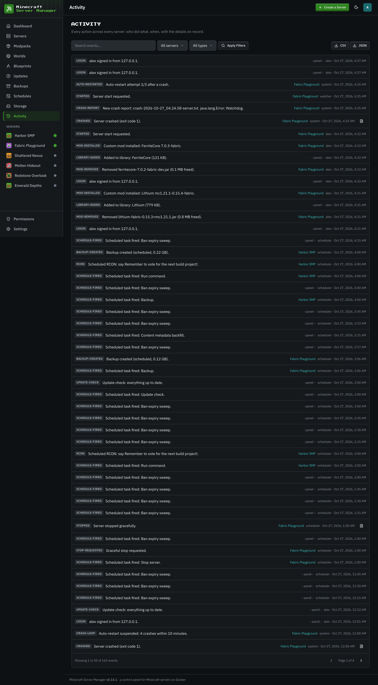

# Activity log

[← Back to docs index](README.md)

The **Activity** page is the full audit trail: a searchable, chronological record of everything that happened in the panel. Filter it by server or by event type, search the summaries, and export what you filtered as CSV or JSON. Entries that captured a log (a crash, for example) open it in place.

## What's recorded

- **Auth**: sign-ins (including whether 2FA or a backup code was used), account lockouts, password changes, and 2FA being enabled, disabled, or reset.
- **Server lifecycle**: creates, starts, stops, restarts, crashes, automatic restarts, and out-of-memory events.
- **Alerts**: stalled boots, stop failures, failed schedules, quota stops, unhealthy containers, offline-after-restart.
- **Data**: backups created and restored, blueprints exported, pack installs and upgrades, mod and world changes, and file edits.
- **Players**: kicks, bans, whitelist and op changes, and player notes.
- **Configuration**: chat-command changes, user and role changes, per-server permission changes, game port changes, and settings edits.

Each entry records who did it (a username, or the panel/scheduler for automated actions), which server it relates to, and when. The [dashboard](dashboard.md) shows the most recent entries; this page is the complete history. Operators and viewers only see entries for the servers they can view (plus panel-wide ones), and per-server permission changes are shown to admins only. Lifecycle and alert events can also be forwarded to Discord (see [Integrations](integrations.md)).

Because it captures security-relevant events (logins, 2FA changes, role and permission changes), the activity log is also your first stop if something looks off with an account.
