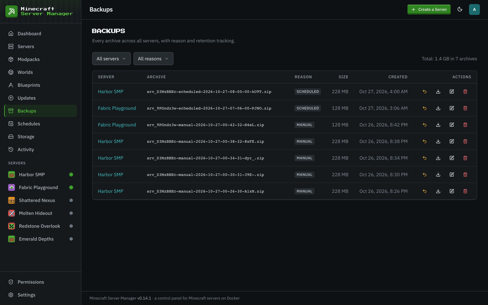
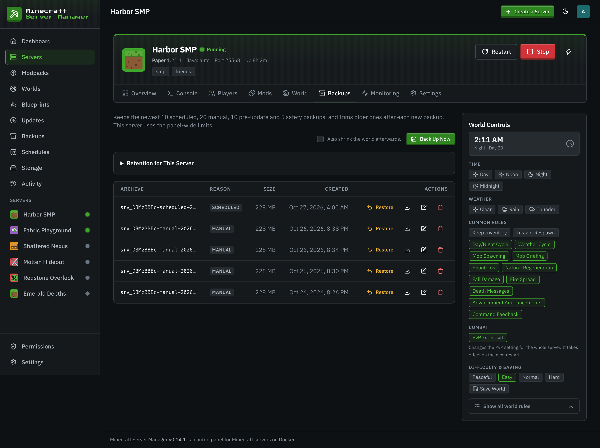
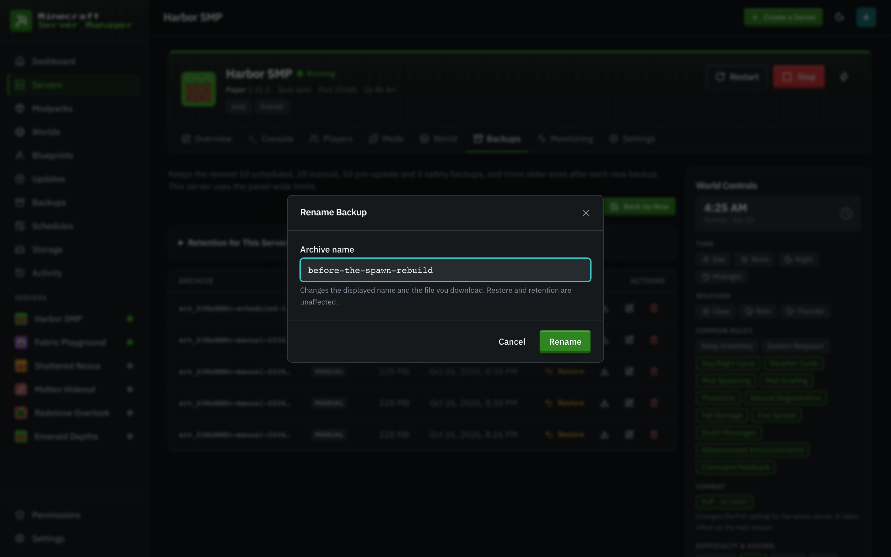

# Backups

[← Back to docs index](README.md)

The **Backups** page is every snapshot across your fleet, with size, reason, and age.

## Creating a backup

From a server's **Backups** tab (or via a [schedule](schedules.md)) you can snapshot the whole server directory in one click. The panel quiesces the world first (`save-off` → `save-all`), zips the data, then re-enables saving (`save-on`), so backups are consistent even on a running server. Compression runs in a background worker thread so it doesn't stall the panel. Each backup can carry a note.

Every archive is **integrity-checked** the moment it's written: the panel reopens the zip and reads its directory. A torn or unopenable archive is deleted and the backup call fails there and then, rather than the problem surfacing months later when a restore is the only thing between you and data loss. A zero-entry archive (a server that has never started) is allowed but flagged on the event.

Tick **"Also shrink the world afterwards"** (on the Backups tab, or in a backup schedule) to remove rarely-visited chunks once the archive is safely written (see **[Shrinking a world](world-shrink.md)**). The shrink only runs while the server is stopped; on a running server the backup still happens and the shrink is skipped.

## Backup reasons

Backups are tagged by why they were taken:

- **manual** - you clicked the button.
- **scheduled** - created by a [schedule](schedules.md). Every new server is also seeded a daily scheduled backup automatically (staggered between 02:00 and 05:59), so a server has automatic coverage from day one, not just before updates.
- **pre-update** - taken automatically before a pack upgrade, so an upgrade is always reversible.
- **pre-restore** - taken automatically right before a restore or a world reset, as a safety net in case the restore isn't what you wanted.

## Retention

Retention is capped **per server, per reason**: the newest in each group are kept, older ones are pruned automatically after each successful backup:

| Reason      | Kept |
| ----------- | ---- |
| scheduled   | 10   |
| pre-update  | 10   |
| manual      | 20   |
| pre-restore | 5    |

`pre-restore` has its own small bucket precisely so an automatic safety backup can never evict a `manual` backup you deliberately kept.

Two optional ceilings apply on top of the per-reason counts, both off by default: a **maximum age** (backups older than N days are pruned, whatever their reason) and a **maximum total size** per server (the oldest are pruned until the total fits: safety backups first, then scheduled ones, then the rest). The newest backup of a server is never pruned by either ceiling.

### Changing it

Admins set the panel-wide policy in the **Backup Retention** card on the **Settings** page. A server can differ on any of the six values: open its **Backups** tab and expand **Retention for This Server**. Each field there is blank unless that server sets it, and a blank field follows the panel-wide value (shown inside it). So a server can, for example, keep 3 scheduled backups and use the panel-wide values for everything else; clearing a field puts it back on the panel-wide value.

Saving never deletes anything by itself. If the new limits would leave existing backups over the limit, the panel lists, per server, how many backups of each kind would go, how much space that frees and how old the oldest one is. It also says when a server was already over its limits before this change (for example after an earlier **From Next Backup**), since applying now trims everything over the limit, not only what this edit adds. Then it asks how to apply them:

- **Remove Now** deletes exactly the backups it just listed, nothing more: a backup made in the meantime waits for the next trim. From the Settings page, a server in the middle of a restore, backup or similar action is skipped and trims after its next backup; on a server's own Backups tab you are asked to try again once that action finishes. While a server's old backups are being deleted (usually seconds), other actions on that server have to wait: a scheduled backup or start that lands then tries again every minute until it can (for up to 30 minutes), a crashed server is restarted within about 20 seconds of it finishing (for up to 30 minutes), and a scheduled restart or stop that collides with it is skipped until its next time.
- **From Next Backup** keeps them for now; each server trims its backups the next time it makes one, as it always has.

A backup that is being restored is never removed while the restore runs: retention leaves it alone (and does not delete other backups to make room for it), and deleting it by hand is refused until the restore finishes.

The same settings are available to scripts as admin API endpoints: `GET`/`POST /api/backups/retention` and `/api/servers/:id/backups/retention`. Panel-wide values cannot be `null`. For a server, a value of `null` removes that one key (it then follows the panel-wide value; before this change `null` was read as 0, which meant "no limit" for the age and size limits and "keep 1" for the counts), and `{ "reset": true }` removes them all. Under each of those two paths, `POST …/preview` reports what a change would remove without removing it (`backups`, `bytes`, `servers`, `ids` and a per-server `byServer` breakdown), and `POST …/apply` applies the saved policy now and answers `{ deleted, skipped }` panel-wide (`skipped` counts busy servers) or `{ deleted }` for one server. Send the preview's `{ "token": "..." }` (kept for 10 minutes) or its `{ "ids": [...] }` to delete only those; with neither, everything over the limit goes. A per-server apply on a busy server answers 409.

Backups can be **renamed** from the backup list (the rename button on each row). The archive on disk and the panel's record move together, so download, restore, and retention keep working with the new name.

> Retention is bounded automatically, but large modded archives still count toward a server's [disk quota](storage.md), so keep an eye on the total for big packs.

## Restoring

Restoring a backup stops the server (verifying the container really stopped before touching any files), takes a `pre-restore` safety backup, replaces the **whole server directory** with the snapshot, and leaves it stopped for you to start again. Because pack upgrades always take a `pre-update` backup first, you can always roll back a bad upgrade.

## The panel's own database

Server backups only cover per-server world directories. The panel's own database (`panel.db`, holding users, roles, 2FA secrets, schedules, pack pins, and history) is snapshotted separately on the daily maintenance timer:

- `VACUUM INTO` writes a consistent, defragmented copy to `data/backups/_panel/`; the newest **14** are kept.
- On boot the panel runs `PRAGMA integrity_check` and logs loudly if it fails, pointing you at `data/backups/_panel` for the newest good copy.

Back up the whole `data/` tree (it also contains `.secret-key`, the at-rest encryption key) and you've backed up everything.
