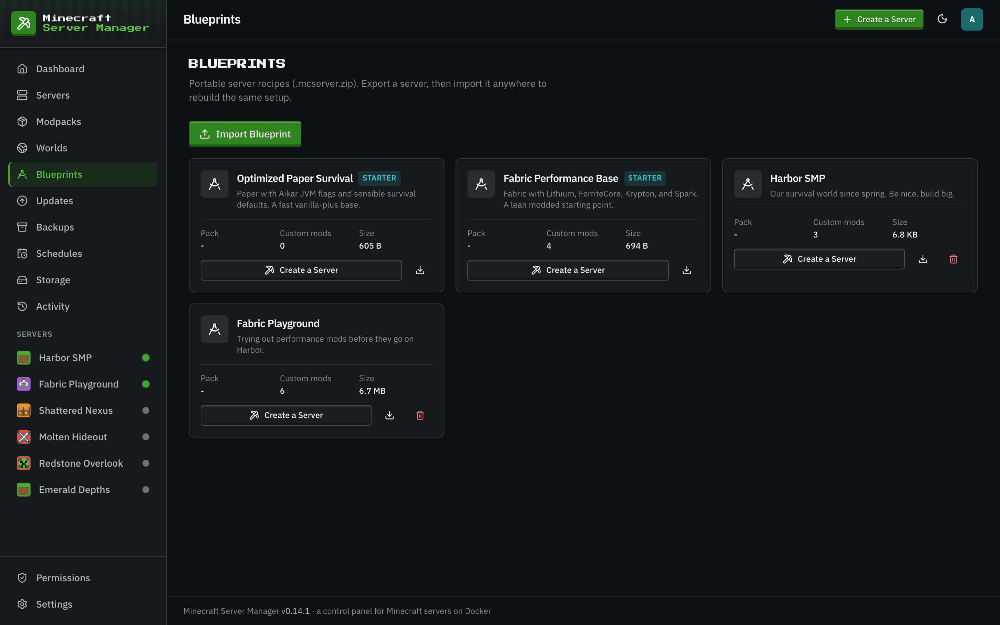

# Blueprints

[← Back to docs index](README.md)

A **blueprint** captures a server's whole configuration (type, version, resources, environment, pack pin, custom mods, and optionally its config and world) into a single portable `.mcserver.zip` file you can stamp new servers out of. Secrets (passwords, tokens, and keys in the environment) are never written to a blueprint.

## Exporting

From a server's **Settings → Configuration** tab, use **Export as Blueprint** and choose what to include: the server's configuration always, its config directories (on by default), and optionally the custom mod files themselves (a bigger file that installs without downloading anything) and the active world. The result is saved to your blueprint library and can be downloaded to share.

**Clone Server**, on the same card, does an export and an import in one step to make a copy of the server, with or without its world.

## Importing & creating from a blueprint

Import a blueprint file (**Import Blueprint** on the **Blueprints** page) or pick one from the library (**Create a Server** on its card, or the wizard's **From Blueprint** tab) to create a new server pre-configured exactly like the original. The new server gets its own ports and a fresh RCON password. Custom mods that were not embedded are downloaded again and checked against the hashes the blueprint recorded. The library also starts with two starter blueprints, one Paper and one Fabric.

It's the fastest way to:

- Spin up identical servers (a network of minigame servers, staging copies of production).
- Move a server between panels.
- Keep a known-good template you can always fall back to.

Because a blueprint records the exact [pack pin](modpacks.md), a modpack server created from a blueprint installs the same pinned version, with no surprise upgrades.
