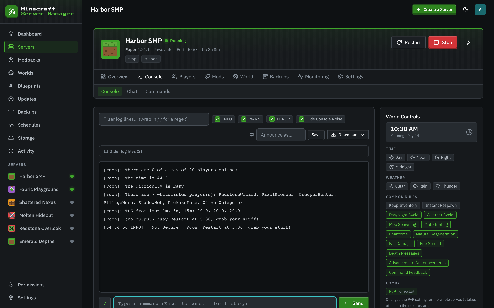
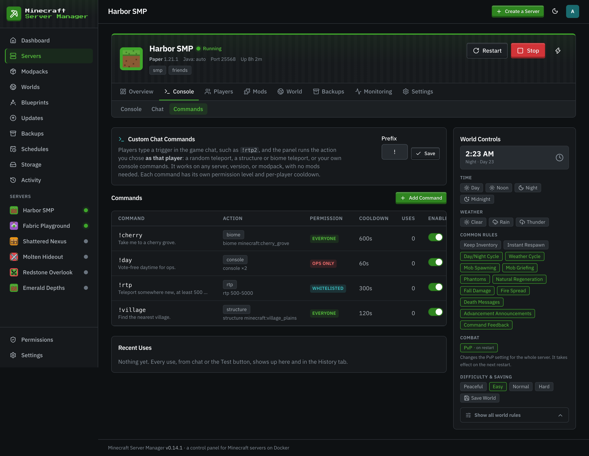

# Console & chat commands

[← Back to docs index](README.md)

## The live console

The **Console** tab streams the server log in real time and gives you a command box to send any server command. No `docker exec`, no SSH. Output comes back inline, colors and all. Sending commands needs the Console permission on that server; without it you can still watch the log.

Above the log you can filter lines by text (or a `/regex/`) and by level (INFO, WARN, ERROR), and **Download** offers the recent output, the full `latest.log`, or every log file as a zip.

The console is also where the panel reads the server's state: it watches the log to classify the boot phase ("Loading mods", "Generating world", "Finishing startup") and calls `list` to track who's online, so the dashboard and server cards always reflect reality.

That polling opens a short-lived RCON connection every cycle, which the server logs as a `Thread RCON Client … started` / `shutting down` pair every ~20 seconds, and (on servers whose core or plugins echo it) a `Rcon issued server command: …` line for each read-only poll (`list` for player counts, plus `time query …` and `gamerule <name>` reads while World Controls is open). The **Hide Console Noise** toggle above the log filters those lines out (along with the RCON listener startup lines). It's on by default and remembered per browser; turn it off to see the raw stream.

Commands sent from the panel can be announced in-game under a per-server label (the **Announce as…** box), so players know an operator acted rather than a mystery console.

## Chat

**Console → Chat** sends messages into the game while the server runs: **Styled** messages take colors and formatting and can go to everyone or one online player, and **Plain** sends a simple `[Server]` broadcast to everyone.

## Chat commands

Chat commands (**Console → Commands**) let players trigger panel actions by typing a prefix command in game chat, for example `!spawn` to random-teleport. Detection is log-based and execution goes through the server, so **no mods are required**.

Each command has:

- A **trigger** (e.g. `spawn`), typed after the server's **prefix** (`!` by default, one or two characters, never `/`).
- An **action**: random teleport, teleport to a structure, teleport to a biome, or run raw console commands.
- A **permission level**: everyone, whitelisted players, or operators only.
- A per-player **cooldown** (30 seconds by default), and customizable pending / success / failure messages with placeholders like `{distance}`.

### A note on safety

Commands that can wreck a server (`stop`, `op`, `ban`, `whitelist`, and friends) are only allowed on **operator-only** triggers. The panel checks for these even when they're nested inside an `execute … run …` chain, so a low-permission trigger can't smuggle a dangerous command through. Ordinary chat text that merely mentions those words (like a `say` message) is left alone.
