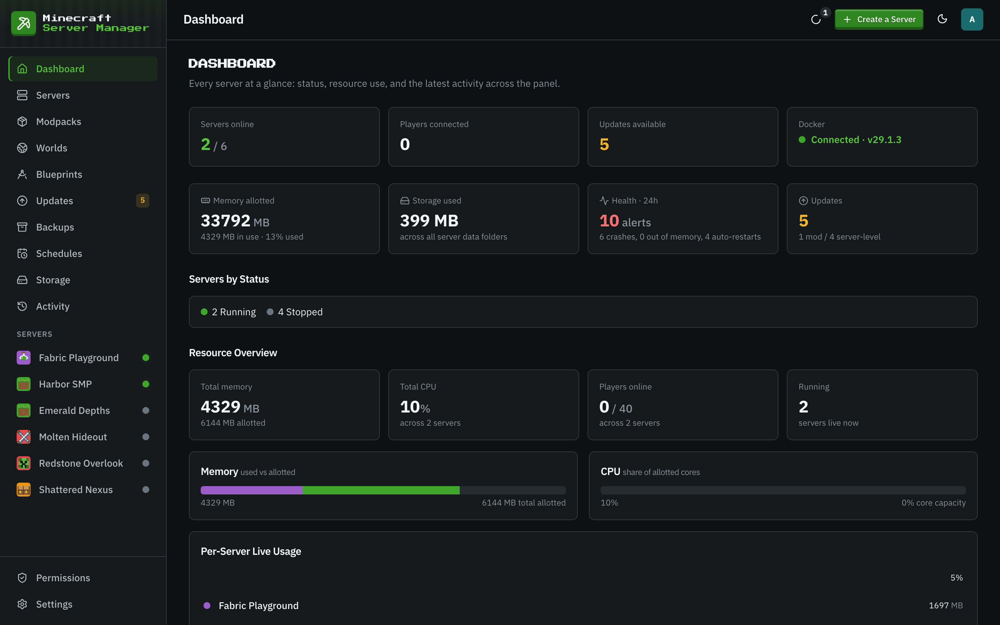

# The dashboard

[← Back to docs index](README.md)

The dashboard is your home base: every server, its live status, and a running feed of what's been happening.

## The summary tiles

Across the top:

- **Servers online**: how many of your servers are currently running, out of the total.
- **Players connected**: the total player count across all running servers.
- **Updates available**: how many servers, packs, or mods have a newer version ([see Updates](updates.md)).
- **Docker**: whether the panel can reach the Docker daemon, and its version.

A second row adds **Memory allotted** (and how much is in use), **Storage used** across all server data folders, **Health · 24h** (crashes, out-of-memory stops, and auto-restarts in the last day), and **Updates** split into mods and server-level updates. Below them, **Servers by Status** counts your servers in each state, and the **Resource Overview** charts every server's share of memory and CPU.

## Server cards

Each server shows as a card with its status (Running, Starting, Stopped, Crashed, and in-between states such as Unhealthy or Stalled), the type and Minecraft version, its game port, and its tags. Every card shows **players** and **disk** use against the quota; running servers also show live **CPU** and **memory**, updated continuously.

Click a card to open that server. The empty **Create a Server** card and the top-bar **Create a Server** button both start the [creation wizard](servers.md).

You can search your servers (by name, type, version, or tag), sort them by status, name, size, last started, or created, and switch between grid and list layouts with the toggle on the right.

## Recent activity

The feed at the bottom shows the most recent entries from the panel's human-readable audit trail: logins, backups, blueprint exports, update checks, chat-command changes, server starts and stops, and more. Every entry is tagged with the server it belongs to (or the panel itself) and how long ago it happened. **View All** opens the full history on the [Activity](activity.md) page.
