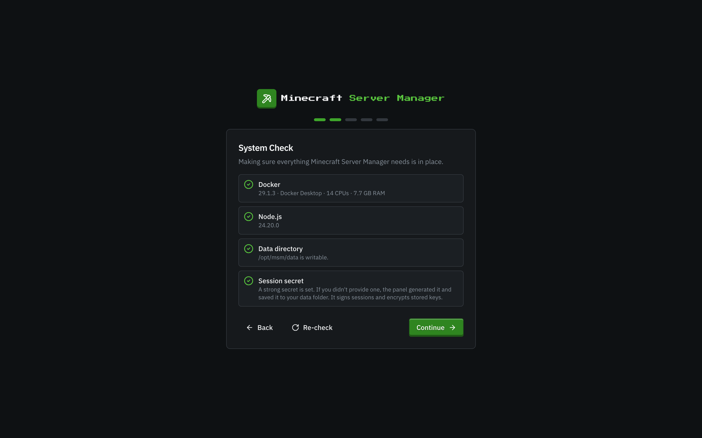
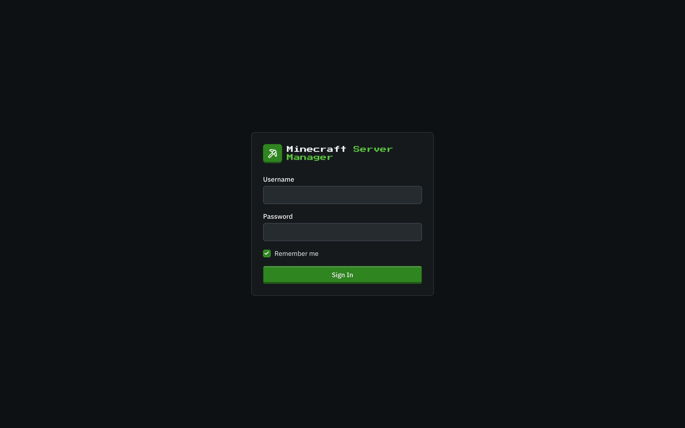
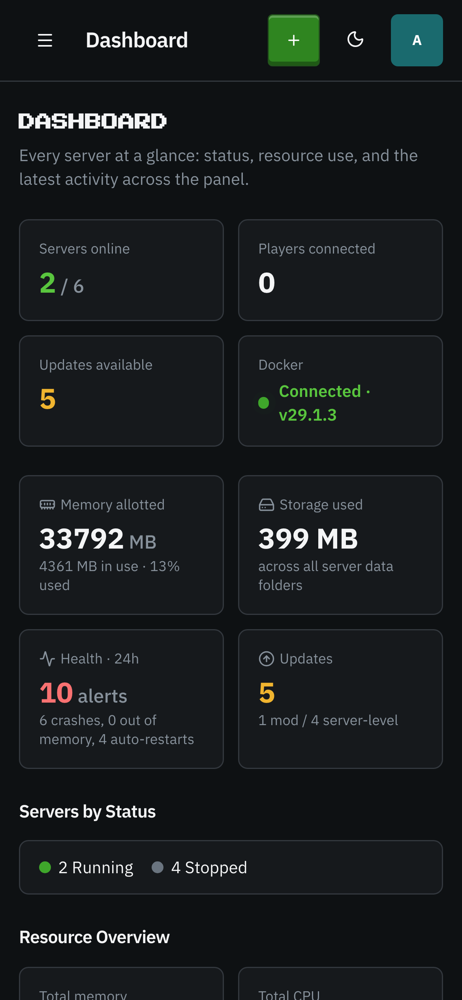
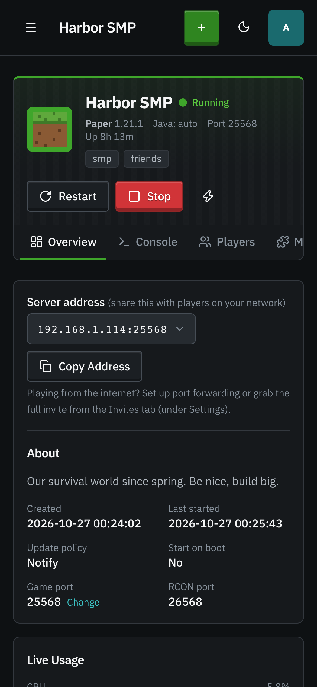
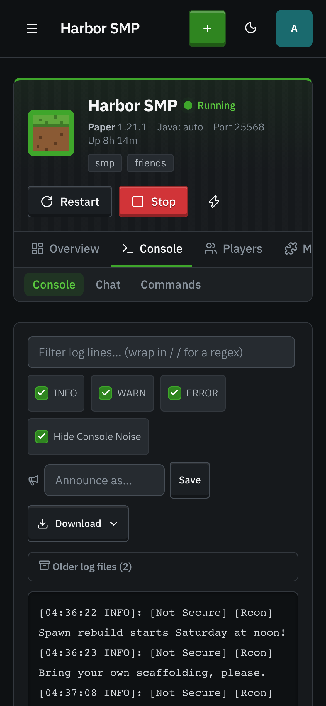
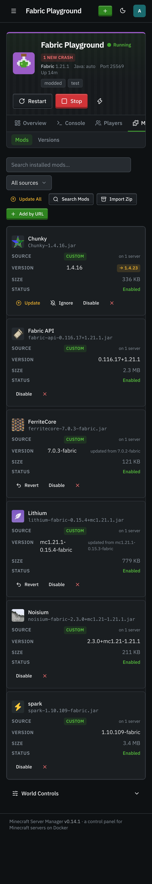
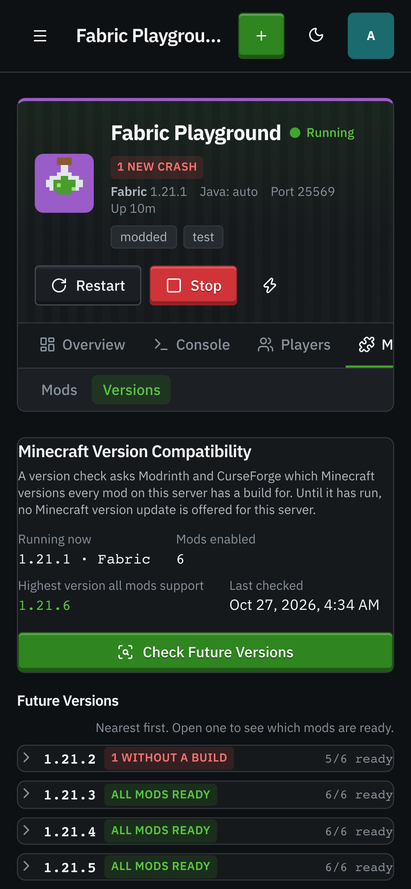

# Getting started

[← Back to docs index](README.md)

## First-run setup

The first time you open the panel, a short setup wizard walks you through it:

1. **System Check** makes sure Docker is reachable, Node.js is new enough, and the data folder is writable. If Docker isn't running yet you can still continue; creating and starting servers waits until it is.
2. **Create Your Admin Account**. This is the only account that exists until you add more, and it has full control. Pick a username (2 to 32 characters) and a password of at least 8 characters. You're signed in as soon as it's created.
3. **Panel Configuration** (optional): a public domain to show players in connect addresses, a CurseForge API key, and your time zone. All of it can be changed later in **Settings**.

The last step offers **Create a Server** or **Go to the Dashboard**.

> **Exposed installs are PIN-gated.** If you start the panel bound to a non-loopback address (`PANEL_HOST` other than `127.0.0.1`), the setup page also asks for a **6-digit PIN**. The panel prints it to its console on startup. Enter it along with your username and password. This stops a stranger who reaches the port first from claiming the admin account. The PIN disappears once the admin account exists.

## Signing in

After setup, the panel is protected by a login screen. Enter your username and password to continue.

If [two-factor authentication](two-factor-authentication.md) is enabled on your account, you'll be asked for a 6-digit code from your authenticator app right after your password.

## Finding your way around

Everything hangs off the left sidebar:

- **Dashboard** - every server at a glance ([details](dashboard.md)).
- **Servers**, **Modpacks**, **Worlds**, **Blueprints** - create and manage servers and their content.
- **Updates**, **Backups**, **Schedules**, **Storage**, **Activity** - the operational side: what's out of date, your snapshots, automation, disk usage, and the audit log.
- **Permissions** (bottom, admins only): what each user may do on each server ([details](users-and-roles.md#per-server-permissions)).
- **Settings** (bottom, admins only): API keys, panel configuration, defaults for new servers, [backup retention](backups.md#retention), users, sign-in security, and the public API.

Below those, the sidebar lists your servers. Opening one shows its own tabs: **Overview**, **Console**, **Players**, **Mods**, **World**, **Backups**, **Monitoring**, and **Settings**, most with related sub-tabs (for example, **Settings → Configuration** holds the server's settings and its game port). See [A single server](servers.md#a-single-server).

The top bar has the **Create a Server** button, a **theme toggle** (dark/light), and your **account menu**, where you can change your profile picture, manage [two-factor authentication](two-factor-authentication.md), or sign out.

## On a phone or tablet

Every page is laid out for a narrow screen first and widens from there: the sidebar tucks away behind the menu button, data tables stack into cards, toolbars wrap, and the world-controls rail collapses to a card you open when you need it. Buttons and chips have a real touch target size. Nothing is desktop-only.

  
  
  
  
  
  

## What you need

The panel talks to Docker to run servers, so it needs access to a Docker daemon (Docker Desktop or a Docker Engine socket). When Docker is reachable, the dashboard's Docker tile shows **Connected** and its version. If it's not, the panel still runs. You just can't start servers until the daemon is up.

## Next steps

- [Create your first server →](servers.md)
- [Secure your account with 2FA →](two-factor-authentication.md)
