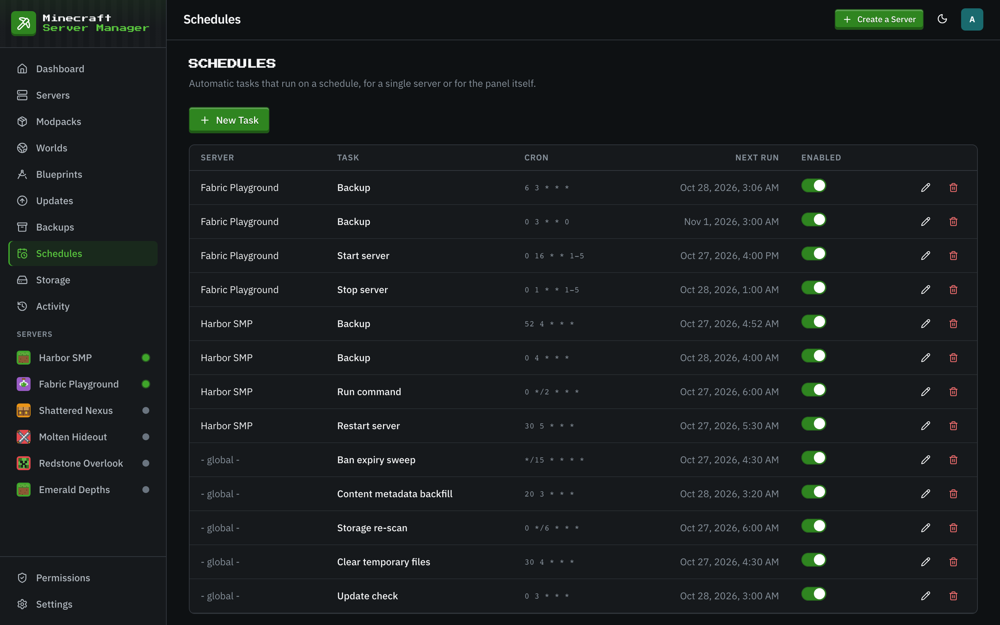

# Schedules

[← Back to docs index](README.md)

The **Schedules** page automates recurring tasks with cron expressions. No external cron, no scripts.

## What you can schedule

- **Restarts**: a nightly restart to keep a long-running server healthy.
- **Stops and starts**: take a server down overnight and bring it back in the morning.
- **Backups**: regular snapshots (tagged `scheduled` on the [Backups](backups.md) page). A backup schedule can also shrink the world after each backup ([shrinking a world](world-shrink.md)). Every new server gets a daily backup schedule automatically.
- **Commands**: run any server command on a schedule.
- **Update checks**: periodically refresh what's out of date. The scheduled check is also what applies updates for servers set to [Auto-Update](modpacks.md#update-policy).

Each schedule targets a specific server (or the panel globally), runs on its own cron expression, and can be enabled or disabled without deleting it. The editor previews the next run times as you type, cron times follow the panel's time zone (set in **Settings**), and the table shows each schedule's next run. Every firing is recorded as a history event, and so is a failed run.

The panel also seeds its own maintenance schedules on first boot, which you can retime or turn off: a daily update check, a storage re-scan every six hours, a daily clear of old temporary files, a ban expiry sweep every 15 minutes (lifting temporary bans that have run out), and a nightly content metadata backfill (filling in missing mod names and icons).

## When the server is busy

A scheduled backup or start that finds its server in the middle of another action (a restore, a backup cleanup, a port change) waits and tries again every minute until that action finishes, for up to 30 minutes. A waiting start is dropped if someone starts or stops the server in the meantime. A scheduled restart or stop is not retried: it is skipped and runs again at its next time.
