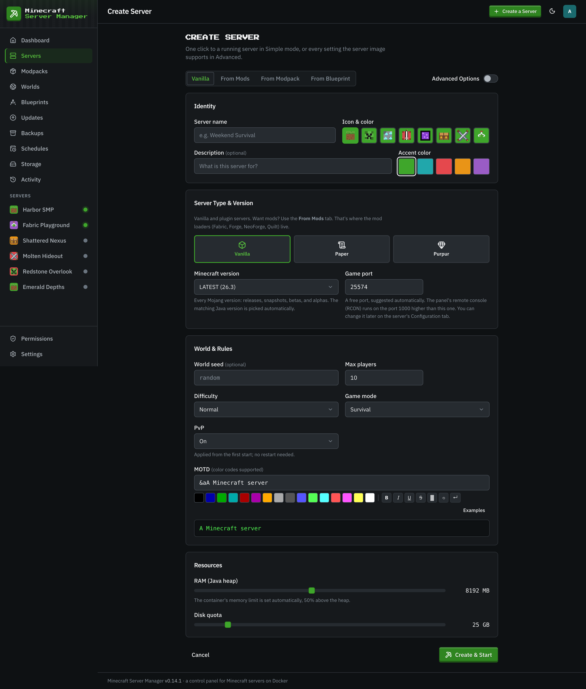
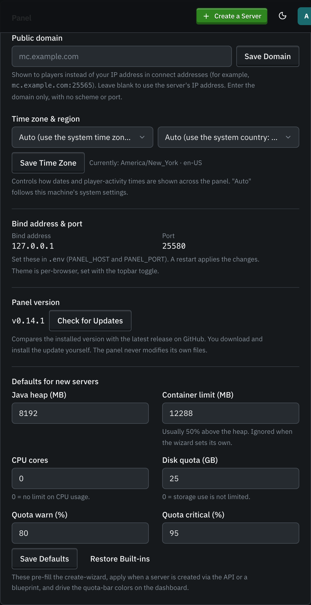
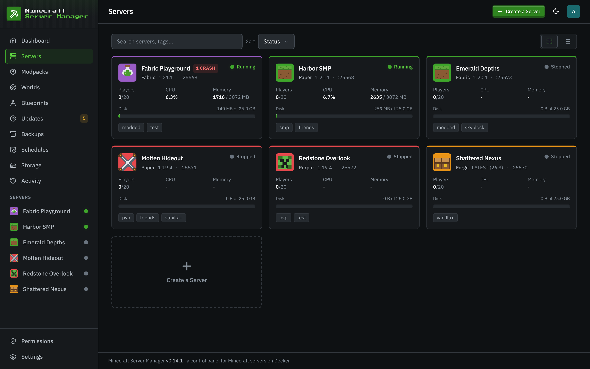
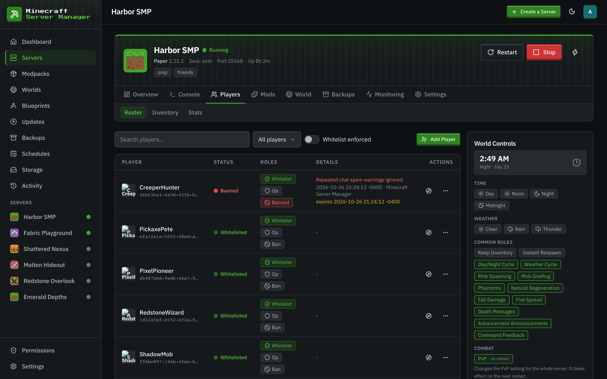
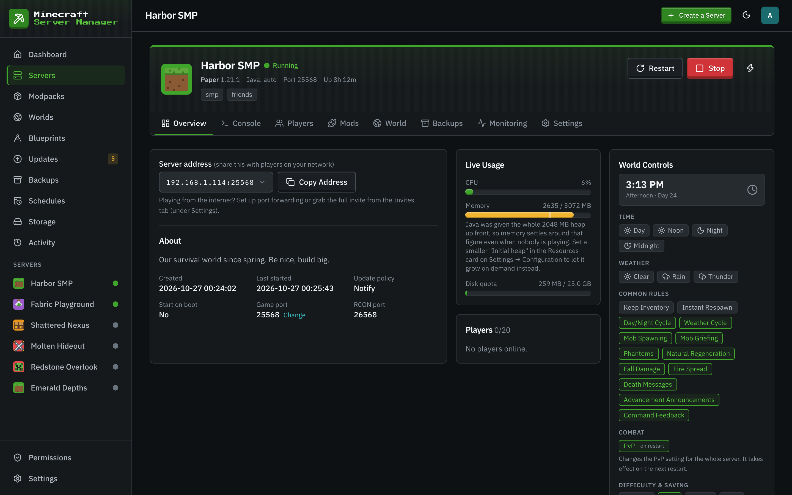
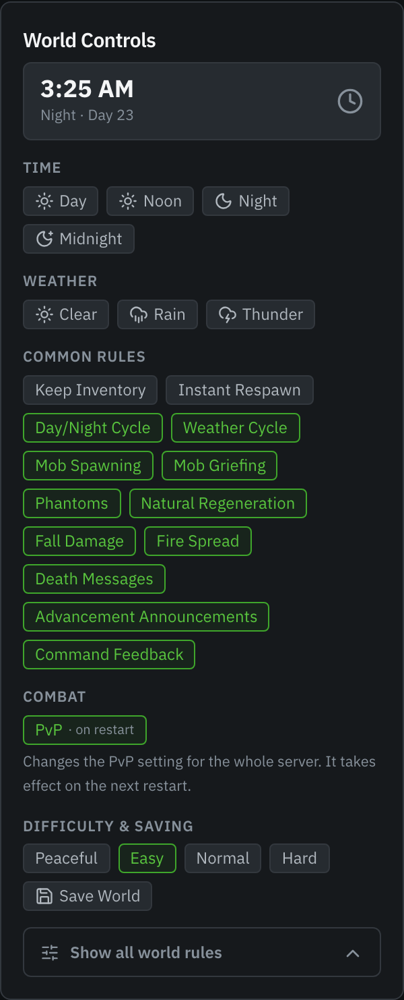
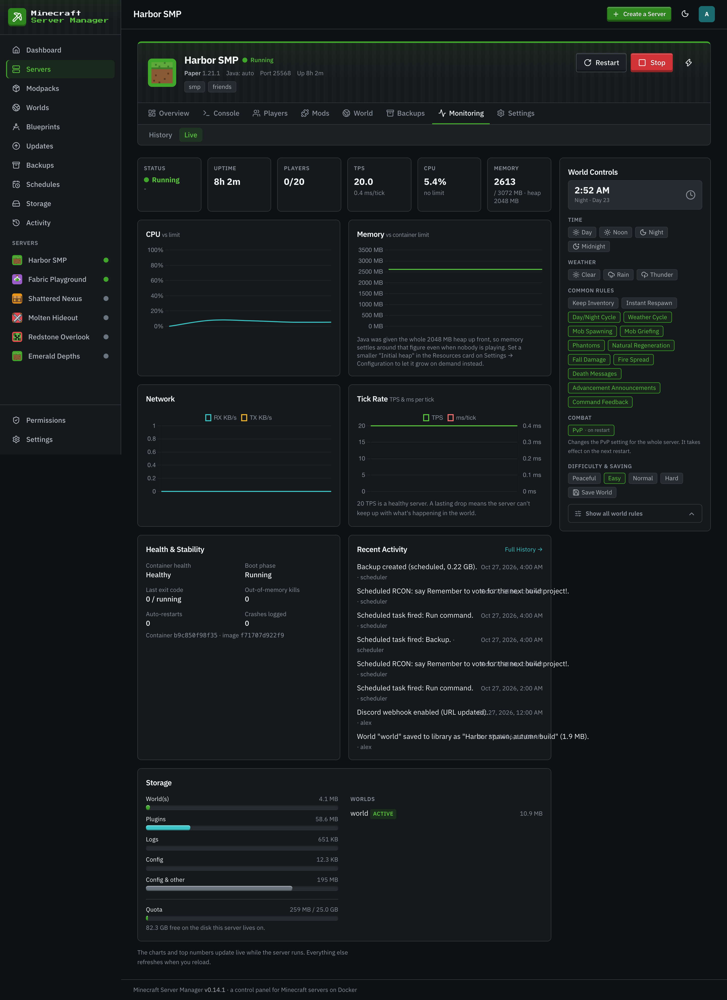
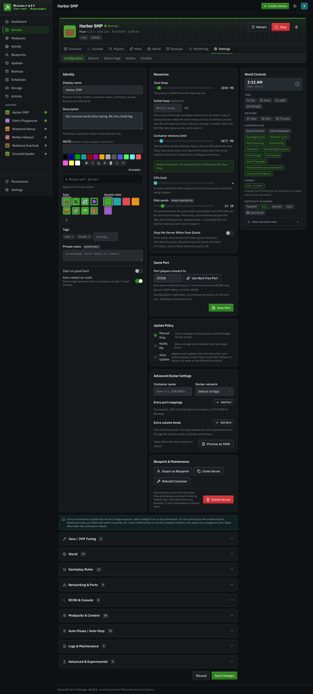
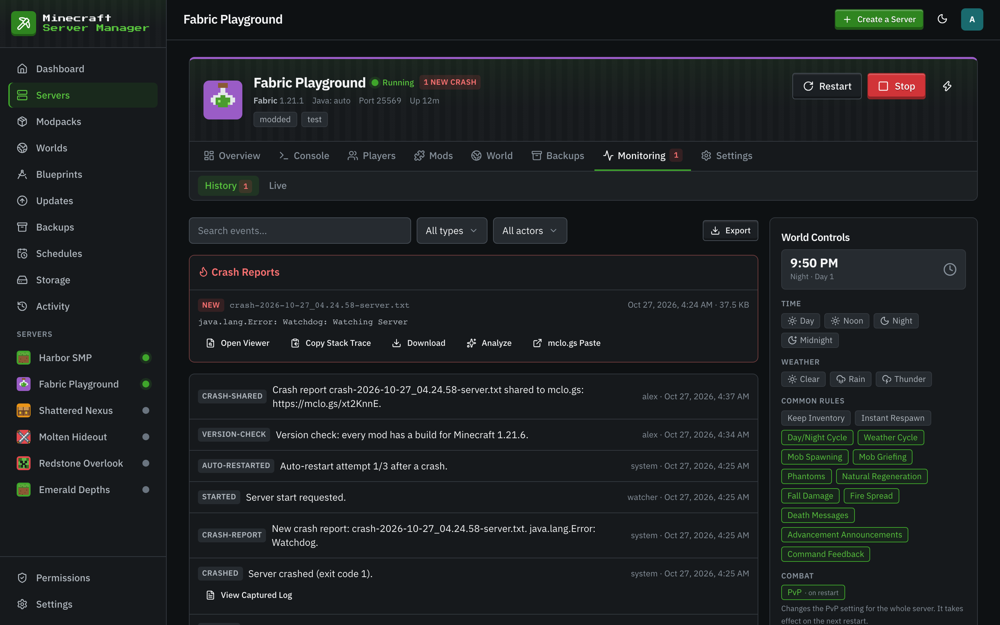
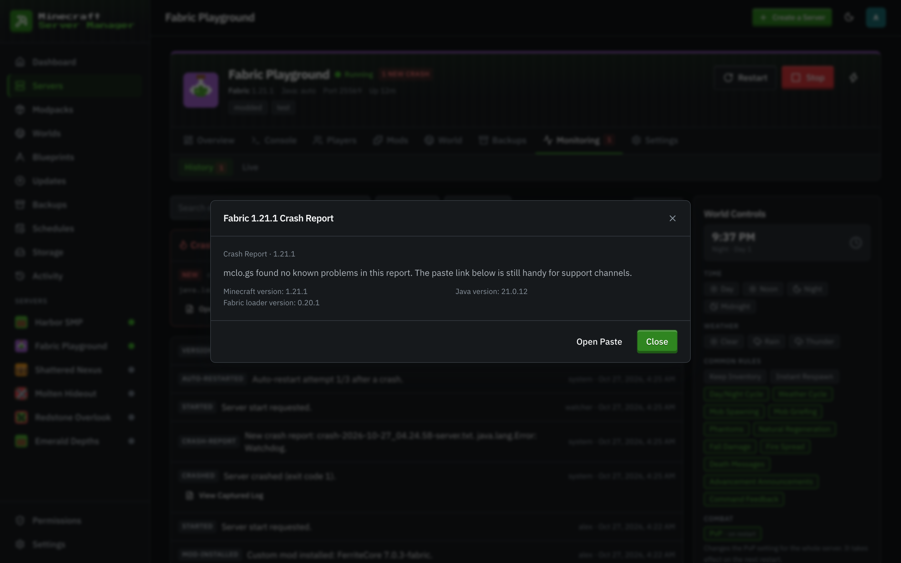

# Creating & managing servers

[← Back to docs index](README.md)

## Creating a server

Click **Create a Server** (top bar) or the **Create a Server** card to open the wizard.

The wizard pre-fills the Java heap and disk quota from **Defaults for new servers** on the Settings page, which an admin can change at any time. A new server takes its CPU limit from there too.

You choose:

- A **name** (and an optional description, icon, and accent color). Tags to organize your fleet are added later, on the server's settings.
- A **server type**: Vanilla, Paper, or Purpur on the **Vanilla** tab. For a modded server, the **From Mods** tab picks the loader (Fabric, Forge, NeoForge, or Quilt), the Minecraft version, and a loader build (the latest, or a specific one), then lets you search for mods.
- A **Minecraft version**: `LATEST`, a snapshot, or a specific version (betas and alphas included).
- A **game port**: a free one is suggested. The remote console (RCON) uses the port 1000 higher (by default). You can change it later (see [Changing the game port](#changing-the-game-port)).
- **Resources**: the Java heap (the container memory limit is set 50% above it) and a disk quota.

**Advanced Options** opens every other setting the server image supports, plus extra environment variables and (for admins) the advanced Docker settings.

Prefer a modpack? The **From Modpack** tab installs a CurseForge, Modrinth, or GT New Horizons pack instead (see [Modpacks](modpacks.md)), or takes a **custom zip you upload**: a Modrinth `.mrpack`, a CurseForge modpack export (`manifest.json`), or any zip of mod jars. The manifest (or a majority vote across the identified jars) fills in the loader and Minecraft version, and every mod installs in one task. You can also start from a saved [Blueprint](blueprints.md) on the **From Blueprint** tab.

The panel picks a sensible Java runtime for your version automatically, pulls the image, creates the container, and starts it, all from the one form.

## The servers list

The **Servers** page lists your whole fleet with status and quick stats.

## A single server

Opening a server gives you a tabbed workspace:

- **Overview**: the address to share with players, the description, live usage, and who's online.
- **Console**: the live log stream and command input, in-game chat, and [chat commands](console-and-chat.md).
- **Players**: the roster, plus inventory and statistics.
- **Mods**: the installed mod list, the [mod browser](modpacks.md), and content updates. On a modded server, its **Versions** sub-tab checks which future Minecraft versions your mods have builds for ([updates](updates.md#minecraft-version-compatibility)).
- **World**: [worlds, the live map, and the file manager](worlds-and-files.md).
- **Backups**: [snapshots and restore](backups.md) for this server.
- **Monitoring**: per-server history and live metrics, including crash reports (see below).
- **Settings**: **Configuration** (everything about how the server runs), plus the [integrations](integrations.md) (Discord, Status Page, Invites, and, for admins, Chatbot).

The start, stop, and restart controls sit in the header above every tab. What you can do on each tab depends on your [permissions on that server](users-and-roles.md#per-server-permissions): for example, the **Files** sub-tab needs the Files permission, and sending console commands needs Console.

The **World Controls** rail rides along on every tab: the in-game clock, weather, the common gamerules as toggle chips, and "Show all world rules" for the rest.

**Monitoring → Live** shows TPS and milliseconds per tick, a health and stability card with crashes (last 24 h and 7 d), out-of-memory kills, and auto-restarts, and per-world sizes.

## Server settings

**Settings → Configuration** is the full configuration surface: name, description, MOTD, icon, color and tags, resources, the game port, update policy, start on panel boot and auto-restart on crash, every environment variable the server image supports, the advanced Docker settings, and blueprint export, clone, rebuild, and delete. Changes that only take effect once the server is rebuilt are saved right away and wait: an **Apply Changes** button appears in the server's header, and they are also applied the next time the server starts.

**Auto-restart on crash** starts a crashed server again, waiting longer between each try (5, 10, then 20 seconds) and stopping after 3 tries within 10 minutes. It skips crashes the panel recognizes as a setup problem (the EULA, the wrong Java, a world from a newer version, a port in use, out of memory, a missing CurseForge key), because those need a fix first. If another action is busy with the server (a backup, a restore, a port change), it waits for up to 30 minutes, and it gives up as soon as someone stops or starts the server themselves.

Direct setting changes always stick across restarts. A PvP or difficulty change made with the **World Controls** rail, a whitelist toggle on the **Players** tab, or a `server.properties` edit in the **Files** editor removes the matching environment variable (if one was set) and marks the server to be rebuilt, so the on-disk value wins instead of being re-asserted by the container image on the next start.

**About the memory meter.** "RAM (Java heap)" is handed to Java as both its starting and its maximum heap, and Java fills a heap it was given up front within the first minute, with or without the Aikar / MeowIce flag presets. So the memory meter settles at about the heap size and stays there even when nobody is playing; the tick on the meter marks where the heap sits under the container limit, and the note under it says so. If you would rather see memory follow real use, give the server a smaller starting heap with **Initial heap** in the Resources card on **Settings → Configuration** (or under **Advanced Options** in the wizard), for example 512 MB: on a 2 GB heap that brought idle use from 2.6 GB to about 1.3 GB in our measurements. Java also needs memory outside the heap (about 0.5 GB on vanilla, 1.5 to 2 GB on a large modpack), which is what the container limit's headroom is for. See the README's "Two memory limits" for the numbers.

> The **Advanced Docker Settings** (container name, Docker network, extra port mappings, and extra volume binds) are **admin-only**, because a bind mount plus the panel's Docker access is effectively root on the host. See [Users & roles](users-and-roles.md).

### Changing the game port

The **Game Port** card on **Settings → Configuration** moves a server to another port at any time, with its own **Save Port** button. **Use Next Free Port** picks the lowest free one, and the card checks any port you enter before you save it. RCON always follows at 1000 above the game port (the default offset). Admins can pick any port from 1024 up; everyone else picks from the first game port (25565 by default) up. Saving applies the change right away: a stopped server just moves, and a running one asks first, then restarts on the new port (the world is saved first, and players reconnect on the new port). If the server can't start on the new port, it goes back to the old one. The change is refused while other changes wait for **Apply Changes**, so apply those first. Changing the port needs the Settings permission on that server.

## Crash reports & mclo.gs analysis

Crash reports (`crash-reports/*.txt` and JVM `hs_err_pid*.log` files) are picked up automatically, parsed into a one-line summary with the exception and suspected mods, and listed under **Monitoring → History**:

Each report card offers a built-in viewer (with collapsible sections and highlighted exceptions), copy-stack-trace, and download, plus two [mclo.gs](https://mclo.gs) actions:

- **Share to mclo.gs** publishes the report as a public paste and copies the link: the exact thing mod authors and support Discords ask for. The link is remembered on the report, so nothing is ever uploaded twice.
- **Analyze** runs mclo.gs's automated insights over the paste: known problems with suggested fixes (missing dependencies, version mismatches, common mod conflicts), rendered right in the panel.

Both actions sit behind an explicit confirmation, because a paste is public: crash reports can include player names and your full mod list. The panel never uploads anything on its own.
