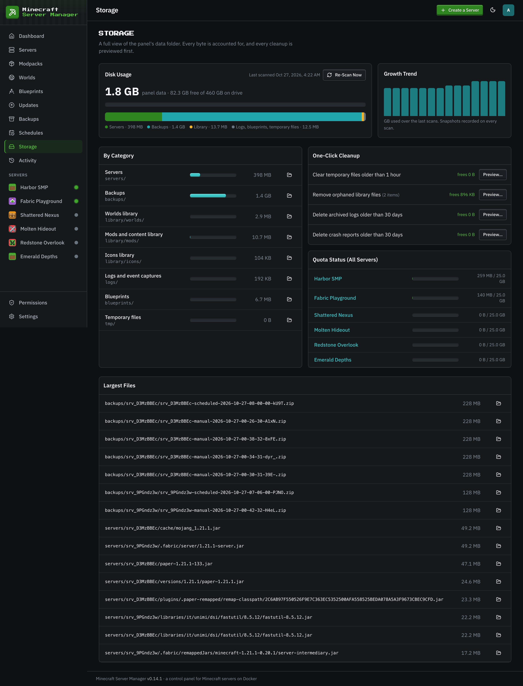

# Storage

[← Back to docs index](README.md)

The **Storage** page shows where your disk is going: usage by category, each server against its quota, the largest files, and how total use is trending over recent scans. It is for admins only.

## Disk quotas are panel-enforced

Docker can't cap the disk usage of a bind mount, so the panel does it. A background size-indexer walks the data folder (every 15 minutes, after changes, or when you press **Re-Scan Now**), caches each server's footprint, and enforces the disk quota you set per server. An action that would take a server's folder (world, mods, configs, logs, and everything else in it) over its quota, such as installing a mod or a world or uploading files, is blocked until space is freed or the quota is raised, rather than letting one server fill your host.

Set a server's quota in its [settings](servers.md#server-settings). Turning on **Stop the Server When Over Quota** there also stops a running server once its folder grows more than 10% past the quota, and notes it in the server's history. Modded servers can be large, so give them room. [Backups](backups.md) are stored separately and don't count toward the quota.

## Cleanup

The **One-Click Cleanup** card frees space the panel can safely reclaim: temporary files older than an hour, orphaned library files, and archived logs and crash reports older than 30 days. Each one shows how much it frees and opens a preview before anything is deleted. The **By Category** and **Largest Files** lists link straight into the file manager, so you can find what else to prune before you run out of space.
