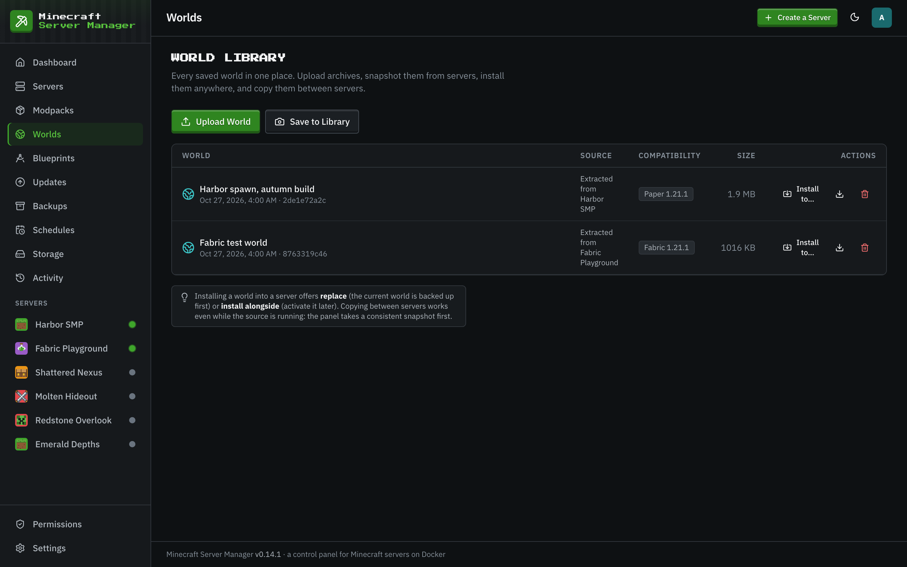
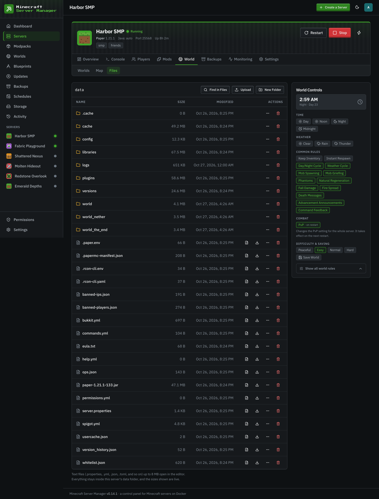
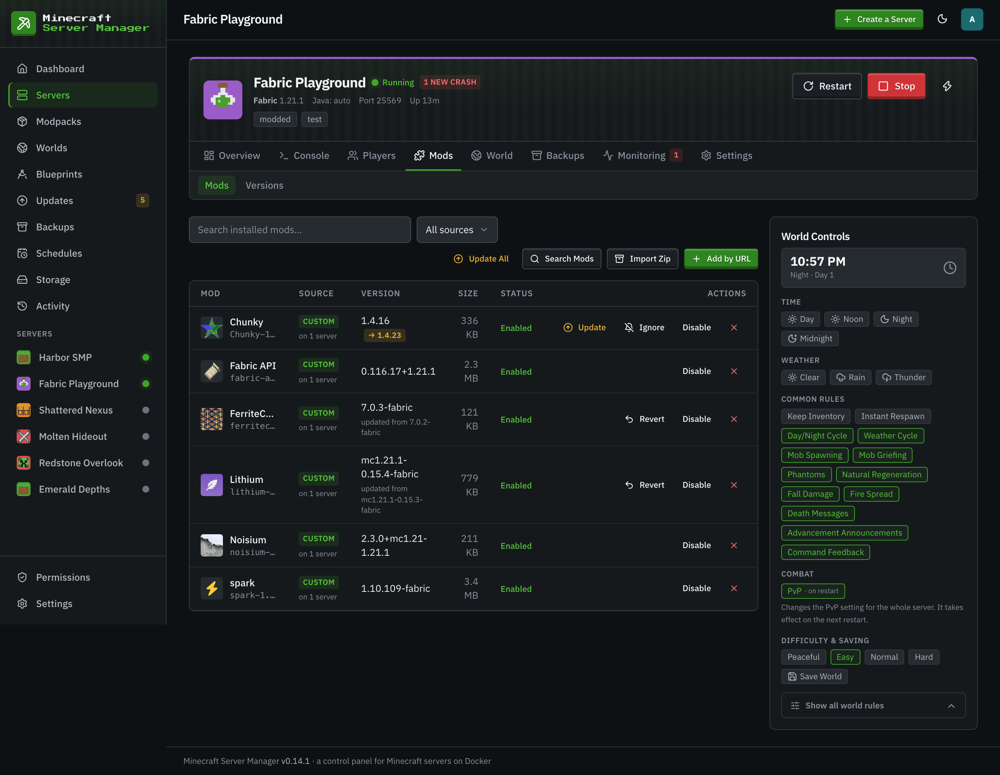
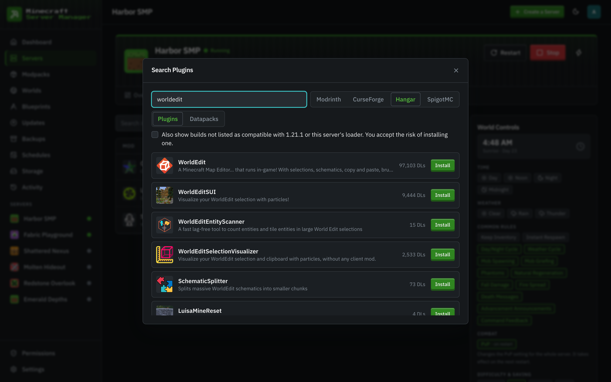
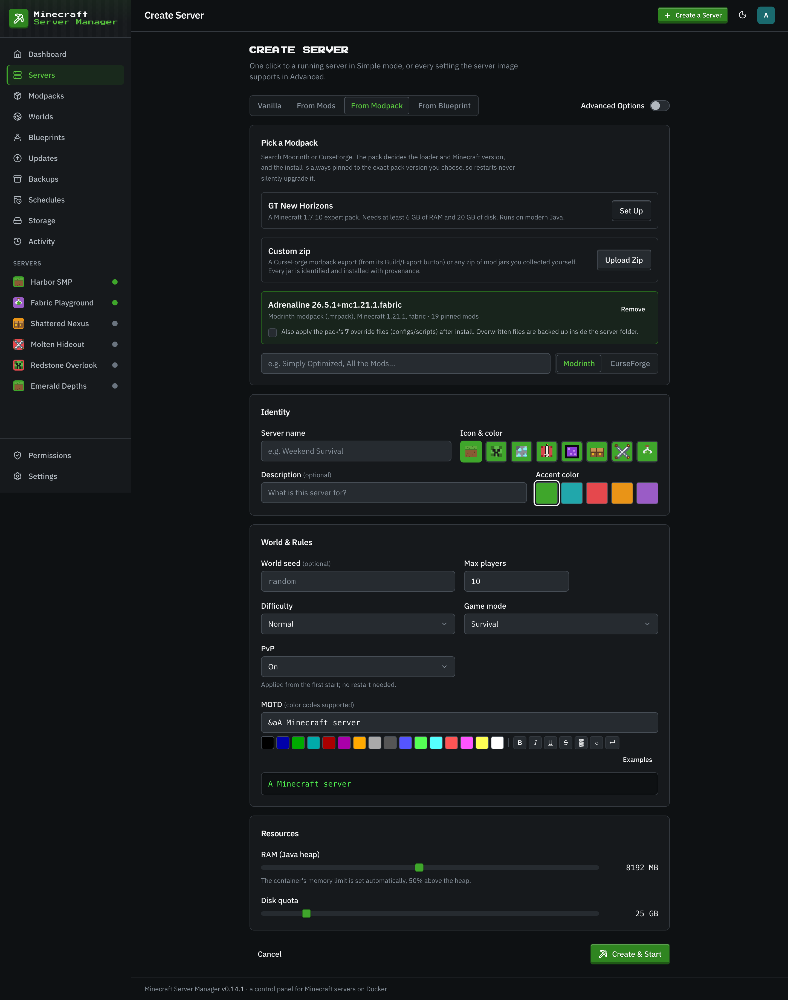
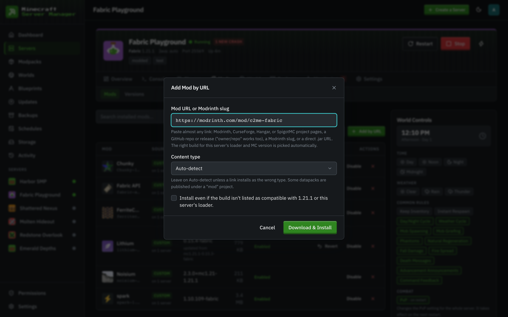

# Worlds & files

[← Back to docs index](README.md)

## Worlds

The **Worlds** page is the world library: every saved world in one place. **Upload World** takes a `.zip` or `.tar` archive and finds the world inside it automatically, **Save to Library** snapshots a server's live world (it works while the server is running), and each library world can be downloaded or installed to any server with **Install to…**. Installing either replaces the server's world (the server must be stopped, and its current world is backed up first) or adds it alongside, to activate later. A compatibility check runs before every install.

A server's own **World → Worlds** tab lists the worlds on that server. From there you can activate another world (with the server stopped), download, duplicate, rename, or [shrink](world-shrink.md) a world, copy it to another server, delete an inactive one, and reset the active world with a new, kept, or custom seed (a safety backup is offered first). The same library sits below, with **Install Here**.

## The file manager

Under a server's **World** section, the **Files** tab is a full in-browser file manager for that server's data directory. List, read, edit, rename, move, copy, delete, and upload files, create folders, and search the text of files under a folder with **Find in Files**: everything you'd normally do over SSH, from the browser.

Text files open in an editor with an 8 MB limit; larger files can be downloaded. Uploads accept up to 20 files at once.

### Staying inside the sandbox

Every file operation is confined to the server's own data directory. The panel resolves each path and refuses anything that would escape: `..` traversal, absolute paths, and even symlinks that point outside the directory (including dangling ones that don't exist yet). A mod or plugin can't plant a link to trick the file manager into reading or writing elsewhere on the host.

## Mods

For modded and plugin servers, the **Mods** tab (its own group in the server sidebar) manages the mod set: browse and add mods, and see what's installed. From each installed mod's row you can update it (or ignore that update), [revert](updates.md#undoing-a-mod-update) it, disable it, or remove it, and **Update All** applies every available update with one restart. Mod and pack updates also surface on the [Updates](updates.md) page.

### Adding mods

Four ways in, all from the Mods tab toolbar:

- **Search Mods**: search **Modrinth or CurseForge** (the CurseForge chip appears once an API key is stored under **Settings → API Keys**), and on plugin servers also **Hangar** (PaperMC's own plugin registry) and **SpigotMC** (via Spiget's CDN proxy), both keyless. A **Datapacks** tab searches Modrinth's datapacks. Everything is filtered to the server's loader and Minecraft version (a checkbox also shows builds not listed as compatible, at your own risk); Quilt servers automatically see fabric-tagged builds too, since Quilt runs Fabric mods. Results already on the server show an **Installed** badge. If a CurseForge author disallows automated downloads (or a SpigotMC resource is hosted off-site), the panel says so up front and offers an **Open CurseForge** (or **Open SpigotMC**) + **Upload Jar** path instead of failing mid-install.

  

- **Import Zip**: one button, three shapes, auto-detected:
  - A **Modrinth modpack (`.mrpack`)**: every pinned file is canonicalized back into its Modrinth project via hash lookup (so imported mods keep real names, icons, and stay update-checkable; files Modrinth doesn't know install from the pack's own URL), verified against the pack's sha512 checksums while downloading, and previewed with fit verdicts. Client-only files are skipped visibly, and both override trees (`overrides/`, then `server-overrides/`; the server-specific copy wins) can be applied.

    

  - A **CurseForge modpack export** (the zip CurseForge's app produces, with `manifest.json`): every pinned mod is resolved in bulk, previewed with warnings (wrong loader/MC for this server, files no longer on CurseForge, mods that need a manual download), and installed with real progress. The pack's `overrides/` (configs, scripts) can optionally be applied too; any file that would be overwritten is backed up first into `.import-backups/<timestamp>/` inside the server folder.
  - A **plain zip of jars** you collected yourself: each jar is identified (Modrinth hash match → CurseForge fingerprint → the jar's own metadata) and judged against the server (_fits / wrong loader / wrong MC version / already installed / unidentified_), so you pick what actually belongs before anything installs.
- **Add by URL**: paste almost anything: Modrinth, CurseForge, Hangar, or SpigotMC project pages, a GitHub repo or release URL (a bare `owner/repo` works too; GitHub installs prefer the newest stable release and skip `-sources`/`-javadoc` sidecar jars), a bare Modrinth slug, or any direct `.jar` URL. The panel resolves the right build for the server's loader and MC version.

  

- **Upload Jar** (from the search fallback or the pending-downloads resolver): uploaded jars are identified the same way, so they keep their real name, version, icon, and become update-checkable.

Every registry install is **checksum-verified while it downloads**: the stream is checked against the strongest digest the registry publishes (sha512 → sha256 → sha1 → md5) and a mismatch aborts before anything lands on the server.

A whole zip (`.mrpack` included) can also **create a server**: in the wizard's **From Modpack** tab, upload it and the pack manifest (or a majority vote across the identified jars) fills in the loader, Minecraft version, and loader build.
