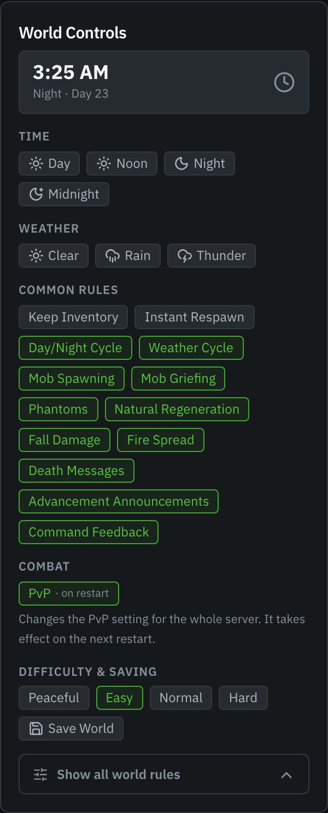

[← العودة إلى فهرس المستندات](/docs/)

## إنشاء خادم

انقر فوق **إنشاء خادم** (الشريط العلوي) أو بطاقة **إنشاء خادم** لفتح المعالج.

يقوم المعالج بملء حقول الذاكرة ووحدة المعالجة المركزية وحصة القرص مسبقًا من **الافتراضيات للخوادم الجديدة** في صفحة الإعدادات، والتي يمكن للمسؤول تغييرها في أي وقت.

أنت تختار:

- **اسم** (وأيقونة اختيارية، ولون مميز، وعلامات لتنظيم أسطولك).
- **نوع الخادم** - عادي (vanilla)، Paper، Fabric، Forge، NeoForge، والمزيد، كل منها مرتبط بصورة itzg المناسبة في الخلفية.
- **إصدار Minecraft** - `LATEST`، أو لقطة (snapshot)، أو إصدار محدد.
- **الموارد** - ذاكرة الوصول العشوائي (RAM) (heap)، وحد الذاكرة للحاوية (container memory limit)، وحدة المعالجة المركزية (CPU)، وحصة القرص (disk quota).

تفضل حزمة تعديلات (modpack)؟ يقوم علامة التبويب **من حزمة تعديلات** بتثبيت حزمة CurseForge، Modrinth، FTB، أو GT New Horizons بدلاً من ذلك (انظر [حزم التعديلات](/docs/modpacks/))، أو يأخذ **ملف zip مخصص تقوم بتحميله**: تصدير حزمة تعديلات CurseForge (`manifest.json`) أو أي ملف zip من ملفات التعديلات (mod jars). يقوم البيان (أو تصويت الأغلبية عبر ملفات التعديلات المحددة) بملء المُحمل (loader) وإصدار Minecraft، ويتم تثبيت كل تعديل في مهمة واحدة. يمكنك أيضًا البدء من [مخطط (Blueprint)](/docs/blueprints/) محفوظ.

تختار اللوحة وقت تشغيل Java مناسبًا لإصدارك تلقائيًا، وتسحب الصورة، وتنشئ الحاوية، (اختياريًا) تبدأها، كل ذلك من نموذج واحد.

## قائمة الخوادم

تسرد صفحة **الخوادم** أسطولك بالكامل مع الحالة والإحصائيات السريعة.

## خادم واحد

يمنحك فتح خادم مساحة عمل ذات علامات تبويب:

- **نظرة عامة** - الحالة، الإحصائيات الحية، وقت التشغيل، وعناصر التحكم الأساسية لبدء / إيقاف / إعادة التشغيل.
- **وحدة التحكم** - بث السجل المباشر ومدخل الأوامر، بالإضافة إلى الدردشة داخل اللعبة ([التفاصيل](/docs/console-and-chat/)).
- **اللاعبون** - من متصل بالإنترنت، بالإضافة إلى المخزون، والإحصائيات، و[أوامر الدردشة](/docs/console-and-chat/).
- **التعديلات** - قائمة التعديلات المثبتة، و[متصفح التعديلات](/docs/modpacks/)، وتحديثات المحتوى.
- **العالم** - [العوالم، والخريطة الحية، ومدير الملفات](/docs/worlds-and-files/).
- **النسخ الاحتياطي** - [اللقطات والاستعادة](/docs/backups/) لهذا الخادم.
- **المراقبة** - سجل لكل خادم ومقاييس حية، بما في ذلك تقارير الأعطال (انظر أدناه).
- **الإعدادات** - كل شيء عن كيفية تشغيل الخادم، بالإضافة إلى [التكاملات](/docs/integrations/) (Discord، صفحة الحالة، الدعوات، روبوت الدردشة).

يتحرك شريط **عناصر تحكم العالم** (World Controls) مع كل علامة تبويب: ساعة اللعبة، الطقس، قواعد اللعبة الشائعة كشرائح تبديل، و"إظهار جميع قواعد العالم" للباقي.

يعرض **المراقبة → حية** (Monitoring → Live) معدل نقل الأوامر (TPS) والمللي ثانية لكل دورة (milliseconds per tick)، وبطاقة صحة واستقرار مع آخر 24 ساعة / 7 أيام من الأعطال وإعادة التشغيل، وأحجام لكل عالم.

## إعدادات الخادم

علامة التبويب **الإعدادات** هي واجهة التكوين الكاملة: إعادة التسمية، الموارد، سياسة التحديث، البدء التلقائي / إعادة التشغيل التلقائي، متغيرات البيئة، وتجاوزات Docker المتقدمة. يتم تمييز الحقول التي تغير كيفية تشغيل الحاوية بوضوح على أنها تتطلب إعادة تشغيل.

**حول مقياس الذاكرة.** يتم تمرير "RAM (Java heap)" إلى Java كحد أقصى وحد بداية لمكدسها (heap)، ويملأ Java المكدس الذي تم إعطاؤه له مسبقًا خلال الدقيقة الأولى، سواء مع أو بدون مجموعات علامات Aikar / MeowIce. لذلك يستقر مقياس الذاكرة عند حوالي حجم المكدس ويبقى هناك حتى عندما لا يلعب أحد؛ تشير العلامة على المقياس إلى المكان الذي يستقر فيه المكدس تحت حد الحاوية، وتقول الملاحظة أسفله ذلك. إذا كنت تفضل رؤية الذاكرة تتبع الاستخدام الفعلي، فقم بتعيين **مكدس أولي** (Initial heap) أصغر (متقدم): على مكدس بحجم 2 جيجابايت أدى إلى انخفاض الاستخدام الخامل من 2.6 جيجابايت إلى حوالي 1.3 جيجابايت في قياساتنا. تحتاج Java أيضًا إلى ذاكرة خارج المكدس (حوالي 0.5 جيجابايت للخادم العادي، 1.5 إلى 2 جيجابايت لحزمة تعديلات كبيرة)، وهذا هو ما يُخصص له هامش حد الحاوية. انظر "حدود الذاكرة المزدوجة" في README للحصول على الأرقام.

> حقول تجاوز Docker المتقدمة (اسم حاوية مخصص، منفذ إضافي، وربط تحميلات، وتجاوزات خام) هي **للمسؤولين فقط**، لأن ربط التحميل مع وصول اللوحة إلى Docker يعادل صلاحيات الجذر (root) على المضيف. انظر [المستخدمون والأدوار](/docs/users-and-roles/).

## تقارير الأعطال وتحليل mclo.gs

يتم التقاط تقارير الأعطال (`crash-reports/*.txt` وملفات JVM `hs_err_pid*.log`) تلقائيًا، وتحليلها إلى ملخص من سطر واحد مع الاستثناء والتعديلات المشتبه بها، وإدراجها تحت **المراقبة → السجل** (Monitoring → History):

تقدم كل بطاقة تقرير عارضًا مدمجًا (مع أقسام قابلة للطي والاستثناءات المميزة)، ونسخ مكدس الأخطاء (copy-stack-trace)، وتنزيل، بالإضافة إلى إجراءين لـ [mclo.gs](https://mclo.gs):

- **المشاركة إلى mclo.gs** تنشر التقرير كنسخة عامة وتنسخ الرابط - وهو الشيء الدقيق الذي يطلبه مؤلفو التعديلات وقنوات دعم Discord. يتم تذكر الرابط على التقرير، لذلك لا يتم تحميل أي شيء مرتين.
- **التحليل** يقوم بتشغيل رؤى mclo.gs الآلية على النسخة: مشاكل معروفة مع حلول مقترحة (تبعيات مفقودة، عدم تطابق الإصدارات، تعارضات تعديلات شائعة)، معروضة مباشرة في اللوحة.

يقع كلا الإجراءين خلف تأكيد صريح، لأن النسخة عامة: يمكن أن تتضمن تقارير الأعطال أسماء لاعبين وقائمة التعديلات الكاملة الخاصة بك. لا تقوم اللوحة بتحميل أي شيء من تلقاء نفسها.
