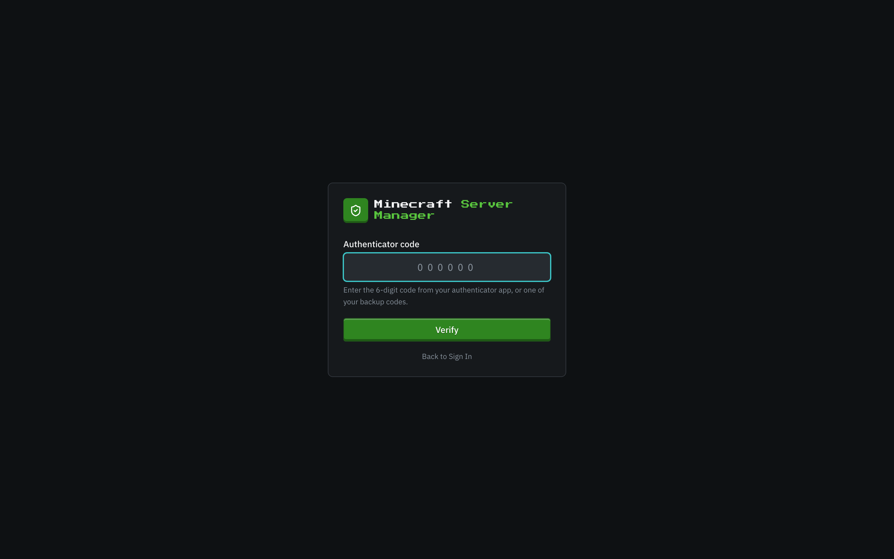

[← الرجوع إلى فهرس المستندات](/docs/)

تضيف المصادقة الثنائية (2FA) خطوة ثانية لتسجيل الدخول: بعد كلمة المرور الخاصة بك، تقوم بإدخال رمز قصير من تطبيق المصادقة على هاتفك. حتى لو عرف شخص ما كلمة المرور الخاصة بك، فلن يتمكن من الدخول بدون جهازك.

تعمل مع أي تطبيق مصادقة قياسي يدعم TOTP (مثل Google Authenticator، Authy، 1Password، Microsoft Authenticator، وغيرها)، وهي متاحة لـ **كل** حساب، وليس فقط للمسؤولين. حماية تسجيل دخولك الخاص ليست إجراءً لإدارة الخادم، لذا يمكن للمشاهدين والمشغلين تمكينها أيضًا.

## تمكين المصادقة الثنائية (2FA)

افتح قائمة الحساب (صورتك الأولية أو صورة ملفك الشخصي، في الزاوية العلوية اليمنى) واختر **2FA**.

ستظهر لك نافذة التسجيل:

1. **امسح رمز QR** باستخدام تطبيق المصادقة الخاص بك، أو اضغط على **نسخ** وأدخل المفتاح اليدوي يدويًا.
2. اكتب **الرمز المكون من 6 أرقام** الذي يعرضه تطبيقك الآن.
3. **أكد كلمة المرور الخاصة بك.** تمكين المصادقة الثنائية يعيد التحقق من كلمة المرور الخاصة بك، لذلك لا يمكن لجلسة مفتوحة عن طريق الخطأ تمكينها باستخدام جهاز شخص آخر.
4. انقر على **تمكين**.

### احفظ رموز النسخ الاحتياطي الخاصة بك

بمجرد تمكين المصادقة الثنائية، يعرض اللوحة مجموعة من **رموز النسخ الاحتياطي** التي تستخدم لمرة واحدة.

يعمل كل رمز **مرة واحدة**، لتسجيل الدخول إذا فقدت الوصول إلى تطبيق المصادقة الخاص بك. احفظها في مكان آمن (مدير كلمات المرور هو الخيار المثالي) لأنها لن تظهر مرة أخرى. يمكنك إعادة إنشاء مجموعة جديدة في أي وقت (مما يبطل المجموعات القديمة).

## تسجيل الدخول باستخدام المصادقة الثنائية (2FA)

منذ ذلك الحين، يتطلب تسجيل الدخول خطوة ثانية. بعد اسم المستخدم وكلمة المرور، يطلب اللوحة الرمز الخاص بك:

أدخل الرمز الحالي المكون من 6 أرقام من تطبيقك (أو أحد رموز النسخ الاحتياطي الخاصة بك) وستدخل. حتى تكمل هذه الخطوة، فإن الجلسة **لم** تسجل الدخول: لا يمكنها الوصول إلى أي صفحة أو واجهة برمجة تطبيقات.

## إدارة أو إيقاف المصادقة الثنائية (2FA)

افتح نفس خيار **2FA** في قائمة الحساب أثناء تمكينه. بعد تأكيد كلمة المرور الخاصة بك، يمكنك:

- **إعادة إنشاء رموز النسخ الاحتياطي** يصدر مجموعة جديدة ويبطل القديمة.
- **تعطيل المصادقة الثنائية (2FA)** يزيلها من حسابك.

كلاهما يعيد التحقق من كلمة المرور الحالية أولاً.

## فقدت هاتفك **و** رموز النسخ الاحتياطي الخاصة بك؟

يمكن **للمسؤول** إعادة تعيين المصادقة الثنائية لمستخدم آخر من **الإعدادات ← المستخدمون** (**إعادة تعيين المصادقة الثنائية** في قائمة إجراءات هذا المستخدم). هذا يمسح المصادقة الثنائية للحساب حتى يتمكن المستخدم من تسجيل الدخول بكلمة المرور الخاصة به فقط وإعدادها من جديد. لا يمكن للمسؤولين إعادة تعيين المصادقة الثنائية الخاصة بهم **دون** كلمة مرور. إنهم يمرون بعملية التعطيل العادية التي تتطلب كلمة مرور، لذلك لا يمكن لجلسة مسؤول مخترقة أن تزيل عاملها الثاني.

## معلومات جيدة

- الرموز تعتمد على الوقت وتتغير كل 30 ثانية؛ يقبل اللوحة انحرافًا بسيطًا في الساعة، ويتعافى بهدوء إذا تم تصحيح ساعة الخادم لاحقًا.
- لا يمكن إعادة استخدام الرمز: بمجرد استخدامه لتسجيل الدخول، لن يعمل نفس الرمز مرة أخرى ضمن نافذته الزمنية.
- الرموز الخاطئة تخضع لتحديد المعدل. يتم **مشاركة** المحدد مع خطوة كلمة المرور (قفل لكل حساب بالإضافة إلى محدد `RATE_LIMIT_AUTH_PER_15MIN` لكل عنوان IP)، لذا فإن إدخال كلمة مرور صحيحة لا يمكن أن يعيد تعيين العداد قبل تخمين الرمز المكون من 6 أرقام.
- يتم تسجيل جميع تغييرات المصادقة الثنائية (التمكين، التعطيل، إعادة التعيين، استخدام رمز النسخ الاحتياطي) في [سجل النشاط](/docs/activity/).
