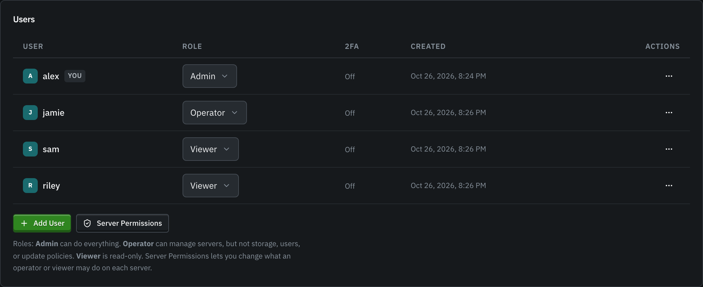

[← العودة إلى فهرس التوثيق](/docs/)

تتميز اللوحة بدعم تعدد المستخدمين. يمكنك إدارة الحسابات من خلال **الإعدادات ← المستخدمون**.

## الأدوار الثلاثة

| الدور               | الصلاحيات                                                                                                                                                    |
| ------------------- | ------------------------------------------------------------------------------------------------------------------------------------------------------------ |
| **admin** (مدير)    | كل شيء: إدارة المستخدمين، مفاتيح API، الملفات العامة، تجاوزات Docker المتقدمة، وجميع إجراءات الخادم.                                                         |
| **operator** (مشغل) | تشغيل وتكوين الخوادم (بدء/إيقاف، وحدة التحكم، النسخ الاحتياطية، العوالم، التعديلات، ومعظم الإعدادات)، ولكن لا يمكنه الوصول إلى المناطق المخصصة للمديرين فقط. |
| **viewer** (مشاهد)  | للقراءة فقط. يمكنه رؤية الخوادم وحالتها، لكن لا يمكنه إجراء أي تغييرات.                                                                                      |

يمكن لكل مستخدم، بما في ذلك المشاهد، إدارة [المصادقة الثنائية](/docs/two-factor-authentication/) الخاصة به، لأن حماية تسجيل دخولك الشخصي لا تُعد من إجراءات إدارة الخادم.

## صلاحيات المدير فقط، ولماذا

تم تقييد بعض الأمور للمديرين فقط لغرض محدد:

- **إدارة المستخدمين، مفاتيح API، والملفات العامة.**
- **[واجهة برمجة التطبيقات العامة (Public API)](/docs/public-api/)** - تفعيل `/api/v1` وإنشاء أو تحديد نطاق أو إلغاء رموز Bearer الخاصة بالقراءة فقط.
- **تجاوزات Docker المتقدمة** - اسم الحاوية المخصص، نشر منافذ إضافية، وربط المجلدات (bind mounts). يمكن لربط المجلدات تعيين أي مسار على المضيف داخل الحاوية، وبالاقتران مع وصول اللوحة إلى Docker، فإن هذا يمنح فعلياً صلاحيات الجذر (root) على المضيف. تظهر هذه الحقول للمديرين فقط.

كما لا يمكن لأسماء الحاويات المخصصة أن تقع ضمن نطاق `msm-` الخاص باللوحة، وذلك لضمان عدم تداخل حاوية مسمّاة يدوياً مع خادم آخر، مما يمنع توجيه أوامر الإيقاف أو غيرها إلى الخادم الخطأ.

## إدارة الحسابات

يمكن للمديرين إنشاء مستخدمين، تغيير الأدوار، إعادة تعيين كلمات المرور، وحذف الحسابات من جدول المستخدمين. يوضح عمود **2FA** ما إذا كان كل مستخدم قد فعّل المصادقة الثنائية؛ يمكن للمدير **إعادة تعيين** المصادقة الثنائية لمستخدم آخر (في حالات فقدان الهاتف ورموز النسخ الاحتياطي)، ولكن لا يمكنه أبداً تعطيل المصادقة الثنائية الخاصة به دون كلمة مروره، وهو ما يتم التعامل معه عبر إجراءات الخدمة الذاتية.

تخضع محاولات تسجيل الدخول الفاشلة لقيود معدل (rate-limit) لكل حساب (عداد لكل عنوان IP وعداد عام للحساب) لإبطاء محاولات الهجوم بالقوة الغاشمة (brute-force)، ويغطي نفس القيد خطوة رمز المصادقة الثنائية بحيث لا يمكن لكلمة مرور صحيحة إعادة تعيين العداد قبل تخمين الرموز. وأمام ذلك، يوجد محدد طلبات أكثر عمومية لكل عنوان IP للعميل على نقاط نهاية تسجيل الدخول / المصادقة الثنائية / الإعداد، يمكن ضبطه عبر `RATE_LIMIT_AUTH_PER_15MIN` (القيمة الافتراضية 100؛ إذا كنت خلف وكيل عكسي، اضبط `TRUST_PROXY` ليعتمد على عنوان IP الحقيقي للعميل).
