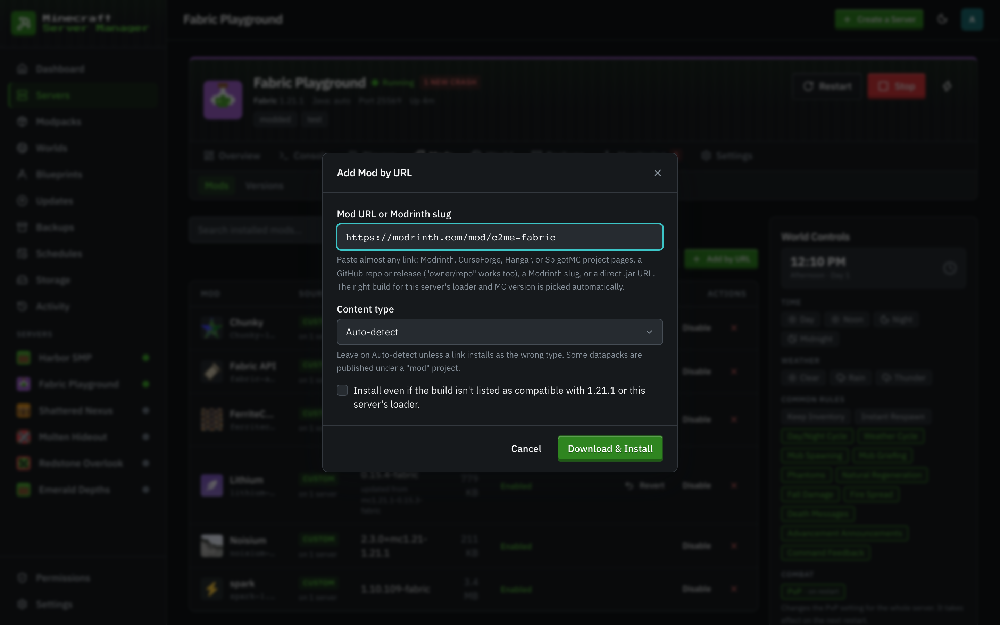

[← Zpět na index dokumentace](/docs/)

## Světy

Stránka **Světů** je knihovna světů: každý uložený svět na jednom místě. **Nahrát svět** vezme archiv `.zip` nebo `.tar` a automaticky v něm najde svět, **Uložit do knihovny** vytvoří snímek běžícího světa serveru (funguje, i když server běží) a každý svět z knihovny lze stáhnout nebo nainstalovat na jakýkoli server pomocí **Nainstalovat do…**. Instalace buď nahradí svět serveru (server musí být zastaven a jeho aktuální svět je nejprve zálohován) nebo jej přidá vedle, k aktivaci později. Před každou instalací proběhne kontrola kompatibility.

Vlastní karta **Svět → Světy** serveru zobrazuje světy na daném serveru. Odtud můžete aktivovat jiný svět (se zastaveným serverem), stáhnout, duplikovat, přejmenovat nebo [zmenšit](/docs/world-shrink/) svět, zkopírovat jej na jiný server, smazat neaktivní a resetovat aktivní svět s novým, zachovaným nebo vlastním seedem (nejprve je nabídnuta bezpečnostní záloha). Stejná knihovna je níže s možností **Nainstalovat zde**.

## Správce souborů

Pod sekcí serveru **Svět** je karta **Soubory** plnohodnotný správce souborů v prohlížeči pro datový adresář daného serveru. Seznam, čtení, úprava, přejmenování, přesun, kopírování, mazání a nahrávání souborů, vytváření složek a vyhledávání textu v souborech pod složkou pomocí **Najít v souborech**: vše, co byste normálně dělali přes SSH, z prohlížeče.

Textové soubory se otevřou v editoru s limitem 8 MB; větší soubory lze stáhnout. Nahrávání přijímá až 20 souborů najednou.

### Zůstat v rámci sandboxu

Každá operace se soubory je omezena na datový adresář serveru. Panel řeší každou cestu a odmítá cokoli, co by uniklo: procházení `..`, absolutní cesty a dokonce i symbolické odkazy, které směřují mimo adresář (včetně visících, které ještě neexistují). Mod nebo plugin nemůže vložit odkaz, aby oklamal správce souborů a přečetl nebo zapsal jinam na hostiteli.

## Mody

Pro modifikované servery a servery s pluginy spravuje karta **Mody** (vlastní skupina v postranním panelu serveru) sadu modů: procházejte a přidávejte mody a zobrazte, co je nainstalováno. Z řádku každého nainstalovaného modu jej můžete aktualizovat (nebo tuto aktualizaci ignorovat), [vrátit zpět](/docs/updates/#undoing-a-mod-update), zakázat nebo jej odstranit a **Aktualizovat vše** použije všechny dostupné aktualizace s jedním restartem. Aktualizace modů a balíčků se také zobrazí na stránce [Aktualizace](/docs/updates/).

### Přidávání modů

Čtyři cesty dovnitř, všechny z panelu nástrojů karty Mody:

- **Vyhledat mody**: prohledá **Modrinth nebo CurseForge** (čip CurseForge se objeví po uložení API klíče v **Nastavení → API klíče**) a na serverech s pluginy také **Hangar** (vlastní registr pluginů PaperMC) a **SpigotMC** (přes CDN proxy Spiget), obojí bez klíče. Karta **Datapacks** prohledává datapacky Modrinth. Vše je filtrováno podle loaderu serveru a verze Minecraftu (zaškrtávací políčko také zobrazuje sestavení, která nejsou označena jako kompatibilní, na vlastní riziko); Quilt servery automaticky vidí i sestavení označená jako fabric, protože Quilt spouští Fabric mody. Výsledky, které již jsou na serveru, zobrazují odznak **Nainstalováno**. Pokud autor CurseForge zakáže automatické stahování (nebo zdroj SpigotMC je hostován mimo stránku), panel to předem oznámí a místo selhání uprostřed instalace nabídne cestu **Otevřít CurseForge** (nebo **Otevřít SpigotMC**) + **Nahrát Jar**.

  

- **Importovat Zip**: jedno tlačítko, tři tvary, automaticky detekováno:
  - **Modpack Modrinth (`.mrpack`)**: každý připnutý soubor je kanonizován zpět do svého projektu Modrinth pomocí vyhledávání hashů (takže importované mody si zachovávají skutečná jména, ikony a zůstávají kontrolovatelné pro aktualizace; soubory, které Modrinth nezná, se instalují z vlastního URL balíčku), ověřeny proti kontrolním součtům sha512 balíčku během stahování a zobrazeny s výsledky shody. Soubory pouze pro klienta jsou viditelně přeskočeny a oba stromy pro přepsání (`overrides/`, pak `server-overrides/`; kopie specifická pro server má přednost) mohou být aplikovány.

    

  - **Export modpacku CurseForge** (zip, který produkuje aplikace CurseForge, s `manifest.json`): každý připnutý mod je hromadně vyřešen, zobrazen s varováními (špatný loader/MC pro tento server, soubory již nejsou na CurseForge, mody vyžadující manuální stažení) a nainstalován s reálným postupem. `overrides/` balíčku (konfigurace, skripty) lze volitelně také aplikovat; jakýkoli soubor, který by byl přepsán, je nejprve zálohován do `.import-backups/<timestamp>/` uvnitř složky serveru.
  - **Obyčejný zip jarů**, které jste si sami nasbírali: každý jar je identifikován (shoda hashe Modrinth → otisk prstu CurseForge → metadata samotného jaru) a posouzen proti serveru (_sedí / špatný loader / špatná verze MC / již nainstalováno / neidentifikováno_), takže si vyberete, co skutečně patří, než se cokoli nainstaluje.
- **Přidat podle URL**: vložte téměř cokoli: stránky projektů Modrinth, CurseForge, Hangar nebo SpigotMC, URL repozitáře nebo vydání na GitHubu (funguje i holé `owner/repo`; instalace na GitHubu upřednostňují nejnovější stabilní vydání a přeskočí postranní jar soubory `-sources`/`-javadoc`), holý slug Modrinth, nebo jakékoli přímé URL `.jar`. Panel vyřeší správné sestavení pro loader a verzi MC serveru.

  

- **Nahrát Jar** (z fallbacku vyhledávání nebo z řešiče čekajících stahování): nahrané jary jsou identifikovány stejným způsobem, takže si zachovávají své skutečné jméno, verzi, ikonu a stávají se kontrolovatelnými pro aktualizace.

Každá instalace z registru je **ověřena kontrolním součtem během stahování**: proud je zkontrolován proti nejsilnějšímu digestu, který registr publikuje (sha512 → sha256 → sha1 → md5) a neshoda se zruší, než cokoli přistane na serveru.

Celý zip (`.mrpack` včetně) může také **vytvořit server**: na kartě **Z modpacku** v průvodci jej nahrajte a manifest balíčku (nebo většinové hlasování mezi identifikovanými jary) vyplní loader, verzi Minecraftu a sestavení loaderu.
