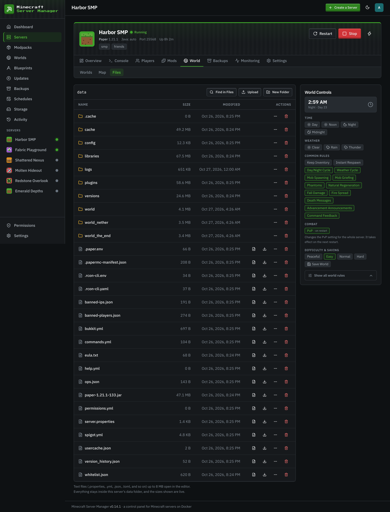

[← Zpět na obsah dokumentace](/docs/)

## Světy

Stránka **Světů** spravuje data světů napříč vašimi servery: přepínejte aktivní svět, nahrajte svět nebo si jej stáhněte.

## Správce souborů

V sekci **Svět** serveru, karta **Soubory** je plnohodnotný správce souborů v prohlížeči pro datový adresář daného serveru. Vypisujte, čtěte, upravujte, vytvářejte, přejmenovávejte, přesouvejte, kopírujte, mažte a nahrávejte soubory: vše, co byste normálně dělali přes SSH, z prohlížeče.

Textové soubory se otevírají v editoru s limitem 2 MB; větší soubory lze stáhnout. Nahrávání podporuje více souborů najednou.

### Zůstat v rámci "sandboxu"

Každá operace se soubory je omezena na datový adresář serveru. Panel vyřeší každou cestu a odmítne cokoli, co by ji opustilo: procházení `..`, absolutní cesty a dokonce i symbolické odkazy, které směřují mimo adresář (včetně visících, které ještě neexistují). Mod nebo plugin nemůže vložit odkaz, aby oklamal správce souborů a přečetl nebo zapsal jinam na hostiteli.

## Mody

Pro modifikované servery, karta **Mody** (vlastní skupina v postranním panelu serveru) spravuje sadu modů: prohlížejte a přidávejte mody a sledujte, co je nainstalováno. Aktualizace modů a balíčků se zobrazí na stránce [Aktualizace](/docs/updates/).

### Přidávání modů

Čtyři způsoby, všechny z panelu nástrojů karty Mody:

- **Hledat mody** - hledejte na **Modrinth nebo CurseForge** (štítok CurseForge se objeví po uložení API klíče v Nastavení → API klíče) a na serverech s pluginy také na **Hangar** (vlastní registr pluginů PaperMC) a **SpigotMC** (přes proxy CDN Spiget) - obojí bez klíče. Vše je filtrováno podle loaderu a verze Minecraftu serveru; Quilt servery automaticky vidí i buildy označené jako fabric, protože Quilt spouští Fabric mody. Výsledky, které již jsou na serveru, zobrazují odznak **Nainstalováno**. Pokud autor CurseForge zakáže automatické stahování - nebo je zdroj SpigotMC hostován mimo stránku - panel to předem oznámí a nabídne cestu **Otevřít stránku** + **Nahrát jar** místo selhání uprostřed instalace.

  

- **Importovat zip** - jedno tlačítko, tři tvary, automaticky detekováno:
  - **Modpack Modrinth (`.mrpack`)**: každý připnutý soubor je kanonizován zpět do svého projektu Modrinth pomocí vyhledávání podle hashe (takže importované mody si zachovají skutečná jména, ikony a zůstanou kontrolovatelné pro aktualizace; soubory, které Modrinth nezná, se instalují z vlastního URL balíčku), ověřeny proti checksumům balíčku sha512 během stahování a předvedeny s výsledky kontroly. Soubory pouze pro klienta jsou viditelně přeskočeny a oba stromy pro přepsání (`overrides/`, pak `server-overrides/` - kopie specifická pro server má přednost) mohou být aplikovány.

    

  - **Export modpacku CurseForge** (zip, který produkuje aplikace CurseForge, s `manifest.json`): každý připnutý mod je hromadně vyřešen, předveden s varováními (špatný loader/MC pro tento server, soubory již nejsou na CurseForge, mody vyžadující manuální stažení) a nainstalován s reálným průběhem. `overrides/` balíčku (konfigurace, skripty) mohou být volitelně také aplikovány - jakýkoli soubor, který by byl přepsán, je nejprve zálohován do `.import-backups/<timestamp>/` uvnitř složky serveru.
  - **Obyčejný zip jar souborů**, které jste si sami nasbírali: každý jar je identifikován (shoda hashe Modrinth → otisk prstu CurseForge → metadata samotného jaru) a posouzen proti serveru - _sedí / špatný loader / špatná verze MC / již nainstalováno / neidentifikováno_ - takže si vyberete, co skutečně patří, než se cokoli nainstaluje.
- **Přidat podle odkazu** - vložte téměř cokoli: projektové stránky Modrinth, CurseForge, Hangar nebo SpigotMC, URL repozitáře nebo vydání na GitHubu (stačí `owner/repo` - GitHub instalace preferuje nejnovější stabilní vydání a přeskočí `-sources`/`-javadoc` postranní jar soubory), holý slug Modrinth, nebo jakýkoli přímý `.jar` URL. Panel vyřeší správný build pro loader a verzi MC serveru.

  

- **Nahrát jar** (z fallbacku vyhledávání nebo z resolveru čekajících stahování) - nahrané jary jsou identifikovány stejným způsobem, takže si zachovají své skutečné jméno, verzi, ikonu a stanou se kontrolovatelnými pro aktualizace.

Každá instalace z registru je **ověřena checksumem během stahování**: stream je zkontrolován proti nejsilnějšímu digestu, který registr publikuje (sha512 → sha256 → sha1 → md5) a neshoda přeruší proces dříve, než cokoli přistane na serveru.

Celý zip (`.mrpack` včetně) může také **vytvořit server**: na kartě průvodce _Z modpacku_ jej nahrajte a manifest balíčku (nebo většinové hlasování mezi identifikovanými jary) vyplní loader, verzi Minecraftu a build loaderu.
