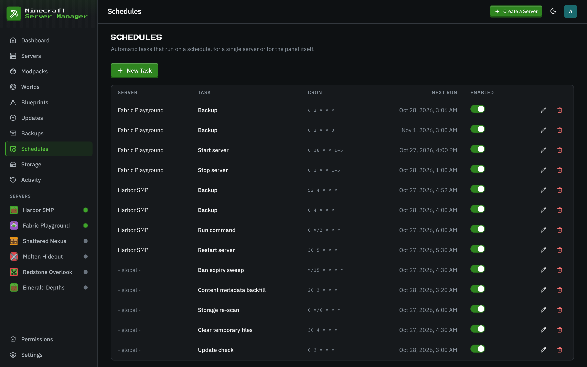

[← Tilbage til dokumentationens indeks](/docs/)

Siden **Tidsplaner** automatiserer tilbagevendende opgaver med cron-udtryk. Ingen ekstern cron, ingen scripts.

## Hvad du kan planlægge

- **Genstarter**: en natlig genstart for at holde en langvarig server sund.
- **Stop og start**: tag en server ned natten over og bring den tilbage om morgenen.
- **Sikkerhedskopier**: regelmæssige snapshots (tagget `scheduled` på siden [Sikkerhedskopier](/docs/backups/)). En sikkerhedskopiplan kan også formindske verden efter hver sikkerhedskopi ([formindskelse af en verden](/docs/world-shrink/)). Hver ny server får automatisk en daglig sikkerhedskopiplan.
- **Kommandoer**: kør enhver serverkommando efter en tidsplan.
- **Opdateringskontrol**: opdater periodisk, hvad der er forældet. Den planlagte kontrol er også det, der anvender opdateringer til servere, der er indstillet til [Auto-opdatering](/docs/modpacks/#update-policy).

Hver tidsplan er rettet mod en specifik server (eller panelet globalt), kører på sit eget cron-udtryk og kan aktiveres eller deaktiveres uden at slette den. Editoren viser de næste køretider, mens du skriver, cron-tider følger panelets tidszone (indstillet i **Indstillinger**), og tabellen viser hver tidsplans næste kørsel. Hver udførelse registreres som en historikbegivenhed, og det samme gælder en mislykket kørsel.

Panelet sår også sine egne vedligeholdelsesplaner ved første opstart, som du kan omplanlægge eller slå fra: en daglig opdateringskontrol, en lagrings-genscanning hver sjette time, en daglig rydning af gamle midlertidige filer, en sweep af udløbne forbud hvert 15. minut (ophævelse af midlertidige forbud, der er udløbet), og en natlig udfyldning af indholdsmetadata (udfyldning af manglende modnavne og ikoner).

## Når serveren er optaget

En planlagt sikkerhedskopi eller start, der finder sin server midt i en anden handling (en gendannelse, en sikkerhedskopi-oprydning, en portændring), venter og prøver igen hvert minut, indtil handlingen er afsluttet, i op til 30 minutter. En ventende start annulleres, hvis nogen starter eller stopper serveren i mellemtiden. En planlagt genstart eller stop forsøges ikke igen: den springes over og kører igen på sit næste tidspunkt.
