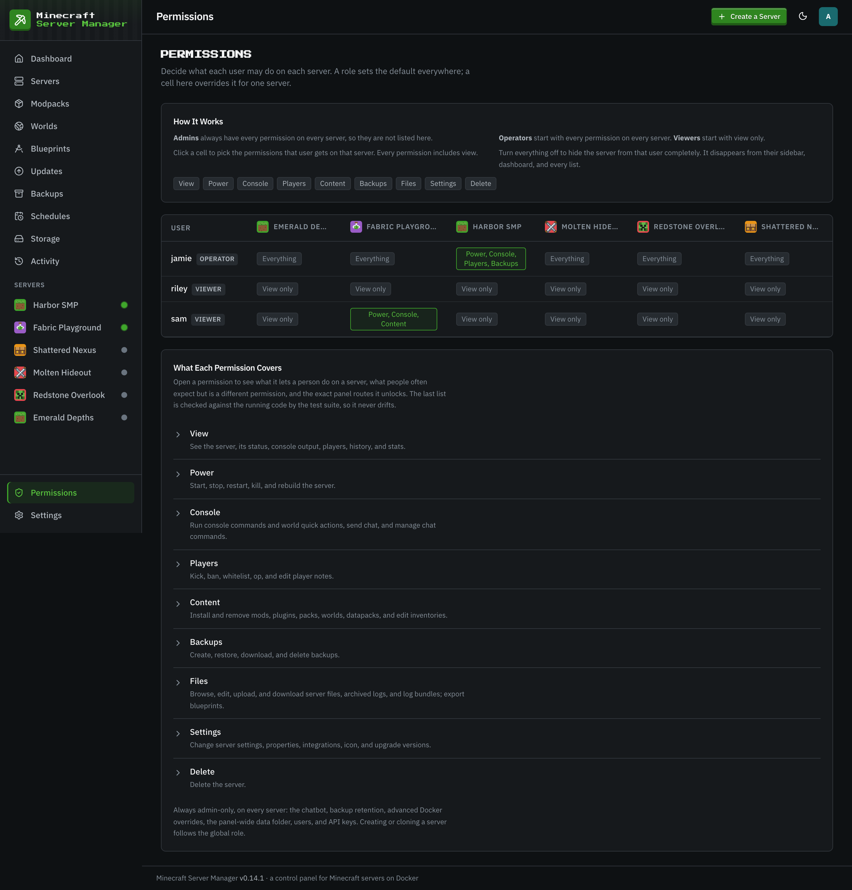
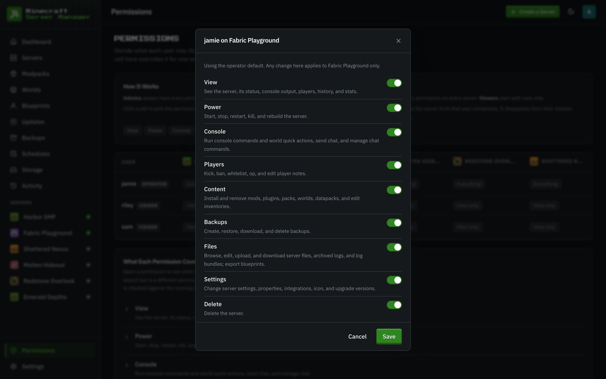

[← Tilbage til dokumentindeks](/docs/)

Panelet er multi-bruger. Administrer konti under **Indstillinger → Brugere**.

## De tre roller

| Rolle        | Standard på hver server                                                                                                        |
| ------------ | ------------------------------------------------------------------------------------------------------------------------------ |
| **admin**    | Alt: administrer brugere, API-nøgler, globale filer, avancerede Docker-overskrivninger og alle serverhandlinger.               |
| **operator** | Kør og konfigurer servere (start/stop, konsol, backups, verdener, mods, de fleste indstillinger), men ikke admin-only områder. |
| **viewer**   | Kun læsning. Se servere og deres status, men foretag ingen ændringer.                                                          |

Hver bruger, inklusive en viewer, kan administrere deres egen [to-faktor-godkendelse](/docs/two-factor-authentication/), fordi beskyttelse af dit eget login ikke er en serveradministrationshandling.

En rolle er **standard** for hver server. For at give nogen forskellige rettigheder på én server, brug per-server-tilladelser nedenfor.

## Per-server-tilladelser

Siden **Tilladelser** (i sidebjælken, eller **Servertilladelser** under **Indstillinger → Brugere**) viser et gitter: hver operator og viewer ned langs siden, hver server hen over toppen. Klik på en celle for at bestemme, hvad den bruger må gøre på den ene server. Admins er ikke listet, fordi de altid har alt.

Hver celle er et sæt af tilladelser:

| Tilladelse   | Hvad den tillader på den server                                                                        |
| ------------ | ------------------------------------------------------------------------------------------------------ |
| **View**     | Se serveren, dens status, konsoloutput, spillere, historik og statistik.                               |
| **Power**    | Start, stop, genstart, dræb og genopbyg serveren.                                                      |
| **Console**  | Kør konsolkommandoer og hurtige verdenshandlinger, send chat og administrer chatkommandoer.            |
| **Players**  | Spark, ban, whitelist, op, og rediger spillerbemærkninger.                                             |
| **Content**  | Installer og fjern mods, plugins, pakker, verdener, datapacks og rediger inventar.                     |
| **Backups**  | Opret, gendan, download og slet backups.                                                               |
| **Files**    | Gennemse, rediger, upload og download serverfiler, arkiverede logs og logbunker; eksporter blueprints. |
| **Settings** | Ændr serverindstillinger, egenskaber, integrationer, ikon og opgrader versioner.                       |
| **Delete**   | Slet serveren.                                                                                         |

Under gitteret åbner **Hvad Hver Tilladelse Dækker** hver tilladelse til, hvad en person kan gøre, hvad der ikke er inkluderet, og de præcise panelruter, den låser op for. Den sidste liste kontrolleres mod den kørende kode af testsuiten.

På en telefon stables gitteret til ét kort pr. bruger, med en række pr. server.

  

Sådan passer delene sammen:

- **Rollen er standarden.** En operator starter med alle tilladelser på alle servere; en viewer starter kun med View. En celle i svag tekst (dens tooltip siger "Rolle standard") er aldrig blevet ændret.
- **En celle tilsidesætter rollen for kun den server.** Giv en viewer Power og Console på én server, og de kan køre den, mens alle andre servere forbliver skrivebeskyttede for dem. Fjern Delete fra en operator på din hovedserver, og de beholder alt andet der.
- **Alle tilladelser inkluderer View.** Du kan ikke handle på en server, du ikke kan se.
- **Slå alt fra for at skjule en server.** Den forsvinder fra brugerens sidebjælke, dashboard, backups, tidsplaner, aktivitet, opdateringer, modpacks, live status, kørende opgaver og blueprints, og verdensbiblioteket stopper med at nævne den. Et direkte link, API-kald eller konsolforbindelse svarer "ikke fundet", ligesom en server, der ikke eksisterer.
- **Panel-dækkende handlinger følger stadig rollen.** Oprettelse af servere (inklusive kloning af en), lagerplads, brugere, API-nøgler, globale indstillinger og panel-dækkende tidsplaner er ikke per-server, så en viewer med tilladelser på nogle servere kan stadig ikke gøre nogen af disse. Operators beholder serveroprettelse og panel-dækkende tidsplaner; lagerplads, brugere, API-nøgler og globale indstillinger er kun for admins.
- **Tidsplaner følger serveren.** En planlagt genstart, backup eller kommando på en server kræver den matchende tilladelse der (Power, Backups eller Console), uanset rollen.
- **Blueprints følger også serveren.** Eksport af en server som en blueprint kræver Files der, da arkivet bærer dens filer. En blueprint eksporteret fra en server, nogen ikke kan se, er også skjult for dem.
- **Admin-only områder forbliver admin-only** på alle servere: chatbotten, backup-retention og avancerede Docker-overskrivninger.

Hver ændring skrives til aktivitetsloggen med hvem der ændrede hvad; disse poster vises kun for admins. Sletning af en bruger fjerner deres rækker. Fjernelse af en server beholder dem, så en server skjult for nogen forbliver skjult i dens historik og gemte backups.

Eksisterende installationer fortsætter med at fungere uændret: indtil en admin redigerer en celle, har hver bruger præcis, hvad deres rolle gav dem før.

## Kun for admins, og hvorfor

Et par ting er bevidst begrænset til admins:

- **Brugeradministration, lagerplads, globale indstillinger, API-nøgler og globale filer.**
- **Den [offentlige API](/docs/public-api/)**: aktivering af `/api/v1` og oprettelse, afgrænsning eller tilbagekaldelse af dens read-only Bearer-tokens.
- **Avancerede Docker-overskrivninger**: brugerdefineret containernavn, ekstra portudgivelser og bind mounts. Et bind mount kan mappe enhver host-sti ind i en container, og kombineret med panelets Docker-adgang er det effektivt root på hosten. Disse felter vises kun for admins.

Brugerdefinerede containernavne kan heller ikke leve i panelets egen `msm-` navnerum, så en håndnavngivet container kan aldrig skygge for en anden servers og omdirigere et stop eller en kommando til den forkerte instans.

## Administration af konti

Admins kan oprette brugere, ændre roller, nulstille adgangskoder og slette konti fra Bruger-tabellen. **2FA**-kolonnen viser, om hver bruger har to-faktor aktiveret; en admin kan nulstille en anden brugers 2FA med **Nulstil 2FA** i den pågældende brugers handlingsmenu (til tilfældet med mistet telefon og backup-koder), men aldrig deaktivere deres egen uden deres adgangskode, hvilket selvbetjeningsflowet håndterer i stedet.

Mislykkede logins er rate-begrænset pr. konto (både en tæller pr. IP og en global tæller for kontoen) for at sænke hastigheden på brute-force forsøg, og den samme grænse dækker 2FA-kodetrinnet, så en korrekt adgangskode ikke kan nulstille tælleren før kodegætning. Foran dette sidder en grovere per-klient-IP anmodningsbegrænser på login / 2FA / setup-endepunkterne, der kan justeres via `RATE_LIMIT_AUTH_PER_15MIN` (standard 100; bag en reverse proxy, sæt `TRUST_PROXY` så den nøgler på den rigtige klient-IP).
