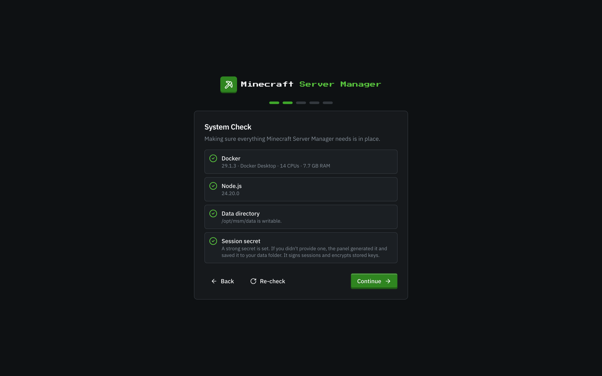
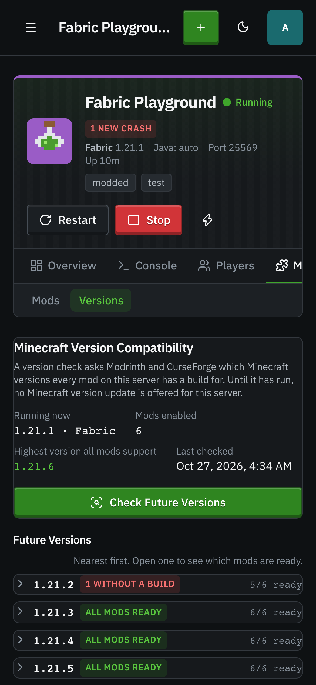

[← Zurück zum Dokumentenverzeichnis](/docs/)

## Ersteinrichtung

Beim ersten Öffnen des Panels führt Sie ein kurzer Einrichtungsassistent durch die notwendigen Schritte:

1.  **Systemprüfung**: Stellt sicher, dass Docker erreichbar ist, Node.js aktuell genug ist und der Datenordner beschreibbar ist. Wenn Docker noch nicht läuft, können Sie trotzdem fortfahren; das Erstellen und Starten von Servern wartet, bis es läuft.
2.  **Erstellen Sie Ihr Administratorkonto**: Dies ist das einzige Konto, das existiert, bis Sie weitere hinzufügen, und es hat die volle Kontrolle. Wählen Sie einen Benutzernamen (2 bis 32 Zeichen) und ein Passwort mit mindestens 8 Zeichen. Sie sind sofort nach der Erstellung angemeldet.
3.  **Panel-Konfiguration** (optional): Eine öffentliche Domain, die Spielern in Verbindungsadressen angezeigt wird, ein CurseForge API-Schlüssel und Ihre Zeitzone. All dies kann später in **Einstellungen** geändert werden.

Der letzte Schritt bietet die Optionen **Server erstellen** oder **Zum Dashboard wechseln**.

> **Öffentlich zugängliche Installationen sind PIN-geschützt.** Wenn Sie das Panel an eine nicht-lokale Adresse binden (`PANEL_HOST` ungleich `127.0.0.1`), fragt die Einrichtungsseite auch nach einer **6-stelligen PIN**. Das Panel gibt diese beim Start in seiner Konsole aus. Geben Sie sie zusammen mit Ihrem Benutzernamen und Passwort ein. Dies verhindert, dass ein Fremder, der zuerst auf den Port zugreift, das Administratorkonto beansprucht. Die PIN verschwindet, sobald das Administratorkonto existiert.

## Anmelden

Nach der Einrichtung wird das Panel durch einen Anmeldebildschirm geschützt. Geben Sie Ihren Benutzernamen und Ihr Passwort ein, um fortzufahren.

Wenn [Zwei-Faktor-Authentifizierung](/docs/two-factor-authentication/) für Ihr Konto aktiviert ist, werden Sie direkt nach Ihrem Passwort nach einem 6-stelligen Code aus Ihrer Authentifizierungs-App gefragt.

## Navigation

Alles ist über die linke Seitenleiste erreichbar:

- **Dashboard**: Alle Server auf einen Blick ([Details](/docs/dashboard/)).
- **Server**, **Modpacks**, **Welten**, **Blueprints**: Server und deren Inhalte erstellen und verwalten.
- **Updates**, **Backups**, **Zeitpläne**, **Speicher**, **Aktivität**: Die operative Seite: Was ist veraltet, Ihre Snapshots, Automatisierung, Festplattennutzung und das Audit-Protokoll.
- **Berechtigungen** (unten, nur für Administratoren): Was jeder Benutzer auf jedem Server tun darf ([Details](/docs/users-and-roles/#per-server-permissions)).
- **Einstellungen** (unten, nur für Administratoren): API-Schlüssel, Panel-Konfiguration, Standardwerte für neue Server, [Backup-Aufbewahrung](/docs/backups/#retention), Benutzer, Anmeldesicherheit und die öffentliche API.

Darunter listet die Seitenleiste Ihre Server auf. Das Öffnen eines Servers zeigt dessen eigene Tabs: **Übersicht**, **Konsole**, **Spieler**, **Mods**, **Welt**, **Backups**, **Überwachung** und **Einstellungen**, die meisten mit zugehörigen Unter-Tabs (z. B. enthält **Einstellungen → Konfiguration** die Servereinstellungen und den Spiel-Port). Siehe [Ein einzelner Server](/docs/servers/#a-single-server).

Die obere Leiste enthält die Schaltfläche **Server erstellen**, einen **Themenumschalter** (dunkel/hell) und Ihr **Konto-Menü**, in dem Sie Ihr Profilbild ändern, die [Zwei-Faktor-Authentifizierung](/docs/two-factor-authentication/) verwalten oder sich abmelden können.

## Auf einem Telefon oder Tablet

Jede Seite ist zuerst für einen schmalen Bildschirm ausgelegt und verbreitert sich von dort aus: Die Seitenleiste verbirgt sich hinter der Menüschaltfläche, Datentabellen werden zu Karten gestapelt, Werkzeugleisten werden umgebrochen und die Welt-Steuerleiste wird zu einer Karte zusammengeklappt, die Sie öffnen, wenn Sie sie benötigen. Schaltflächen und Chips haben eine angemessene Touch-Target-Größe. Nichts ist nur für Desktops.

  
  
  
  
  
  

## Was Sie benötigen

Das Panel kommuniziert mit Docker, um Server auszuführen, daher benötigt es Zugriff auf einen Docker-Daemon (Docker Desktop oder einen Docker Engine Socket). Wenn Docker erreichbar ist, zeigt die Docker-Kachel im Dashboard **Verbunden** und seine Version an. Wenn nicht, läuft das Panel trotzdem. Sie können Server erst starten, wenn der Daemon läuft.

## Nächste Schritte

- [Erstellen Sie Ihren ersten Server →](/docs/servers/)
- [Sichern Sie Ihr Konto mit 2FA →](/docs/two-factor-authentication/)
