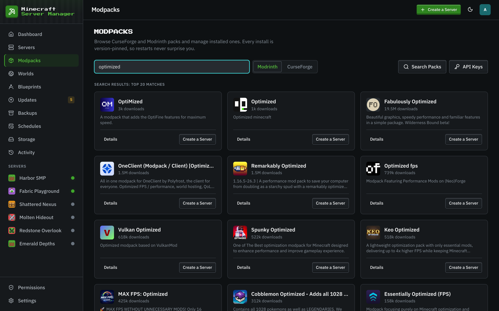

[← Zurück zum Dokumentenverzeichnis](/docs/)

Die Seite **Modpacks** (und der Tab **Aus Modpack** im [Erstellungs-Assistenten](/docs/servers/)) installiert ein Modpack als Server, immer **an eine exakte Pack-Version angeheftet**, sodass ein Neustart das Pack niemals unbemerkt aktualisieren kann.

## Unterstützte Plattformen

- **CurseForge**: Suche nach Namen. Benötigt einen CurseForge API-Schlüssel (fügen Sie ihn unter **Einstellungen → API-Schlüssel** hinzu).
- **Modrinth**: Suche nach Namen.
- **FTB**: Feed The Beast Packs, nur über die API (eine numerische Pack-ID plus eine explizite Versions-ID). Das Panel prüft FTB-Packs noch nicht auf Updates.
- **GT New Horizons**: Das 1.7.10 Expert Pack, installiert aus dem eigenen Release-Index von GTNH. GTNH wählt seine Java-Laufzeitumgebung pro Pack-Version (2.8.0+ läuft auf **Java 25** über gebündelte lwjgl3ify-Patches, ältere Releases auf Java 21 oder 17), und der Assistent erhöht den RAM und Speicherplatz des Servers auf sinnvolle Mindestwerte dafür.
- **Benutzerdefiniertes Zip**: Gar kein veröffentlichtes Pack. Laden Sie einen **CurseForge Modpack-Export** hoch (die Zip-Datei mit `manifest.json`, die die CurseForge-App für eine handverlesene Mod-Auswahl erstellt), ein **Modrinth `.mrpack`** oder **beliebige Zip-Dateien mit Mod-JARs**. Das Panel löst das Manifest in großen Mengen auf (oder identifiziert jede JAR-Datei anhand von Hash/Fingerabdruck/Metadaten), zeigt eine Vorschau dessen an, was passt, und installiert alles in einer Aufgabe, einschließlich der `overrides/`-Konfigurationen des Packs, wenn Sie zustimmen. Mods, deren Autoren automatisierte Downloads nicht erlauben, werden mit einem Browser-Link und einem manuellen Upload-Slot aufgeführt, anstatt die Installation fehlschlagen zu lassen.

## Funktionsweise des Anheftens

Wenn Sie ein Pack auswählen, löst das Panel die exakte Version auf, zeichnet sie auf und installiert diese. Auf der Seite **Updates** werden Sie darüber informiert, wenn eine neuere Version verfügbar ist (es sei denn, die [Update-Richtlinie](#update-policy) des Servers ist **Nur Manuell**); ein Upgrade ist eine bewusste, geschützte Aktion mit einem Backup vor dem Update und einem Rollback. Stable-Tracking-Servern wird niemals eine Beta-Version angeboten. Der eigene Tab **Versionen** eines Servers beantwortet die andere Hälfte der Frage: welche zukünftigen Minecraft-Versionen die Mods, die er tatsächlich hat, verfolgen können ([Updates](/docs/updates/#minecraft-version-compatibility)).

Die Mod-Loader-Version wird ebenfalls mit dem Pack geliefert: Der Server installiert den Forge-, NeoForge- oder Fabric-Build, den das Pack deklariert. Wenn ein Forge- oder Fabric-CurseForge-Pack eine Version deklariert, die für seine eigenen Mods zu alt ist, kann der Tab **Versionen** diese überschreiben, bis das Pack behoben ist; ein Pack-Update entfernt die Überschreibung, da die neue Version ihre eigene deklariert ([Ändern der Mod-Loader-Version](/docs/updates/#changing-the-mod-loader-version)).

Server, die auf sehr alten Panel-Versionen (vor 0.9.7) erstellt wurden, könnten _nicht angeheftet_ sein, was bedeutet, dass das Container-Image bei jedem Start leise die neueste Pack-Version installiert. Das Panel repariert diese jetzt beim Booten: Es sperrt jede einzelne an die tatsächlich installierte Version (gelesen aus den eigenen Aufzeichnungen des Panels oder dem Installationsmanifest des Images, niemals ein frisch aufgelöstes "latest") und protokolliert ein Ereignis. Wenn es nicht feststellen kann, was installiert ist, zeigt die Seite Einstellungen des Servers eine Warnung mit einer Schaltfläche **Version auswählen…** (CurseForge-, Modrinth- und GTNH-Packs), die den [Versionsauswähler](#changing-the-pack-version) öffnet, und jeder Versuch, eine nicht angeheftete Modpack-Konfiguration zu speichern, wird sofort abgelehnt.

## Update-Richtlinie

Jeder Server hat eine Karte **Update-Richtlinie** auf seinem Tab **Einstellungen → Konfiguration**, und alle drei Optionen bedeuten, was sie sagen:

- **Nur Manuell** (Standard): Nichts ändert sich von selbst, und der Server wird vollständig aus der Update-Schaltfläche und der Updates-Seite herausgehalten. Der "Lass mich in Ruhe"-Modus: ideal für ein handabgestimmtes oder importiertes Pack, das Sie niemals anfassen möchten. Es sperrt die Version nicht: [**Version ändern…**](#changing-the-pack-version) funktioniert unter jeder Richtlinie. Um über neue Versionen informiert zu werden und sie mit einem Klick anzuwenden, wählen Sie **Benachrichtigen**.
- **Benachrichtigen**: Die tägliche Prüfung zeigt verfügbare Updates als Schaltfläche und auf der Updates-Seite an; die Anwendung ist immer Ihr Klick.
- **Automatische Updates**: Nach der geplanten täglichen Prüfung werden anstehende **Pack**-Updates über denselben geschützten Pfad wie ein manuelles Upgrade angewendet: Backup vor dem Update, Gesundheitsüberwachung und ein automatischer Rollback, wenn die neue Version nicht startet. Updates, die den Server auf eine andere Minecraft-Version verschieben würden, werden immer übersprungen und stattdessen ein Ereignis ausgelöst: Die Konvertierung einer Welt ist eine Entscheidung, die das Panel nicht für Sie treffen wird. Die manuellen Schaltflächen **Jetzt prüfen** prüfen nur; sie lösen niemals automatische Updates aus.

## Ein Pack aktualisieren

Von einem angehefteten Server aus können Sie mit einer einzigen Aktion auf eine neuere Version aktualisieren. Das Panel erstellt zuerst ein Backup, tauscht die angeheftete Version aus, baut den Server neu (löst Java neu auf, falls die neue Version eine andere Laufzeitumgebung benötigt) und überwacht den ersten Start, mit einem großzügigen Zeitfenster für große Packs wie GTNH, die ein paar Gigabyte herunterladen und eine Welt mit mehreren hundert Mods beim ersten Start aufbauen.

## Pack-Version ändern

Um eine bestimmte Version, neuer oder älter, auszuführen, verwenden Sie **Version ändern…** auf der Pack-Karte des Servers im Tab **Übersicht**. Auf der Seite **Modpacks** gibt das Öffnen der Karte eines installierten Packs die gleiche Wahl: Wählen Sie eine Version im Dropdown-Menü und klicken Sie auf **Zu dieser Version wechseln**. Beide benötigen die Berechtigung **Inhalt** des Servers, und beide sind für CurseForge-, Modrinth- und GTNH-Packs verfügbar (FTB-Packs haben noch keine Versionsliste). Die Liste zeigt die 25 neuesten Versionen für CurseForge und Modrinth und jede GTNH-Veröffentlichung.

Der Wechsel erfolgt über denselben geschützten Pfad wie ein Upgrade: ein Backup vor dem Update, die neue Anheftung, ein Neuaufbau und ein überwachter erster Start, mit einem Ein-Klick-Rollback, wenn der Server nicht gesund startet. Ihre benutzerdefinierten Mods werden übernommen, ebenso wie die von Ihnen deaktivierten Pack-Mods, zusammen mit den anderen Installationseinstellungen des Packs (erzwungene Mods, zu ignorierende Dateien, zusätzliche Projekte). Die Installation eines anderen Packs setzt diese Einstellungen zurück, da sie nur für das Pack sinnvoll sind, für das sie erstellt wurden.

Jede Version wird mit der Minecraft-Version aufgeführt, mit der sie läuft, verglichen mit der Version, mit der Ihre Welt zuletzt gespeichert wurde:

- **Gleiche Minecraft-Version**: Wechsel nach normaler Bestätigung. Das Zurückkehren zu einer älteren Pack-Version kann Blöcke und Gegenstände von Mods fallen lassen, die diese Version nicht hat, sodass das Backup in jedem Fall im Tab Backups verbleibt.
- **Neuere Minecraft-Version**: Erlaubt nach einer Bestätigung, die warnt, dass die Welt endgültig konvertiert wird. Das zuerst erstellte Backup ist der einzige Weg zurück zur alten Welt.
- **Ältere Minecraft-Version**: Nicht verfügbar. Minecraft kann keine Welt auf einer älteren Version laden als der, mit der sie zuletzt gespeichert wurde, daher lehnt das Panel dies ab, anstatt einen Server zu hinterlassen, der beim Booten abstürzt.
