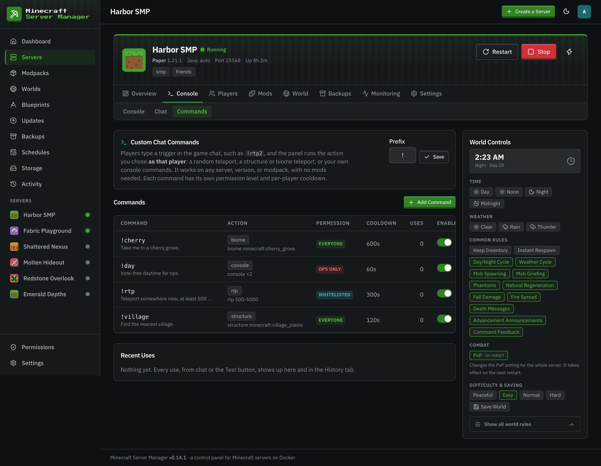

[← Πίσω στον δείκτη τεκμηρίωσης](/docs/)

## Η ζωντανή κονσόλα

Η καρτέλα **Κονσόλα** μεταδίδει το αρχείο καταγραφής του διακομιστή σε πραγματικό χρόνο και παρέχει ένα πλαίσιο εντολών για την αποστολή οποιασδήποτε εντολής του διακομιστή. Όχι `docker exec`, όχι SSH. Η έξοδος επιστρέφει ενσωματωμένη, με χρώματα και όλα.

Η κονσόλα είναι επίσης το σημείο όπου το πάνελ διαβάζει την κατάσταση του διακομιστή: παρακολουθεί το αρχείο καταγραφής για να ταξινομήσει τη φάση εκκίνησης ("Φόρτωση mods", "Δημιουργία κόσμου", "Ολοκλήρωση εκκίνησης") και καλεί `list` για να παρακολουθεί ποιοι είναι συνδεδεμένοι, έτσι ώστε ο πίνακας ελέγχου και οι κάρτες διακομιστών να αντικατοπτρίζουν πάντα την πραγματικότητα.

Αυτή η παρακολούθηση ανοίγει μια βραχύβια σύνδεση RCON κάθε κύκλο, την οποία ο διακομιστής καταγράφει ως ένα ζεύγος `Thread RCON Client … started` / `shutting down` κάθε ~20 δευτερόλεπτα, και (σε διακομιστές των οποίων ο πυρήνας ή τα πρόσθετα την αντικατοπτρίζουν) μια γραμμή `Rcon issued server command: …` για κάθε ανάγνωση-μόνο δημοσκόπηση - `list` για μετρήσεις παικτών, συν `time query …` και αναγνώσεις `gamerule <name>` ενώ η σελίδα Ελέγχου Κόσμου είναι ανοιχτή. Η εναλλαγή **Απόκρυψη θορύβου RCON** πάνω από το αρχείο καταγραφής φιλτράρει αυτές τις γραμμές (μαζί με τις γραμμές εκκίνησης του ακροατή RCON). Είναι ενεργοποιημένη από προεπιλογή και απομνημονεύεται ανά πρόγραμμα περιήγησης. απενεργοποιήστε την για να δείτε την ακατέργαστη ροή.

Οι εντολές που αποστέλλονται από το πάνελ μπορούν να ανακοινωθούν εντός του παιχνιδιού κάτω από μια ετικέτα ανά διακομιστή, ώστε οι παίκτες να γνωρίζουν ότι ένας διαχειριστής ενήργησε αντί για μια μυστηριώδη κονσόλα.

## Εντολές συνομιλίας

Οι εντολές συνομιλίας επιτρέπουν στους παίκτες να ενεργοποιούν ενέργειες του πάνελ πληκτρολογώντας μια εντολή προθέματος εντός της συνομιλίας του παιχνιδιού, για παράδειγμα `!spawn` για τυχαία τηλεμεταφορά. Η ανίχνευση βασίζεται στο αρχείο καταγραφής και η εκτέλεση γίνεται μέσω του διακομιστή, οπότε **δεν απαιτούνται mods**.

Κάθε εντολή έχει:

- Ένα **ενεργοποιητή** (π.χ. `spawn`) και ένα **πρόθεμα** (`!` από προεπιλογή).
- Μια **ενέργεια**: τυχαία τηλεμεταφορά, τηλεμεταφορά σε δομή, τηλεμεταφορά σε βιότοπο ή εκτέλεση ακατέργαστων εντολών κονσόλας.
- Ένα **επίπεδο δικαιωμάτων**: όλοι, παίκτες στη λίστα επιτρεπόμενων ή μόνο διαχειριστές.
- Μια **ψύξη**, και προσαρμόσιμα μηνύματα αναμονής / επιτυχίας / αποτυχίας με placeholders όπως `{distance}`.

### Μια σημείωση για την ασφάλεια

Οι εντολές που μπορούν να καταστρέψουν έναν διακομιστή (`stop`, `op`, `ban`, `whitelist`, και φίλοι) επιτρέπονται μόνο σε ενεργοποιητές **μόνο για διαχειριστές**. Το πάνελ ελέγχει για αυτές ακόμη και όταν είναι ένθετες μέσα σε μια αλυσίδα `execute … run …`, έτσι ώστε ένας ενεργοποιητής χαμηλών δικαιωμάτων να μην μπορεί να περάσει κρυφά μια επικίνδυνη εντολή. Το συνηθισμένο κείμενο συνομιλίας που απλώς αναφέρει αυτές τις λέξεις (όπως ένα μήνυμα `say`) αφήνεται ως έχει.
