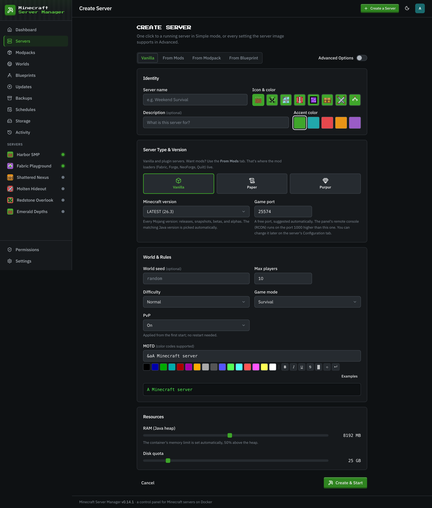

[← بازگشت به فهرست مستندات](/docs/)

## ایجاد سرور

روی **ایجاد سرور** (نوار بالا) یا کارت **ایجاد سرور** کلیک کنید تا جادوگر باز شود.

جادوگر، پشته جاوا و سهمیه دیسک را از **پیش‌فرض‌های سرورهای جدید** در صفحه تنظیمات از پیش پر می‌کند، که مدیر می‌تواند در هر زمان آن را تغییر دهد. سرور جدید نیز حد مجاز CPU خود را از آنجا می‌گیرد.

شما انتخاب می‌کنید:

- یک **نام** (و توضیحات اختیاری، آیکون و رنگ برجسته). برچسب‌ها برای سازماندهی ناوگان شما بعداً در تنظیمات سرور اضافه می‌شوند.
- یک **نوع سرور**: Vanilla، Paper یا Purpur در تب **Vanilla**. برای سرور مود شده، تب **از مودها** بارگذار (Fabric، Forge، NeoForge یا Quilt)، نسخه Minecraft و ساخت بارگذار (آخرین یا یک نسخه خاص) را انتخاب می‌کند، سپس به شما امکان جستجو برای مودها را می‌دهد.
- یک **نسخه Minecraft**: `LATEST`، یک اسنپ‌شات یا یک نسخه خاص (شامل بتا و آلفا).
- یک **پورت بازی**: یک پورت آزاد پیشنهاد می‌شود. کنسول از راه دور (RCON) از پورت ۱۰۰۰ بالاتر (به طور پیش‌فرض) استفاده می‌کند. شما می‌توانید بعداً آن را تغییر دهید (به [تغییر پورت بازی](#changing-the-game-port) مراجعه کنید).
- **منابع**: پشته جاوا (محدودیت حافظه کانتینر ۵۰٪ بالاتر از آن تنظیم شده است) و سهمیه دیسک.

**گزینه‌های پیشرفته** تمام تنظیمات دیگر پشتیبانی شده توسط ایمیج سرور، به علاوه متغیرهای محیطی اضافی و (برای مدیران) تنظیمات پیشرفته Docker را باز می‌کند.

بسته‌های مود را ترجیح می‌دهید؟ تب **از بسته مود** به جای آن یک بسته CurseForge، Modrinth یا GT New Horizons را نصب می‌کند (به [بسته‌های مود](/docs/modpacks/) مراجعه کنید)، یا یک **فشرده سفارشی که آپلود می‌کنید** را می‌گیرد: یک `.mrpack` از Modrinth، یک خروجی بسته مود CurseForge (`manifest.json`)، یا هر فایل فشرده‌ای از فایل‌های مود. مانیفست (یا رأی اکثریت در میان فایل‌های شناسایی شده) بارگذار و نسخه Minecraft را پر می‌کند، و هر مود در یک وظیفه نصب می‌شود. شما همچنین می‌توانید از یک [طرح کلی](/docs/blueprints/) ذخیره شده در تب **از طرح کلی** شروع کنید.

پنل به طور خودکار یک زمان اجرای جاوا منطقی برای نسخه شما انتخاب می‌کند، ایمیج را می‌کشد، کانتینر را ایجاد می‌کند و آن را راه‌اندازی می‌کند، همه از یک فرم واحد.

## لیست سرورها

صفحه **سرورها** کل ناوگان شما را با وضعیت و آمار سریع فهرست می‌کند.

## یک سرور واحد

باز کردن یک سرور به شما یک فضای کاری تب‌دار می‌دهد:

- **مرور کلی**: آدرس برای اشتراک‌گذاری با بازیکنان، توضیحات، استفاده زنده و افرادی که آنلاین هستند.
- **کنسول**: جریان لاگ زنده و ورودی دستور، چت درون بازی و [دستورات چت](/docs/console-and-chat/).
- **بازیکنان**: لیست، به علاوه موجودی و آمار.
- **مودها**: لیست مودهای نصب شده، [مرورگر مود](/docs/modpacks/) و به‌روزرسانی‌های محتوا. در یک سرور مود شده، زیر تب **نسخه‌ها** بررسی می‌کند که کدام نسخه‌های آینده Minecraft برای مودهای شما ساخت دارند ([به‌روزرسانی‌ها](/docs/updates/#minecraft-version-compatibility)).
- **جهان**: [جهان‌ها، نقشه زنده و مدیر فایل](/docs/worlds-and-files/).
- **پشتیبان‌گیری‌ها**: [اسنپ‌شات‌ها و بازیابی](/docs/backups/) برای این سرور.
- **نظارت**: تاریخچه و معیارهای زنده هر سرور، از جمله گزارش‌های خرابی (در زیر را ببینید).
- **تنظیمات**: **پیکربندی** (همه چیز در مورد نحوه اجرای سرور)، به علاوه [یکپارچه‌سازی‌ها](/docs/integrations/) (Discord، صفحه وضعیت، دعوت‌نامه‌ها و برای مدیران، چت‌بات).

کنترل‌های شروع، توقف و راه‌اندازی مجدد در بالای هر تب قرار دارند. آنچه شما می‌توانید در هر تب انجام دهید به [مجوزهای شما در آن سرور](/docs/users-and-roles/#per-server-permissions) بستگی دارد: به عنوان مثال، زیر تب **فایل‌ها** به مجوز فایل نیاز دارد و ارسال دستورات کنسول به کنسول نیاز دارد.

نوار **کنترل‌های جهان** در هر تب همراه شماست: ساعت درون بازی، آب و هوا، قوانین رایج بازی به عنوان تراشه‌های سوئیچ، و "نمایش همه قوانین جهان" برای بقیه.

**نظارت → زنده** نمایش می‌دهد TPS و میلی‌ثانیه در هر تیک، یک کارت سلامت و پایداری با خرابی‌ها (۲۴ ساعت گذشته و ۷ روز)، کشته شدن به دلیل کمبود حافظه، و راه‌اندازی مجدد خودکار، و اندازه‌های هر جهان.

## تنظیمات سرور

**تنظیمات → پیکربندی** سطح پیکربندی کامل است: نام، توضیحات، MOTD، آیکون، رنگ و برچسب‌ها، منابع، پورت بازی، سیاست به‌روزرسانی، شروع در راه‌اندازی پنل و راه‌اندازی مجدد خودکار در صورت خرابی، هر متغیر محیطی که ایمیج سرور پشتیبانی می‌کند، تنظیمات پیشرفته Docker، و صادرات طرح کلی، کلون، بازسازی و حذف. تغییراتی که فقط پس از بازسازی سرور اعمال می‌شوند، بلافاصله ذخیره می‌شوند و منتظر می‌مانند: دکمه **اعمال تغییرات** در هدر سرور ظاهر می‌شود و همچنین در راه‌اندازی بعدی سرور اعمال می‌شوند.

**راه‌اندازی مجدد خودکار در صورت خرابی** یک سرور خراب را دوباره راه‌اندازی می‌کند، با انتظار بیشتر بین هر تلاش (۵، ۱۰، سپس ۲۰ ثانیه) و توقف پس از ۳ تلاش در عرض ۱۰ دقیقه. این خرابی‌هایی را که پنل به عنوان مشکل راه‌اندازی تشخیص می‌دهد (EULA، جاوا اشتباه، جهانی از نسخه جدیدتر، پورتی که استفاده شده، کمبود حافظه، کلید CurseForge گمشده) نادیده می‌گیرد، زیرا آن موارد ابتدا نیاز به رفع دارند. اگر اقدام دیگری با سرور مشغول باشد (پشتیبان‌گیری، بازیابی، تغییر پورت)، تا ۳۰ دقیقه صبر می‌کند و به محض اینکه کسی سرور را متوقف یا راه‌اندازی کند، تسلیم می‌شود.

تغییرات مستقیم تنظیمات همیشه در طول راه‌اندازی مجدد باقی می‌مانند. تغییر PvP یا دشواری که با ریل **کنترل‌های جهان** انجام می‌شود، یک سوئیچ لیست سفید در تب **بازیکنان**، یا ویرایش `server.properties` در ویرایشگر **فایل‌ها**، متغیر محیطی مطابق (اگر تنظیم شده باشد) را حذف می‌کند و سرور را برای بازسازی علامت‌گذاری می‌کند، بنابراین مقدار روی دیسک به جای اینکه در راه‌اندازی بعدی توسط ایمیج کانتینر مجدداً تأیید شود، برنده می‌شود.

**درباره متر حافظه.** "RAM (پشته جاوا)" به عنوان حداکثر و حداقل پشته به جاوا داده می‌شود، و جاوا پشته‌ای را که از قبل به آن داده شده است در دقیقه اول پر می‌کند، با یا بدون تنظیمات پیش‌فرض Aikar / MeowIce. بنابراین متر حافظه در حدود اندازه پشته تثبیت می‌شود و حتی زمانی که کسی بازی نمی‌کند در آنجا باقی می‌ماند؛ تیک روی متر نشان می‌دهد که پشته در زیر حد کانتینر قرار دارد و یادداشت زیر آن این را می‌گوید. اگر ترجیح می‌دهید حافظه از استفاده واقعی پیروی کند، یک پشته شروع کوچکتر به سرور بدهید با **پشته اولیه** در کارت منابع در **تنظیمات → پیکربندی** (یا زیر **گزینه‌های پیشرفته** در جادوگر)، به عنوان مثال ۵۱۲ مگابایت: در یک پشته ۲ گیگابایتی که استفاده بیکار را از ۲.۶ گیگابایت به حدود ۱.۳ گیگابایت در اندازه‌گیری‌های ما رساند. جاوا همچنین به حافظه خارج از پشته (حدود ۰.۵ گیگابایت در Vanilla، ۱.۵ تا ۲ گیگابایت در یک بسته مود بزرگ) نیاز دارد، که فضای اضافی حد کانتینر برای آن است. برای اعداد به "دو حد حافظه" در README مراجعه کنید.

> **تنظیمات پیشرفته Docker** (نام کانتینر، شبکه Docker، نگاشت پورت اضافی، و اتصال حجم اضافی) **فقط برای مدیران** است، زیرا یک اتصال حجم به علاوه دسترسی Docker پنل به طور موثر روت روی هاست است. به [کاربران و نقش‌ها](/docs/users-and-roles/) مراجعه کنید.

### تغییر پورت بازی

کارت **پورت بازی** در **تنظیمات → پیکربندی** سرور را در هر زمان به پورت دیگری منتقل می‌کند، با دکمه **ذخیره پورت** مخصوص به خود. **استفاده از پورت آزاد بعدی** کمترین پورت آزاد را انتخاب می‌کند و کارت قبل از ذخیره کردن هر پورتی که وارد می‌کنید، آن را بررسی می‌کند. RCON همیشه در ۱۰۰۰ بالاتر از پورت بازی (افست پیش‌فرض) دنبال می‌شود. مدیران می‌توانند هر پورتی را از ۱۰۲۴ به بالا انتخاب کنند؛ همه دیگر از اولین پورت بازی (به طور پیش‌فرض ۲۵۵۶۵) به بالا انتخاب می‌کنند. ذخیره کردن بلافاصله تغییر را اعمال می‌کند: یک سرور متوقف شده فقط جابجا می‌شود، و یک سرور در حال اجرا ابتدا سؤال می‌کند، سپس در پورت جدید راه‌اندازی مجدد می‌شود (جهان ابتدا ذخیره می‌شود و بازیکنان در پورت جدید دوباره متصل می‌شوند). اگر سرور نتواند در پورت جدید راه‌اندازی شود، به پورت قدیمی برمی‌گردد. تغییر در حالی که تغییرات دیگر منتظر **اعمال تغییرات** هستند، رد می‌شود، بنابراین ابتدا آن‌ها را اعمال کنید. تغییر پورت نیاز به مجوز تنظیمات در آن سرور دارد.

## گزارش‌های خرابی و تحلیل mclo.gs

گزارش‌های خرابی (`crash-reports/*.txt` و فایل‌های JVM `hs_err_pid*.log`) به طور خودکار دریافت می‌شوند، به یک خلاصه یک خطی با استثنا و مودهای مشکوک تجزیه می‌شوند و در زیر **نظارت → تاریخچه** فهرست می‌شوند:

هر کارت گزارش یک نمایشگر داخلی (با بخش‌های قابل جمع شدن و استثناهای برجسته)، کپی کردن پشته استثنا، و دانلود را ارائه می‌دهد، به علاوه دو اقدام [mclo.gs](https://mclo.gs):

- **اشتراک‌گذاری در mclo.gs** گزارش را به عنوان یک چسب عمومی منتشر می‌کند و لینک را کپی می‌کند: دقیقاً همان چیزی که نویسندگان مود و دیسکوردهای پشتیبانی درخواست می‌کنند. لینک روی گزارش به خاطر سپرده می‌شود، بنابراین هیچ چیز هرگز دو بار آپلود نمی‌شود.
- **تحلیل** بینش‌های خودکار mclo.gs را بر روی چسب اجرا می‌کند: مشکلات شناخته شده با راه‌حل‌های پیشنهادی (وابستگی‌های گمشده، عدم تطابق نسخه، تداخلات رایج مود)، که مستقیماً در پنل نمایش داده می‌شوند.

هر دو اقدام پشت تأیید صریح قرار دارند، زیرا یک چسب عمومی است: گزارش‌های خرابی می‌توانند نام بازیکنان و لیست کامل مود شما را شامل شوند. پنل هرگز چیزی را به تنهایی آپلود نمی‌کند.
