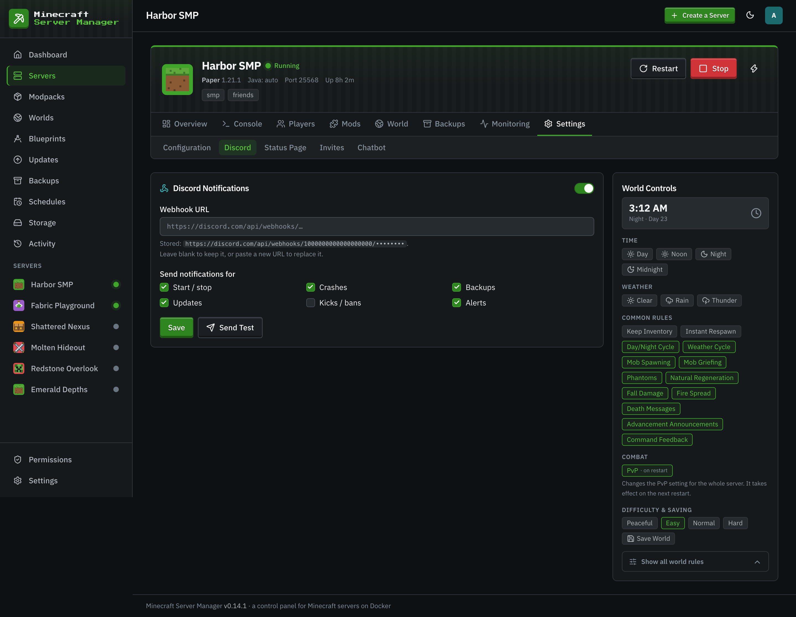

[← Takaisin dokumenttien luetteloon](/docs/)

Jokaisella palvelimella on integrointinsa **Asetukset**-ryhmässä: **Discord**, julkinen **Tilatiedote**, kertakäyttöiset **Kutsut** ja valinnainen **Chatbot**-välilehti (vain ylläpitäjille). Tämä sivu käsittelee Discordia; [kutsut ja tilatiedote](/docs/invites-and-status-page/) käsittelevät näitä kahta, ja [chatbotilla](/docs/chatbot/) on oma sivunsa.

## Discord-ilmoitukset

Paneeli välittää palvelintapahtumia Discord-kanavalle webhookin kautta. Ei bottia, ei OAuthia.

### Asennus

1. Discordissa: **Server Settings → Integrations → Webhooks → New Webhook**. Valitse kanava ja kopioi webhook-URL.
2. Paneelissa avaa palvelimen **Asetukset → Discord** -välilehti, liitä URL **Webhook URL** -kenttään, kytke kortti **päälle** ja paina **Tallenna**. URL tallennetaan salattuna (samassa levossa olevassa tallennustilassa kuin API-avaimesi).
3. Käytä **Send Test** -painiketta varmistaaksesi, että se toimii.

Jos haluat korvata tallennetun URL-osoitteen, liitä uusi ja tallenna; jätä kenttä tyhjäksi säilyttääksesi nykyisen. Tallennettu URL-osoite näytetään peitettynä (token on piilotettu).

### Mitä lähetetään

Ilmoitukset on ryhmitelty kytkettäviin luokkiin. Kaikki ovat oletuksena päällä.

| Kategoria                 | Tapahtumat                                                         |
| ------------------------- | ------------------------------------------------------------------ |
| **Käynnistys / pysäytys** | Palvelin käynnistyi, palvelin pysähtyi                             |
| **Kaatumiset**            | Kaatui, kaatumisloop havaittu, uusi kaatumisraportti               |
| **Varmuuskopiot**         | Varmuuskopio luotu, varmuuskopio palautettu                        |
| **Päivitykset**           | Päivitys tehty, päivitys peruutettu, päivitys epäonnistui          |
| **Potkut / bannit**       | Pelaaja potkittu, pelaaja bannattu                                 |
| **Hälytykset**            | Asiat, jotka hiljaa jättävät palvelimen rikkinäiseksi (katso alla) |

### Hälytykset-kategoria

`Alerts` on "jotain vaatii ihmisen huomiota" -kanava, tilanteisiin, jotka olivat aiemmin näkyvissä vain paneelissa:

| Tapahtuma               | Merkitys                                                                                                                                   |
| ----------------------- | ------------------------------------------------------------------------------------------------------------------------------------------ |
| `oom`                   | Säiliö pysäytettiin muistin loppumisen vuoksi.                                                                                             |
| `unhealthy`             | Prosessi on käynnissä, mutta `mc-health`-tarkistus epäonnistuu: elävä mutta kuollut palvelin.                                              |
| `startup-stalled`       | Käynnistyy edelleen noin 10 minuutin kuluttua ilman "Done"-merkintää lokeissa (diagnoosilla siitä, mitä korjata, jos sellainen tunnetaan). |
| `stop-failed`           | Siisti pysäytys ei onnistunut ja säiliö on edelleen käynnissä.                                                                             |
| `schedule-failed`       | Aikataulutettu uudelleenkäynnistys / varmuuskopiointi / komento epäonnistui.                                                               |
| `quota-exceeded`        | Tiukassa tilassa levytila kiintiö ylittyi ja palvelin pysäytettiin.                                                                        |
| `offline-after-restart` | Palvelin oli käynnissä ennen paneelin uudelleenkäynnistystä, ei ole nyt, eikä sitä käynnistetä automaattisesti uudelleen.                  |
| `port-change-failed`    | Portin vaihto epäonnistui eikä palvelinta voitu laittaa takaisin vanhaan porttiin, joten se on alhaalla.                                   |
| `auto-restart-gave-up`  | Kaatunutta palvelinta ei käynnistetty uudelleen, koska toinen toiminto piti sitä liian kauan kiireisenä.                                   |

### Miten toimitus toimii

Taustalla oleva silta tarkistaa [tapahtumalokin](/docs/activity/) 15 sekunnin välein ja välittää yhdistetyt rivit. Jos webhook POST epäonnistuu väliaikaisesti, kyseistä riviä yritetään uudelleen myöhemmissä tarkistuksissa pudottamisen sijaan; muutaman epäonnistuneen yrityksen jälkeen rivi ohitetaan, ja toimitusvirheet kirjataan enintään kerran tunnissa per palvelin. Paneelin uudelleenkäynnistyksen jälkeen silta lähettää tapahtumat, joita se ei ollut vielä toimittanut, mutta ei koskaan enempää kuin kaksi tuntia taaksepäin; ensimmäisellä ajokerrallaan se aloittaa uusimmasta tapahtumasta.
