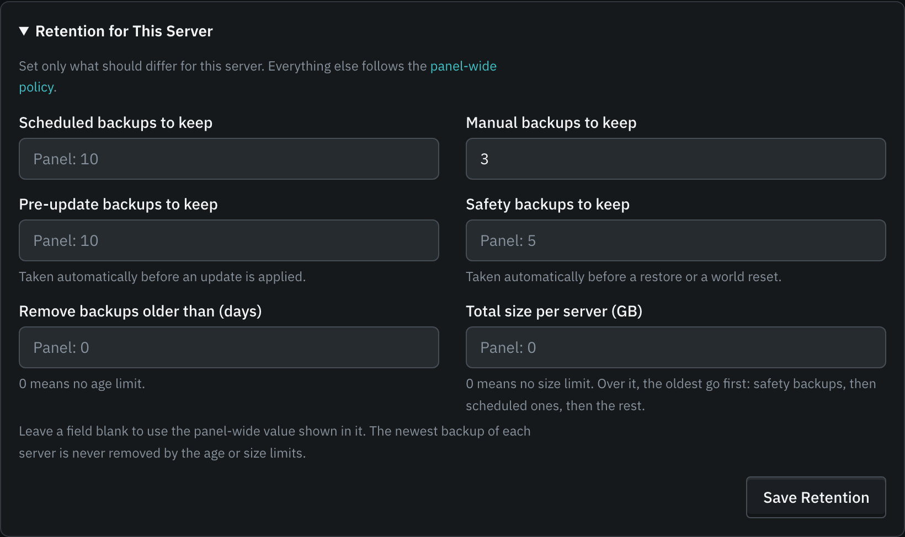

[← Retour à l'index de la documentation](/docs/)

La page **Sauvegardes** répertorie toutes les instantanés de votre parc de serveurs, avec leur taille, leur raison et leur âge, filtrables par serveur et par raison.

## Créer une sauvegarde

Depuis l'onglet **Sauvegardes** d'un serveur (ou via une [planification](/docs/schedules/)), vous pouvez créer un instantané de l'intégralité du répertoire du serveur en un clic. Le panneau met d'abord le monde en veille (`save-off` → `save-all`), compresse les données, puis réactive la sauvegarde (`save-on`), de sorte que les sauvegardes sont cohérentes même sur un serveur en cours d'exécution. La compression s'exécute dans un thread d'arrière-plan afin de ne pas bloquer le panneau. Une sauvegarde démarrée via l'API peut comporter une note.

Chaque archive est **vérifiée en intégrité** au moment où elle est écrite : le panneau rouvre le zip et lit son répertoire. Une archive corrompue ou impossible à ouvrir est supprimée et l'appel de sauvegarde échoue immédiatement, plutôt que le problème ne se manifeste des mois plus tard lorsqu'une restauration est la seule chose qui vous sépare de la perte de données. Une archive sans entrée (un serveur qui n'a jamais démarré) est autorisée mais signalée dans l'événement.

Cochez **"Réduire également le monde après"** (dans l'onglet Sauvegardes, ou dans une planification de sauvegarde) pour supprimer les morceaux rarement visités une fois que l'archive est sauvegardée en toute sécurité (voir **[Réduction d'un monde](/docs/world-shrink/)**). La réduction ne s'exécute que lorsque le serveur est arrêté ; sur un serveur en cours d'exécution, la sauvegarde a toujours lieu et la réduction est ignorée.

## Raisons des sauvegardes

Les sauvegardes sont étiquetées en fonction de la raison pour laquelle elles ont été prises :

- **manuelle** : vous avez cliqué sur **Sauvegarder maintenant**. Remplacer le monde actif d'un serveur par un autre de la bibliothèque effectue également une sauvegarde `manuelle` au préalable.
- **planifiée** : créée par une [planification](/docs/schedules/). Chaque nouveau serveur reçoit également une sauvegarde planifiée quotidienne automatique (répartie entre 02h00 et 05h59), de sorte qu'un serveur bénéficie d'une couverture automatique dès le premier jour, pas seulement avant les mises à jour.
- **pré-mise à jour** : prise automatiquement avant une mise à niveau de pack ou un changement de version de Minecraft, de sorte qu'une mise à niveau est toujours réversible.
- **pré-restauration** : prise automatiquement juste avant une restauration ou une réinitialisation du monde, comme filet de sécurité au cas où la restauration ne serait pas ce que vous vouliez.

## Rétention

La rétention est plafonnée **par serveur, par raison** : les plus récentes de chaque groupe sont conservées, les plus anciennes sont automatiquement élaguées après chaque sauvegarde réussie :

| Raison           | Conservé par défaut |
| ---------------- | ------------------- |
| planifiée        | 10                  |
| pré-mise à jour  | 10                  |
| manuelle         | 20                  |
| pré-restauration | 5                   |

`pré-restauration` (appelées sauvegardes de sécurité dans le panneau) dispose de son propre petit espace dédié afin qu'une sauvegarde de sécurité automatique ne puisse jamais évincer une sauvegarde `manuelle` que vous avez délibérément conservée.

Deux plafonds optionnels s'appliquent en plus des décomptes par raison, tous deux désactivés par défaut : un **âge maximum** (les sauvegardes plus anciennes que N jours sont élaguées, quelle que soit leur raison) et une **taille totale maximale** par serveur (les plus anciennes sont élaguées jusqu'à ce que le total corresponde : les sauvegardes de sécurité d'abord, puis les planifiées, puis le reste). La sauvegarde la plus récente d'un serveur n'est jamais élaguée par l'un ou l'autre plafond.

### Modification

Les administrateurs définissent la politique globale du panneau dans la carte **Rétention des sauvegardes** de la page **Paramètres** (**Remplir les valeurs par défaut** remet les valeurs par défaut ci-dessus dans le formulaire, prêtes à être enregistrées). Un serveur peut différer sur l'une des six valeurs : ouvrez son onglet **Sauvegardes** et développez **Rétention pour ce serveur**. Chaque champ y est vide sauf si ce serveur le définit, et un champ vide suit la valeur globale du panneau (affichée à l'intérieur). Ainsi, un serveur peut, par exemple, conserver 3 sauvegardes planifiées et utiliser les valeurs globales du panneau pour tout le reste ; effacer un champ le remet sur la valeur globale du panneau.

L'enregistrement ne supprime jamais rien par lui-même. Si les nouvelles limites laissaient des sauvegardes existantes au-dessus de la limite, le panneau liste, par serveur, combien de sauvegardes de chaque type seraient supprimées, combien d'espace cela libérerait et quel est l'âge de la plus ancienne. Il indique également quand un serveur dépassait déjà ses limites avant ce changement (par exemple, après une précédente **À partir de la prochaine sauvegarde**), car l'application maintenant supprime tout ce qui dépasse la limite, pas seulement ce que cet edit ajoute. Ensuite, il demande comment les appliquer :

- **Supprimer maintenant** supprime exactement les sauvegardes qu'il vient de lister, rien de plus : une sauvegarde effectuée entre-temps attend le prochain élagage. Depuis la page Paramètres, un serveur en cours de restauration, de sauvegarde ou d'action similaire est ignoré et élague après sa prochaine sauvegarde ; sur l'onglet Sauvegardes d'un serveur, il vous est demandé de réessayer une fois cette action terminée. Pendant que les anciennes sauvegardes d'un serveur sont supprimées (généralement quelques secondes), d'autres actions sur ce serveur doivent attendre : une sauvegarde planifiée ou un démarrage qui arrive alors réessaie toutes les minutes jusqu'à ce qu'il puisse (jusqu'à 30 minutes), un serveur planté est redémarré environ 20 secondes après sa fin (jusqu'à 30 minutes), et un redémarrage ou un arrêt planifié qui entre en collision avec lui est ignoré jusqu'à sa prochaine échéance.
- **À partir de la prochaine sauvegarde** les conserve pour l'instant ; chaque serveur élague ses sauvegardes lors de la prochaine création, comme il l'a toujours fait.

Une sauvegarde en cours de restauration n'est jamais supprimée tant que la restauration s'exécute : la rétention la laisse tranquille (et ne supprime pas d'autres sauvegardes pour faire de la place), et sa suppression manuelle est refusée jusqu'à la fin de la restauration.

Les mêmes paramètres sont disponibles pour les scripts via les points d'accès de l'API admin : `GET`/`POST /api/backups/retention` et `/api/servers/:id/backups/retention`. Les valeurs globales du panneau ne peuvent pas être `null`. Pour un serveur, une valeur de `null` (ou `""`) supprime cette clé spécifique, le faisant à nouveau suivre la valeur globale du panneau, et `{ "reset": true }` les supprime toutes. Sous chacun de ces deux chemins, `POST …/preview` signale ce qu'un changement supprimerait sans le supprimer (`backups`, `bytes`, `servers`, `ids` et une ventilation par serveur `byServer`), et `POST …/apply` applique la politique enregistrée maintenant et répond `{ deleted, skipped }` globalement (`skipped` compte les serveurs occupés) ou `{ deleted }` pour un serveur. Envoyez le `{ "token": "..." }` de l'aperçu (conservé pendant 10 minutes) ou son `{ "ids": [...] }` pour supprimer uniquement ceux-ci ; sans l'un ou l'autre, tout ce qui dépasse la limite est supprimé. Une application par serveur sur un serveur occupé répond 409.

Les sauvegardes peuvent être **renommées** depuis la liste des sauvegardes (le bouton renommer sur chaque ligne). L'archive sur disque et l'enregistrement du panneau bougent ensemble, de sorte que le téléchargement, la restauration et la rétention continuent de fonctionner avec le nouveau nom.

> La rétention est plafonnée automatiquement, mais les grosses archives moddées comptent toujours dans le [quota de disque](/docs/storage/) d'un serveur, alors gardez un œil sur le total pour les gros packs.

## Restauration

La restauration d'une sauvegarde arrête le serveur (en vérifiant que le conteneur s'est bien arrêté avant de toucher aux fichiers), prend une sauvegarde de sécurité `pré-restauration`, remplace **l'intégralité du répertoire du serveur** par l'instantané, et le laisse arrêté pour que vous puissiez le redémarrer. L'archive est décompressée sur le côté d'abord et échangée uniquement une fois qu'elle est entièrement extraite, de sorte qu'une restauration qui échoue à mi-chemin laisse les fichiers actuels intacts. Comme les mises à niveau de pack prennent toujours une sauvegarde `pré-mise à jour` d'abord, vous pouvez toujours annuler une mauvaise mise à niveau.

## La base de données du panneau elle-même

Les sauvegardes de serveur ne couvrent que le dossier de chaque serveur. La base de données du panneau elle-même (`panel.db`, contenant les utilisateurs, les rôles, les secrets 2FA, les planifications, les épingles de pack et l'historique) est instantanée séparément lors de la minuterie de maintenance quotidienne :

- `VACUUM INTO` écrit une copie cohérente et défragmentée dans `backups/_panel/` dans le dossier de données ; les **14** plus récentes sont conservées.
- Au démarrage, le panneau exécute `PRAGMA integrity_check` et enregistre bruyamment en cas d'échec, vous indiquant `backups/_panel` pour la copie valide la plus récente.

Sauvegardez l'intégralité du dossier de données (il contient également `.secret-key`, la clé de chiffrement au repos) et vous aurez tout sauvegardé.
