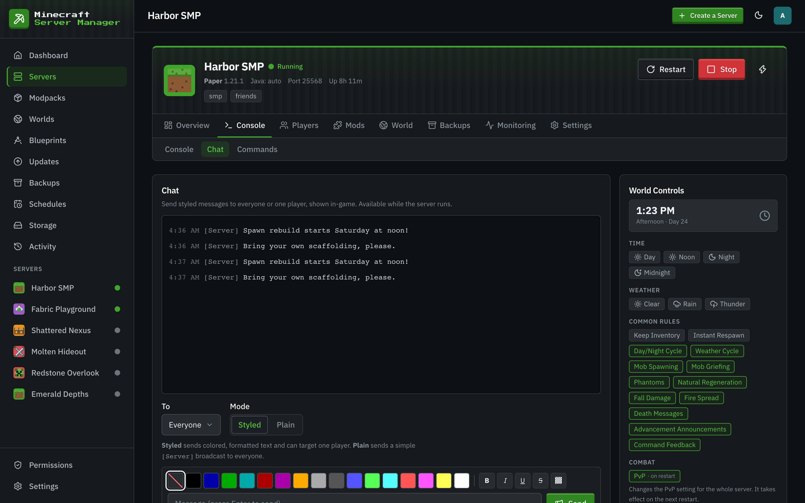

[← Retour à l'index des docs](/docs/)

## La console en direct

L'onglet **Console** diffuse le journal du serveur en temps réel et vous fournit une zone de saisie pour envoyer n'importe quelle commande du serveur. Pas besoin de `docker exec`, ni de SSH. La sortie revient directement, avec les couleurs et tout le reste. L'envoi de commandes nécessite la permission Console sur ce serveur ; sans elle, vous pouvez toujours regarder le journal.

Au-dessus du journal, vous pouvez filtrer les lignes par texte (ou par `/regex/`) et par niveau (INFO, WARN, ERROR), et **Télécharger** propose la sortie récente, le fichier `latest.log` complet, ou tous les fichiers journaux dans une archive zip.

La console est également l'endroit où le panneau lit l'état du serveur : il surveille le journal pour classer la phase de démarrage ("Chargement des mods", "Génération du monde", "Finalisation du démarrage") et appelle `list` pour suivre qui est en ligne, afin que le tableau de bord et les cartes de serveur reflètent toujours la réalité.

Ce sondage ouvre une connexion RCON de courte durée à chaque cycle, ce qui est enregistré dans le journal du serveur comme une paire `Thread RCON Client … started` / `shutting down` toutes les ~20 secondes, et (sur les serveurs dont le cœur ou les plugins le répètent) une ligne `Rcon issued server command: …` pour chaque lecture seule (`list` pour le nombre de joueurs, ainsi que des lectures de `time query …` et `gamerule <name>` lorsque les Contrôles du Monde sont ouverts). Le bouton **Masquer le bruit de la console** au-dessus du journal filtre ces lignes (ainsi que les lignes de démarrage du listener RCON). Il est activé par défaut et mémorisé par navigateur ; désactivez-le pour voir le flux brut.

Les commandes envoyées depuis le panneau peuvent être annoncées en jeu sous une étiquette par serveur (la zone **Annoncer comme…**), afin que les joueurs sachent qu'un opérateur a agi plutôt qu'une console mystérieuse.

## Chat

**Console → Chat** envoie des messages dans le jeu pendant que le serveur fonctionne : les messages **Stylisés** prennent en compte les couleurs et la mise en forme et peuvent être envoyés à tout le monde ou à un joueur en ligne, et **Simple** envoie une diffusion basique `[Server]` à tout le monde.

## Commandes de chat

Les commandes de chat (**Console → Commandes**) permettent aux joueurs de déclencher des actions du panneau en tapant une commande préfixée dans le chat du jeu, par exemple `!spawn` pour une téléportation aléatoire. La détection est basée sur le journal et l'exécution passe par le serveur, donc **aucun mod n'est requis**.

Chaque commande a :

- Un **déclencheur** (par exemple, `spawn`), tapé après le **préfixe** du serveur (`!` par défaut, un ou deux caractères, jamais `/`).
- Une **action** : téléportation aléatoire, téléportation vers une structure, téléportation vers un biome, ou exécution de commandes console brutes.
- Un **niveau de permission** : tout le monde, joueurs sur liste blanche, ou opérateurs uniquement.
- Un **délai d'attente** par joueur (30 secondes par défaut), et des messages personnalisables de pending / succès / échec avec des espaces réservés comme `{distance}`.

### Une note sur la sécurité

Les commandes qui peuvent endommager un serveur (`stop`, `op`, `ban`, `whitelist`, et similaires) ne sont autorisées que pour les déclencheurs **réservés aux opérateurs**. Le panneau vérifie cela même lorsqu'elles sont imbriquées dans une chaîne `execute … run …`, de sorte qu'un déclencheur de faible permission ne peut pas introduire une commande dangereuse en douce. Le texte ordinaire du chat qui mentionne simplement ces mots (comme un message `say`) n'est pas affecté.
