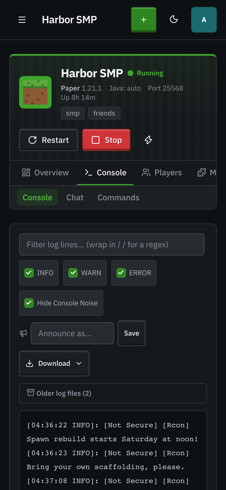

[← Retour à l'index de la documentation](/docs/)

## Configuration initiale

La première fois que vous ouvrez le panneau, un court assistant de configuration vous guide :

1.  **Vérification du système** s'assure que Docker est accessible, que Node.js est suffisamment récent et que le dossier de données est accessible en écriture. Si Docker n'est pas encore en cours d'exécution, vous pouvez continuer ; la création et le démarrage des serveurs attendront qu'il le soit.
2.  **Créez votre compte administrateur**. C'est le seul compte existant jusqu'à ce que vous en ajoutiez d'autres, et il dispose d'un contrôle total. Choisissez un nom d'utilisateur (2 à 32 caractères) et un mot de passe d'au moins 8 caractères. Vous êtes connecté dès sa création.
3.  **Configuration du panneau** (facultatif) : un domaine public à afficher aux joueurs dans les adresses de connexion, une clé API CurseForge et votre fuseau horaire. Tout cela peut être modifié ultérieurement dans **Paramètres**.

La dernière étape propose **Créer un serveur** ou **Aller au tableau de bord**.

> **Les installations exposées sont protégées par un code PIN.** Si vous démarrez le panneau lié à une adresse non-boucle (`PANEL_HOST` autre que `127.0.0.1`), la page de configuration demande également un **code PIN à 6 chiffres**. Le panneau l'affiche dans sa console au démarrage. Entrez-le avec votre nom d'utilisateur et votre mot de passe. Cela empêche un étranger qui atteint le port en premier de revendiquer le compte administrateur. Le code PIN disparaît une fois le compte administrateur créé.

## Connexion

Après la configuration, le panneau est protégé par un écran de connexion. Entrez votre nom d'utilisateur et votre mot de passe pour continuer.

Si l'[authentification à deux facteurs](/docs/two-factor-authentication/) est activée sur votre compte, un code à 6 chiffres de votre application d'authentification vous sera demandé juste après votre mot de passe.

## Se repérer

Tout est accessible via la barre latérale gauche :

- **Tableau de bord** - tous les serveurs en un coup d'œil ([détails](/docs/dashboard/)).
- **Serveurs**, **Modpacks**, **Mondes**, **Blueprints** - créez et gérez les serveurs et leur contenu.
- **Mises à jour**, **Sauvegardes**, **Planifications**, **Stockage**, **Activité** - le côté opérationnel : ce qui est obsolète, vos instantanés, l'automatisation, l'utilisation du disque et le journal d'audit.
- **Permissions** (en bas, administrateurs uniquement) : ce que chaque utilisateur peut faire sur chaque serveur ([détails](/docs/users-and-roles/#per-server-permissions)).
- **Paramètres** (en bas, administrateurs uniquement) : clés API, configuration du panneau, valeurs par défaut pour les nouveaux serveurs, [rétention des sauvegardes](/docs/backups/#retention), utilisateurs, sécurité de connexion et API publique.

En dessous, la barre latérale liste vos serveurs. L'ouverture d'un serveur affiche ses propres onglets : **Aperçu**, **Console**, **Joueurs**, **Mods**, **Monde**, **Sauvegardes**, **Surveillance** et **Paramètres**, la plupart avec des sous-onglets associés (par exemple, **Paramètres → Configuration** contient les paramètres du serveur et son port de jeu). Voir [Un serveur unique](/docs/servers/#a-single-server).

La barre supérieure contient le bouton **Créer un serveur**, un **sélecteur de thème** (sombre/clair) et votre **menu de compte**, où vous pouvez changer votre photo de profil, gérer l'[authentification à deux facteurs](/docs/two-factor-authentication/) ou vous déconnecter.

## Sur un téléphone ou une tablette

Chaque page est conçue d'abord pour un écran étroit et s'élargit ensuite : la barre latérale se cache derrière le bouton de menu, les tableaux de données s'empilent en cartes, les barres d'outils s'enroulent et le rail des contrôles du monde se réduit à une carte que vous ouvrez lorsque vous en avez besoin. Les boutons et les puces ont une taille de cible tactile réelle. Rien n'est exclusif aux ordinateurs de bureau.

  
  
  
  
  
  

## Ce dont vous avez besoin

Le panneau communique avec Docker pour exécuter des serveurs, il a donc besoin d'accéder à un démon Docker (Docker Desktop ou une socket Docker Engine). Lorsque Docker est accessible, la tuile Docker du tableau de bord affiche **Connecté** et sa version. S'il ne l'est pas, le panneau fonctionne toujours. Vous ne pourrez simplement pas démarrer de serveurs tant que le démon n'est pas actif.

## Prochaines étapes

- [Créez votre premier serveur →](/docs/servers/)
- [Sécurisez votre compte avec la 2FA →](/docs/two-factor-authentication/)
