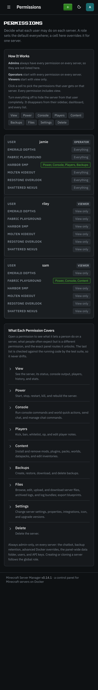

[← Retour à l'index des documents](/docs/)

Le panneau est multi-utilisateurs. Gérez les comptes sous **Paramètres → Utilisateurs**.

## Les trois rôles

| Rôle         | Par défaut sur chaque serveur                                                                                                                                          |
| ------------ | ---------------------------------------------------------------------------------------------------------------------------------------------------------------------- |
| **admin**    | Tout : gestion des utilisateurs, des clés API, des fichiers globaux, des remplacements Docker avancés et de toutes les actions serveur.                                |
| **operator** | Exécute et configure les serveurs (démarrer/arrêter, console, sauvegardes, mondes, mods, la plupart des paramètres), mais pas les zones réservées aux administrateurs. |
| **viewer**   | Lecture seule. Affiche les serveurs et leur état, mais n'effectue aucune modification.                                                                                 |

Chaque utilisateur, y compris un spectateur, peut gérer sa propre [authentification à deux facteurs](/docs/two-factor-authentication/), car la protection de sa propre connexion n'est pas une action de gestion de serveur.

Un rôle est le **défaut** pour chaque serveur. Pour accorder des droits différents à quelqu'un sur un serveur, utilisez les permissions par serveur ci-dessous.

## Permissions par serveur

La page **Permissions** (dans la barre latérale, ou **Permissions du serveur** sous **Paramètres → Utilisateurs**) affiche une grille : chaque opérateur et spectateur sur le côté, chaque serveur en haut. Cliquez sur une cellule pour décider ce que cet utilisateur peut faire sur ce serveur spécifique. Les administrateurs ne sont pas listés car ils ont toujours tout.

Chaque cellule est un ensemble de permissions :

| Permission   | Ce qu'elle permet sur ce serveur                                                                                                               |
| ------------ | ---------------------------------------------------------------------------------------------------------------------------------------------- |
| **View**     | Voir le serveur, son état, la sortie de la console, les joueurs, l'historique et les statistiques.                                             |
| **Power**    | Démarrer, arrêter, redémarrer, tuer et reconstruire le serveur.                                                                                |
| **Console**  | Exécuter des commandes de console et des actions rapides du monde, envoyer du chat et gérer les commandes de chat.                             |
| **Players**  | Expulser, bannir, mettre sur liste blanche, opérer et modifier les notes des joueurs.                                                          |
| **Content**  | Installer et supprimer des mods, plugins, packs, mondes, datapacks, et modifier les inventaires.                                               |
| **Backups**  | Créer, restaurer, télécharger et supprimer des sauvegardes.                                                                                    |
| **Files**    | Parcourir, modifier, télécharger et importer des fichiers serveur, des journaux archivés et des paquets de journaux ; exporter des blueprints. |
| **Settings** | Modifier les paramètres du serveur, les propriétés, les intégrations, l'icône et mettre à jour les versions.                                   |
| **Delete**   | Supprimer le serveur.                                                                                                                          |

Sous la grille, **Ce que couvre chaque permission** détaille ce qu'une personne peut faire, ce qui n'est pas inclus, et les routes exactes du panneau qu'elle déverrouille. Cette dernière liste est vérifiée par rapport au code en cours d'exécution par la suite de tests.

Sur un téléphone, la grille s'empile en une carte par utilisateur, avec une ligne par serveur.

  

Comment les pièces s'assemblent :

- **Le rôle est le défaut.** Un opérateur commence avec toutes les permissions sur tous les serveurs ; un spectateur commence uniquement avec la permission "View". Une cellule en texte grisé (son info-bulle indique "Défaut du rôle") n'a jamais été modifiée.
- **Une cellule remplace le rôle pour ce serveur uniquement.** Donnez à un spectateur les permissions "Power" et "Console" sur un serveur et il pourra l'exécuter, tandis que tous les autres serveurs resteront en lecture seule pour lui. Retirez la permission "Delete" d'un opérateur sur votre serveur principal et il conservera tout le reste sur ce serveur.
- **Chaque permission inclut "View".** Vous ne pouvez pas agir sur un serveur que vous ne pouvez pas voir.
- **Désactivez tout pour masquer un serveur.** Il disparaît de la barre latérale de cet utilisateur, du tableau de bord, des sauvegardes, des planifications, de l'activité, des mises à jour, des modpacks, de l'état en direct, des tâches en cours et des blueprints, et la bibliothèque de mondes cesse de le nommer. Un lien direct, un appel API ou une socket console répondra "non trouvé", tout comme un serveur qui n'existe pas.
- **Les actions globales du panneau suivent toujours le rôle.** La création de serveurs (y compris le clonage), le stockage, les utilisateurs, les clés API, les paramètres globaux et les planifications globales ne sont pas par serveur, donc un spectateur ayant des permissions sur certains serveurs ne peut toujours pas faire l'une de ces choses. Les opérateurs conservent la création de serveurs et les planifications globales ; le stockage, les utilisateurs, les clés API et les paramètres globaux sont réservés aux administrateurs.
- **Les planifications suivent le serveur.** Une planification de redémarrage, de sauvegarde ou de commande sur un serveur nécessite la permission correspondante sur ce serveur (Power, Backups ou Console), quel que soit le rôle.
- **Les blueprints suivent également le serveur.** L'exportation d'un serveur en tant que blueprint nécessite la permission "Files" sur ce serveur, car l'archive contient ses fichiers. Un blueprint exporté à partir d'un serveur que quelqu'un ne peut pas voir lui sera également caché.
- **Les zones réservées aux administrateurs restent réservées aux administrateurs** sur tous les serveurs : le chatbot, la rétention des sauvegardes et les remplacements Docker avancés.

Chaque modification est enregistrée dans le journal d'activité avec qui a modifié quoi ; ces entrées sont montrées uniquement aux administrateurs. La suppression d'un utilisateur supprime ses lignes. La suppression d'un serveur les conserve, de sorte qu'un serveur caché à quelqu'un reste caché dans son historique et ses sauvegardes conservées.

Les installations existantes continuent de fonctionner sans modification : jusqu'à ce qu'un administrateur modifie une cellule, chaque utilisateur dispose exactement de ce que son rôle lui a donné auparavant.

## Réservé aux administrateurs, et pourquoi

Quelques éléments sont délibérément restreints aux administrateurs :

- **Gestion des utilisateurs, stockage, paramètres globaux, clés API et fichiers globaux.**
- **L'[API publique](/docs/public-api/)** : activation de `/api/v1` et création, portée ou révocation de ses jetons Bearer en lecture seule.
- **Remplacements Docker avancés** : nom de conteneur personnalisé, publications de ports supplémentaires et montages de liaison. Un montage de liaison peut mapper n'importe quel chemin d'hôte dans un conteneur, et combiné avec l'accès Docker du panneau, cela équivaut à un accès root sur l'hôte. Ces champs n'apparaissent que pour les administrateurs.

Les noms de conteneurs personnalisés ne peuvent pas non plus résider dans l'espace de noms `msm-` du panneau, de sorte qu'un conteneur nommé manuellement ne peut jamais masquer un autre serveur et rediriger un arrêt ou une commande vers la mauvaise instance.

## Gestion des comptes

Les administrateurs peuvent créer des utilisateurs, modifier les rôles, réinitialiser les mots de passe et supprimer des comptes depuis le tableau des utilisateurs. La colonne **2FA** indique si chaque utilisateur a activé l'authentification à deux facteurs ; un administrateur peut réinitialiser la 2FA d'un autre utilisateur avec **Réinitialiser la 2FA** dans le menu d'actions de cet utilisateur (pour le cas du téléphone perdu et des codes de sauvegarde), mais jamais désactiver la sienne sans son mot de passe, ce que le flux d'auto-service gère à la place.

Les tentatives de connexion échouées sont limitées par compte (un compteur par IP et un compteur global par compte) pour ralentir les tentatives de force brute, et la même limite couvre l'étape du code 2FA afin qu'un mot de passe correct ne puisse pas réinitialiser le compteur avant la devinette du code. Devant cela se trouve un limiteur de requêtes plus grossier par IP client sur les points d'accès de connexion / 2FA / configuration, réglable via `RATE_LIMIT_AUTH_PER_15MIN` (par défaut 100 ; derrière un proxy inverse, définissez `TRUST_PROXY` afin qu'il se base sur la véritable IP du client).
