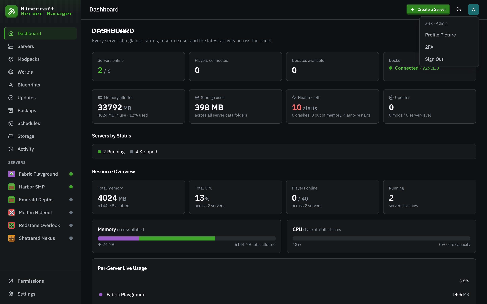

[← חזרה לאינדקס התיעוד](/docs/)

אימות דו-שלבי (2FA) מוסיף שלב שני לכניסה: לאחר הסיסמה שלך, עליך להזין קוד קצר מאפליקציית אימות בטלפון שלך. גם אם מישהו ילמד את הסיסמה שלך, הוא לא יוכל להיכנס ללא המכשיר שלך.

זה עובד עם כל אפליקציית אימות TOTP סטנדרטית (Google Authenticator, Authy, 1Password, Microsoft Authenticator ואחרות), והוא זמין ל**כל** חשבון, לא רק למנהלים. הגנה על הכניסה שלך אינה פעולת ניהול שרת, כך שגם צופים ומפעילים יכולים להפעיל אותה.

## הפעלת 2FA

פתח את תפריט החשבון (האות הראשונה או תמונת הפרופיל שלך, בפינה הימנית העליונה) ובחר **2FA**.

יופיע חלון רישום:

1. **סרוק את קוד ה-QR** באמצעות אפליקציית האימות שלך, או לחץ על **העתק** והזן את המפתח הידני.
2. הקלד את **הקוד בן 6 הספרות** שהאפליקציה שלך מציגה כעת.
3. **אשר את הסיסמה שלך.** הפעלת 2FA בודקת מחדש את הסיסמה שלך, כך שסשן פתוח לא יוכל להפעיל אותה עם מכשיר של מישהו אחר.
4. לחץ על **הפעל**.

### שמור את קודי הגיבוי שלך

ברגע ש-2FA מופעל, הפאנל מציג סט של **קודי גיבוי** חד-פעמיים.

כל קוד עובד **פעם אחת**, כדי לאפשר כניסה אם אי פעם תאבד גישה לאפליקציית האימות שלך. שמור אותם במקום בטוח (מנהל סיסמאות הוא אידיאלי) מכיוון שהם לא יוצגו שוב. ניתן ליצור סט חדש בכל עת (מה שיבטל את תוקפם של הישנים).

## כניסה עם 2FA

מעתה ואילך, הכניסה תכלול שלב שני. לאחר שם המשתמש והסיסמה שלך, הפאנל יבקש את הקוד שלך:

הזן את הקוד הנוכחי בן 6 הספרות מהאפליקציה שלך (או אחד מקודי הגיבוי שלך) וכך תיכנס. עד שתשלים שלב זה, הסשן **אינו** מחובר: הוא אינו יכול לגשת לשום דף או API.

## ניהול או כיבוי של 2FA

פתח את אותה כניסה **2FA** בתפריט החשבון כאשר היא מופעלת. לאחר אישור הסיסמה שלך תוכל:

- **צור מחדש קודי גיבוי** מנפיק סט חדש ומבטל את הישנים.
- **כבה את 2FA** מסיר אותה מחשבונך.

שניהם בודקים מחדש את הסיסמה הנוכחית שלך תחילה.

## איבדת את הטלפון **וגם** את קודי הגיבוי שלך?

**מנהל מערכת** יכול לאפס 2FA של משתמש אחר מתוך **הגדרות → משתמשים** (**אפס 2FA** בתפריט הפעולות של אותו משתמש). זה מנקה את ה-2FA עבור החשבון כך שהמשתמש יוכל להיכנס רק עם הסיסמה שלו ולהגדיר אותו מחדש. מנהלי מערכת אינם יכולים לאפס את ה-2FA **שלהם** ללא סיסמה. הם עוברים את תהליך הכיבוי הרגיל המוגן בסיסמה, כך שסשן מנהל מערכת שנפרץ לא יכול להסיר את הגורם השני שלו.

## כדאי לדעת

- הקודים מבוססי זמן ומסתובבים כל 30 שניות; הפאנל מקבל סטיית שעון קלה, ומתאושש בשקט אם שעון השרת מתוקן מאוחר יותר.
- לא ניתן לעשות שימוש חוזר בקוד: ברגע שהוא משמש לכניסה, אותו קוד לא יעבוד שוב בחלון הזמן שלו.
- קודים שגויים מוגבלים בקצב. המגבלה **משותפת** עם שלב הסיסמה (נעילה לכל חשבון בתוספת מגבלה של `RATE_LIMIT_AUTH_PER_15MIN` לכל IP), כך שהזנת סיסמה נכונה לא יכולה לאפס את המונה ממש לפני ניחוש הקוד בן 6 הספרות.
- שינויים ב-2FA (הפעלה, כיבוי, איפוס, שימוש בקוד גיבוי) נרשמים כולם ב[יומן הפעילות](/docs/activity/).
