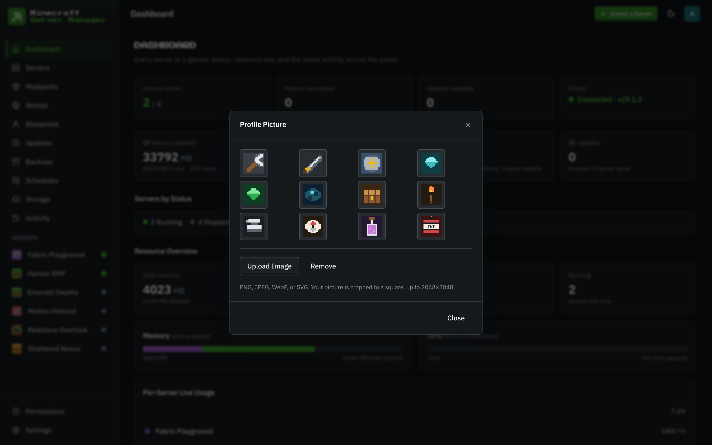

[← חזרה לאינדקס התיעוד](/docs/)

הפאנל תומך בריבוי משתמשים. נהלו חשבונות תחת **הגדרות → משתמשים**.

## שלוש הרמות

| רמה       | ברירת מחדל בכל שרת                                                                                         |
| --------- | ---------------------------------------------------------------------------------------------------------- |
| **מנהל**  | הכל: ניהול משתמשים, מפתחות API, קבצים גלובליים, עקיפות Docker מתקדמות, וכל פעולת שרת.                      |
| **מפעיל** | הפעלה והגדרת שרתים (הפעלה/כיבוי, קונסולה, גיבויים, עולמות, מודים, רוב ההגדרות), אך לא אזורים למנהלים בלבד. |
| **צופה**  | קריאה בלבד. צפייה בשרתים ובסטטוס שלהם, ללא אפשרות לשינויים.                                                |

כל משתמש, כולל צופה, יכול לנהל את [אימות דו-שלבי](/docs/two-factor-authentication/) שלו, מכיוון שהגנה על הכניסה האישית אינה פעולת ניהול שרת.

רמה היא **ברירת המחדל** עבור כל שרת. כדי להעניק למישהו הרשאות שונות בשרת אחד, השתמשו בהרשאות לשרת ספציפי למטה.

## הרשאות לשרת ספציפי

דף **הרשאות** (בסרגל הצד, או **הרשאות שרת** תחת **הגדרות → משתמשים**) מציג טבלה: כל מפעיל וצופה לאורך הצד, כל שרת לרוחב. לחצו על תא כדי להחליט מה המשתמש רשאי לעשות בשרת הספציפי הזה. מנהלים אינם מופיעים מכיוון שתמיד יש להם הכל.

כל תא הוא קבוצת הרשאות:

| הרשאה       | מה היא מאפשרת בשרת זה                                                                 |
| ----------- | ------------------------------------------------------------------------------------- |
| **צפייה**   | צפייה בשרת, בסטטוס שלו, בפלט הקונסולה, בשחקנים, בהיסטוריה ובסטטיסטיקות.               |
| **הפעלה**   | הפעלה, כיבוי, הפעלה מחדש, הרג ובנייה מחדש של השרת.                                    |
| **קונסולה** | הרצת פקודות קונסולה ופעולות מהירות בעולם, שליחת צ'אט וניהול פקודות צ'אט.              |
| **שחקנים**  | גירוש, חסימה, הוספה לרשימה הלבנה, הענקת הרשאות מפעיל ועריכת הערות שחקנים.             |
| **תוכן**    | התקנה והסרה של מודים, פלאגינים, חבילות, עולמות, datapacks ועריכת מלאים.               |
| **גיבויים** | יצירה, שחזור, הורדה ומחיקה של גיבויים.                                                |
| **קבצים**   | גלישה, עריכה, העלאה והורדה של קבצי שרת, לוגים בארכיון וחבילות לוגים; ייצוא של תבניות. |
| **הגדרות**  | שינוי הגדרות שרת, מאפיינים, אינטגרציות, אייקון ושדרוג גרסאות.                         |
| **מחיקה**   | מחיקת השרת.                                                                           |

מתחת לטבלה, **מה כל הרשאה מכסה** פותח כל הרשאה למה שאדם יכול לעשות, מה לא נכלל, ואת נתיבי הפאנל המדויקים שהיא פותחת. הרשימה האחרונה נבדקת מול הקוד הרץ על ידי חבילת הבדיקות.

בטלפון, הטבלה נערמת לכרטיס אחד למשתמש, עם שורה לכל שרת.

  

איך החלקים משתלבים:

- **הרמה היא ברירת המחדל.** מפעיל מתחיל עם כל הרשאה בכל שרת; צופה מתחיל עם צפייה בלבד. תא בטקסט דהוי (ה-tooltip שלו אומר "ברירת מחדל של רמה") מעולם לא שונה.
- **תא עוקף את הרמה עבור אותו שרת בלבד.** הענק צפייה והפעלה וקונסולה לצופה בשרת אחד והוא יוכל להריץ אותו, בעוד שכל שאר השרתים נשארים לקריאה בלבד עבורו. הסר מחיקה ממפעיל בשרת הראשי שלך והוא ישמור על כל השאר שם.
- **כל הרשאה כוללת צפייה.** אי אפשר לפעול על שרת שאי אפשר לראות.
- **כבה הכל כדי להסתיר שרת.** הוא נעלם מסרגל הצד של המשתמש, מהלוח, מהגיבויים, מהתזמונים, מהפעילות, מהעדכונים, מחבילות המודים, מהסטטוס החי, מהמשימות הרצות ומהתבניות, וספריית העולמות מפסיקה לציין אותו. קישור ישיר, קריאת API או חיבור קונסולה יחזירו "לא נמצא", בדיוק כמו שרת שאינו קיים.
- **פעולות על פני הפאנל עדיין עוקבות אחר הרמה.** יצירת שרתים (כולל שיבוט), אחסון, משתמשים, מפתחות API, הגדרות גלובליות ותזמונים על פני הפאנל אינם לשרת ספציפי, כך שצופה עם הרשאות בשרתים מסוימים עדיין לא יוכל לעשות אף אחת מאלה. מפעילים שומרים על יצירת שרתים ותזמונים על פני הפאנל; אחסון, משתמשים, מפתחות API והגדרות גלובליות הם למנהלים בלבד.
- **תזמונים עוקבים אחר השרת.** הפעלה מחדש מתוזמנת, גיבוי או פקודה בשרת דורשים את ההרשאה המתאימה שם (הפעלה, גיבויים או קונסולה), ללא קשר לרמה.
- **תבניות עוקבות גם אחר השרת.** ייצוא שרת כתבנית דורש קבצים שם, מכיוון שהארכיון נושא את קבציו. תבנית שיוצאה משרת שמישהו אינו יכול לראות מוסתרת גם ממנו.
- **אזורים למנהלים בלבד נשארים למנהלים בלבד** בכל שרת: הצ'אטבוט, שימור גיבויים ועקיפות Docker מתקדמות.

כל שינוי נכתב ליומן הפעילות עם מי שינה מה; רשומות אלו מוצגות למנהלים בלבד. מחיקת משתמש מסירה את השורות שלו. הסרת שרת משאירה אותם, כך ששרת המוסתר ממישהו נשאר מוסתר בהיסטוריה שלו ובגיבויים השמורים.

התקנות קיימות ממשיכות לעבוד ללא שינוי: עד שמנהל עורך תא, לכל משתמש יש בדיוק מה שהרמה שלו העניקה לו קודם לכן.

## למנהלים בלבד, ולמה

כמה דברים מוגבלים למנהלים בכוונה:

- **ניהול משתמשים, אחסון, הגדרות גלובליות, מפתחות API וקבצים גלובליים.**
- **[ה-API הציבורי](/docs/public-api/)**: הפעלת `/api/v1` ויצירה, הגדרת היקף או ביטול של אסימוני Bearer לקריאה בלבד שלו.
- **עקיפות Docker מתקדמות**: שם קונטיינר מותאם אישית, פרסומי פורטים נוספים ו-bind mounts. bind mount יכול למפות כל נתיב מארח לתוך קונטיינר, ובשילוב עם גישת ה-Docker של הפאנל, זה שווה ערך ל-root על המארח. שדות אלו מופיעים רק למנהלים.

שמות קונטיינרים מותאמים אישית גם אינם יכולים לחיות במרחב השמות `msm-` של הפאנל עצמו, כך שקונטיינר בעל שם ידני לעולם לא יוכל להסתיר שרת אחר ולהפנות פקודת עצירה או פקודה למופע הלא נכון.

## ניהול חשבונות

מנהלים יכולים ליצור משתמשים, לשנות רמות, לאפס סיסמאות ולמחוק חשבונות מטבלת המשתמשים. העמודה **2FA** מציגה אם אימות דו-שלבי מופעל עבור כל משתמש; מנהל יכול לאפס 2FA של משתמש אחר עם **איפוס 2FA** בתפריט הפעולות של אותו משתמש (במקרה של אובדן טלפון וקודי גיבוי), אך לעולם לא לבטל את שלו ללא סיסמתו, מה שתהליך השירות העצמי מטפל בו במקום זאת.

כניסות שנכשלו מוגבלות לפי חשבון (מונה לכל IP ומונה גלובלי לחשבון) כדי להאט ניסיונות brute-force, ואותו מגבלה מכסה גם את שלב קוד ה-2FA כך שסיסמה נכונה לא יכולה לאפס את המונה לפני ניחוש קוד. לפני כן יושבת מגבלת בקשות גסה יותר לכל IP לקוח על נקודות הקצה של כניסה / 2FA / הגדרה, הניתנת לכוונון באמצעות `RATE_LIMIT_AUTH_PER_15MIN` (ברירת מחדל 100; מאחורי proxy הפוך, הגדר `TRUST_PROXY` כך שהוא יתבסס על ה-IP האמיתי של הלקוח).
