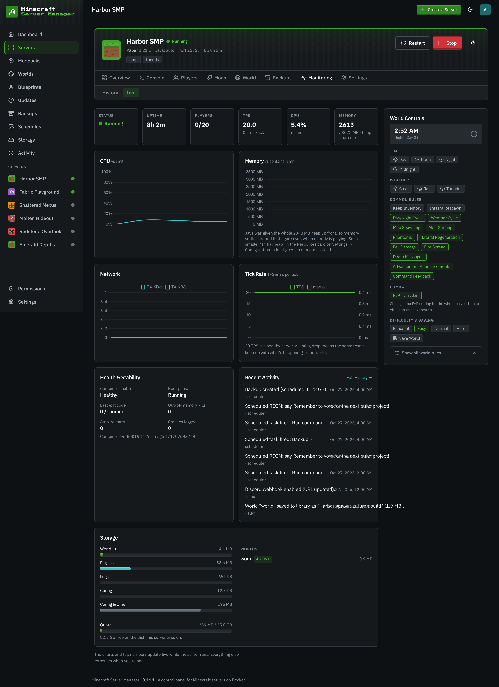

[← डॉक्स इंडेक्स पर वापस](/docs/)

## सर्वर बनाना

विज़ार्ड खोलने के लिए **सर्वर बनाएँ** (ऊपरी बार) पर या **सर्वर बनाएँ** कार्ड पर क्लिक करें।

विज़ार्ड सेटिंग्स पृष्ठ पर **नए सर्वर के लिए डिफ़ॉल्ट** से जावा हीप और डिस्क कोटा को पहले से भर देता है, जिसे कोई एडमिन कभी भी बदल सकता है। एक नया सर्वर वहां से अपना सीपीयू सीमा भी लेता है।

आप चुनते हैं:

- एक **नाम** (और एक वैकल्पिक विवरण, आइकन, और एक्सेंट रंग)। बेड़े को व्यवस्थित करने के लिए टैग बाद में सर्वर की सेटिंग्स पर जोड़े जाते हैं।
- एक **सर्वर प्रकार**: **वैनिला** टैब पर वैनिला, पेपर, या पुरपुर। मॉडेड सर्वर के लिए, **मॉड्स से** टैब लोडर (फैब्रिक, फोर्ज, नियोफोर्ज, या क्विल्ट), माइनक्राफ्ट संस्करण, और लोडर बिल्ड (नवीनतम, या एक विशिष्ट) चुनता है, फिर आपको मॉड्स खोजने देता है।
- एक **माइनक्राफ्ट संस्करण**: `LATEST`, एक स्नैपशॉट, या एक विशिष्ट संस्करण (बीटा और अल्फा शामिल)।
- एक **गेम पोर्ट**: एक मुफ्त पोर्ट सुझाया गया है। रिमोट कंसोल (RCON) डिफ़ॉल्ट रूप से 1000 अधिक पोर्ट का उपयोग करता है। आप इसे बाद में बदल सकते हैं (देखें [गेम पोर्ट बदलना](#changing-the-game-port))।
- **संसाधन**: जावा हीप (कंटेनर मेमोरी सीमा इससे 50% ऊपर सेट है) और एक डिस्क कोटा।

**उन्नत विकल्प** सर्वर छवि द्वारा समर्थित अन्य सभी सेटिंग्स खोलता है, साथ ही अतिरिक्त पर्यावरण चर और (एडमिन के लिए) उन्नत डॉकर सेटिंग्स।

मॉडपैक पसंद है? **मॉडपैक से** टैब इसके बजाय एक कर्सफोर्ज, मॉड्रिंथ, या जीटी न्यू होराइजन्स पैक स्थापित करता है (देखें [मॉडपैक्स](/docs/modpacks/)), या **कस्टम ज़िप जिसे आप अपलोड करते हैं**: एक मॉड्रिंथ `.mrpack`, एक कर्सफोर्ज मॉडपैक निर्यात (`manifest.json`), या मॉड्स जार का कोई भी ज़िप। मैनिफ़ेस्ट (या पहचाने गए जार में बहुमत वोट) लोडर और माइनक्राफ्ट संस्करण भरता है, और हर मॉड एक कार्य में स्थापित होता है। आप **ब्लूप्रिंट से** टैब पर एक सहेजे गए [ब्लूप्रिंट](/docs/blueprints/) से भी शुरू कर सकते हैं।

पैनल आपके संस्करण के लिए स्वचालित रूप से एक समझदार जावा रनटाइम चुनता है, छवि खींचता है, कंटेनर बनाता है, और इसे शुरू करता है, यह सब एक ही फॉर्म से होता है।

## सर्वर सूची

**सर्वर** पृष्ठ स्थिति और त्वरित आँकड़ों के साथ आपके पूरे बेड़े को सूचीबद्ध करता है।

## एक एकल सर्वर

एक सर्वर खोलने पर आपको एक टैब्ड वर्कस्पेस मिलता है:

- **अवलोकन**: खिलाड़ियों के साथ साझा करने का पता, विवरण, लाइव उपयोग, और कौन ऑनलाइन है।
- **कंसोल**: लाइव लॉग स्ट्रीम और कमांड इनपुट, इन-गेम चैट, और [चैट कमांड](/docs/console-and-chat/)।
- **खिलाड़ी**: रोस्टर, साथ ही इन्वेंट्री और आँकड़े।
- **मॉड्स**: स्थापित मॉड सूची, [मॉड ब्राउज़र](/docs/modpacks/), और सामग्री अपडेट। मॉडेड सर्वर पर, इसका **संस्करण** सब-टैब जांचता है कि आपके मॉड्स के भविष्य के माइनक्राफ्ट संस्करणों के लिए कौन से बिल्ड हैं ([अपडेट](/docs/updates/#minecraft-version-compatibility))।
- **दुनिया**: [दुनिया, लाइव मानचित्र, और फ़ाइल प्रबंधक](/docs/worlds-and-files/)।
- **बैकअप**: इस सर्वर के लिए [स्नैपशॉट और पुनर्स्थापना](/docs/backups/)।
- **निगरानी**: प्रति-सर्वर इतिहास और लाइव मेट्रिक्स, जिसमें क्रैश रिपोर्ट भी शामिल हैं (नीचे देखें)।
- **सेटिंग्स**: **कॉन्फ़िगरेशन** (सर्वर कैसे चलता है इसके बारे में सब कुछ), साथ ही [एकीकरण](/docs/integrations/) (डिस्कॉर्ड, स्थिति पृष्ठ, आमंत्रण, और, एडमिन के लिए, चैटबॉट)।

स्टार्ट, स्टॉप, और रीस्टार्ट नियंत्रण हर टैब के ऊपर हेडर में बैठे हैं। आप प्रत्येक टैब पर क्या कर सकते हैं, यह उस सर्वर पर आपकी [अनुमतियों](/docs/users-and-roles/#per-server-permissions) पर निर्भर करता है: उदाहरण के लिए, **फ़ाइलें** सब-टैब को फ़ाइल अनुमति की आवश्यकता होती है, और कंसोल कमांड भेजने के लिए कंसोल की आवश्यकता होती है।

**विश्व नियंत्रण** रेल हर टैब पर चलती रहती है: इन-गेम घड़ी, मौसम, सामान्य गेम नियम टॉगल चिप्स के रूप में, और बाकी के लिए "सभी विश्व नियम दिखाएं"।

**निगरानी → लाइव** टीपीएस और मिलीसेकंड प्रति टिक दिखाता है, क्रैश (पिछले 24 घंटे और 7 दिन) के साथ एक स्वास्थ्य और स्थिरता कार्ड, मेमोरी से बाहर किल, और ऑटो-रीस्टार्ट, और प्रति-विश्व आकार।

## सर्वर सेटिंग्स

**सेटिंग्स → कॉन्फ़िगरेशन** पूर्ण कॉन्फ़िगरेशन सतह है: नाम, विवरण, एमओटीडी, आइकन, रंग और टैग, संसाधन, गेम पोर्ट, अपडेट नीति, पैनल बूट पर शुरू करें और क्रैश पर ऑटो-रीस्टार्ट, सर्वर छवि द्वारा समर्थित हर पर्यावरण चर, उन्नत डॉकर सेटिंग्स, और ब्लूप्रिंट निर्यात, क्लोन, पुनर्निर्माण, और हटाना। वे परिवर्तन जो केवल सर्वर के पुनर्निर्माण के बाद ही प्रभावी होते हैं, तुरंत सहेजे जाते हैं और प्रतीक्षा करते हैं: सर्वर के हेडर में एक **परिवर्तन लागू करें** बटन दिखाई देता है, और वे अगली बार सर्वर शुरू होने पर भी लागू होते हैं।

**क्रैश पर ऑटो-रीस्टार्ट** एक क्रैश हुए सर्वर को फिर से शुरू करता है, प्रत्येक प्रयास के बीच लंबा इंतजार करता है (5, 10, फिर 20 सेकंड) और 10 मिनट के भीतर 3 प्रयासों के बाद रुक जाता है। यह उन क्रैश को छोड़ देता है जिन्हें पैनल एक सेटअप समस्या के रूप में पहचानता है (EULA, गलत जावा, नए संस्करण का विश्व, उपयोग में पोर्ट, मेमोरी से बाहर, गायब कर्सफोर्ज कुंजी), क्योंकि उन्हें पहले ठीक करने की आवश्यकता होती है। यदि कोई अन्य क्रिया सर्वर के साथ व्यस्त है (एक बैकअप, एक पुनर्स्थापना, एक पोर्ट परिवर्तन), तो यह 30 मिनट तक प्रतीक्षा करता है, और जैसे ही कोई व्यक्ति सर्वर को स्वयं रोकता है या शुरू करता है, यह हार मान लेता है।

सीधे सेटिंग परिवर्तन हमेशा रीस्टार्ट के पार बने रहते हैं। **विश्व नियंत्रण** रेल के साथ किया गया PvP या कठिनाई परिवर्तन, **खिलाड़ी** टैब पर एक व्हिटेलिस्ट टॉगल, या **फ़ाइलें** संपादक में एक `server.properties` संपादित करने से मिलान करने वाला पर्यावरण चर हटा दिया जाता है (यदि एक सेट किया गया था) और सर्वर को पुनर्निर्माण के लिए चिह्नित करता है, इसलिए डिस्क पर मान अगले स्टार्ट पर कंटेनर छवि द्वारा फिर से लागू होने के बजाय जीत जाता है।

**मेमोरी मीटर के बारे में।** "रैम (जावा हीप)" जावा को इसके शुरुआती और अधिकतम हीप दोनों के रूप में सौंपा गया है, और जावा पहले मिनट के भीतर दिए गए हीप को भरता है, एईकर / मेवआइस फ्लैग प्रीसेट के साथ या उसके बिना। इसलिए मेमोरी मीटर हीप आकार के बारे में बस जाता है और तब भी वहीं रहता है जब कोई नहीं खेल रहा होता है; मीटर पर टिक उस जगह को चिह्नित करता है जहां हीप कंटेनर सीमा के नीचे बैठता है, और उसके नीचे का नोट यही कहता है। यदि आप इसके बजाय मेमोरी को वास्तविक उपयोग का पालन करते देखना चाहते हैं, तो सर्वर को **सेटिंग्स → कॉन्फ़िगरेशन** पर **संसाधन** कार्ड में (या विज़ार्ड में **उन्नत विकल्प** के तहत) एक छोटा प्रारंभिक हीप दें, उदाहरण के लिए 512 एमबी: 2 जीबी हीप पर जिसने हमारे मापों में निष्क्रिय उपयोग को 2.6 जीबी से लगभग 1.3 जीबी तक लाया। जावा को हीप के बाहर भी मेमोरी की आवश्यकता होती है (वैनिला पर लगभग 0.5 जीबी, बड़े मॉडपैक पर 1.5 से 2 जीबी), जो कंटेनर सीमा के हेडरूम के लिए है। संख्याओं के लिए README का "दो मेमोरी सीमाएं" देखें।

> **उन्नत डॉकर सेटिंग्स** (कंटेनर नाम, डॉकर नेटवर्क, अतिरिक्त पोर्ट मैपिंग, और अतिरिक्त वॉल्यूम बाइंड) **केवल एडमिन के लिए** हैं, क्योंकि एक बाइंड माउंट प्लस पैनल के डॉकर एक्सेस प्रभावी रूप से होस्ट पर रूट है। [उपयोगकर्ता और भूमिकाएं](/docs/users-and-roles/) देखें।

### गेम पोर्ट बदलना

**सेटिंग्स → कॉन्फ़िगरेशन** पर **गेम पोर्ट** कार्ड किसी भी समय सर्वर को दूसरे पोर्ट पर ले जाता है, जिसमें इसका अपना **पोर्ट सहेजें** बटन होता है। **अगला फ्री पोर्ट उपयोग करें** सबसे कम मुफ्त वाला चुनता है, और कार्ड आपके द्वारा दर्ज किए गए किसी भी पोर्ट की जांच करता है इससे पहले कि आप इसे सहेजें। RCON हमेशा गेम पोर्ट (डिफ़ॉल्ट ऑफसेट) से 1000 ऊपर रहता है। एडमिन 1024 से कोई भी पोर्ट चुन सकते हैं; बाकी सभी पहले गेम पोर्ट (डिफ़ॉल्ट रूप से 25565) से ऊपर चुनते हैं। सहेजने से परिवर्तन तुरंत लागू हो जाता है: एक बंद सर्वर बस चला जाता है, और एक चल रहा सर्वर पहले पूछता है, फिर नए पोर्ट पर पुनरारंभ होता है (विश्व पहले सहेजा जाता है, और खिलाड़ी नए पोर्ट पर फिर से जुड़ते हैं)। यदि सर्वर नए पोर्ट पर शुरू नहीं हो पाता है, तो वह पुराने पोर्ट पर वापस चला जाता है। परिवर्तन तब तक अवरुद्ध है जब तक अन्य परिवर्तन **परिवर्तन लागू करें** की प्रतीक्षा कर रहे हैं, इसलिए पहले उन्हें लागू करें। पोर्ट बदलने के लिए उस सर्वर पर सेटिंग्स अनुमति की आवश्यकता होती है।

## क्रैश रिपोर्ट और mclo.gs विश्लेषण

क्रैश रिपोर्ट (`crash-reports/*.txt` और JVM `hs_err_pid*.log` फ़ाइलें) स्वचालित रूप से उठाई जाती हैं, एक-पंक्ति सारांश में अपवाद और संदिग्ध मॉड्स के साथ पार्स की जाती हैं, और **निगरानी → इतिहास** के तहत सूचीबद्ध की जाती हैं:

प्रत्येक रिपोर्ट कार्ड एक अंतर्निहित दर्शक (कॉलेप्सिबल सेक्शन और हाइलाइटेड अपवाद के साथ), स्टैक ट्रेस कॉपी करें, और डाउनलोड प्रदान करता है, साथ ही दो [mclo.gs](https://mclo.gs) क्रियाएं भी:

- **mclo.gs पर साझा करें** रिपोर्ट को एक सार्वजनिक पेस्ट के रूप में प्रकाशित करता है और लिंक कॉपी करता है: वही चीज़ जो मॉड लेखक और समर्थन डिस्कॉर्ड पूछते हैं। लिंक रिपोर्ट पर याद रखा जाता है, इसलिए कुछ भी कभी भी दोबारा अपलोड नहीं किया जाता है।
- **विश्लेषण करें** पेस्ट पर mclo.gs की स्वचालित अंतर्दृष्टि चलाता है: ज्ञात समस्याएं सुझाए गए सुधारों के साथ (लापता निर्भरताएं, संस्करण बेमेल, सामान्य मॉड संघर्ष), सीधे पैनल में प्रस्तुत की जाती हैं।

दोनों क्रियाएं एक स्पष्ट पुष्टि के पीछे बैठी हैं, क्योंकि एक पेस्ट सार्वजनिक होता है: क्रैश रिपोर्ट में खिलाड़ी के नाम और आपकी पूरी मॉड सूची शामिल हो सकती है। पैनल कभी भी अपने आप कुछ भी अपलोड नहीं करता है।
