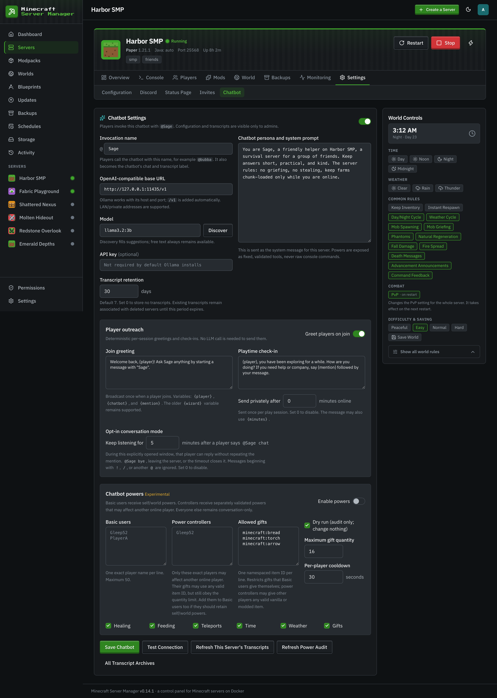

[← Vissza a dokumentumokhoz](/docs/)

Ez a fork minden felügyelt Minecraft szerverhez egy rendszergazda által konfigurálható chatbotot ad hozzá. Egy OpenAI-kompatibilis chat-kompletálási végponthoz csatlakozik, beleértve az Ollama-t egy másik LAN-gazdán. Minden szervernek saját végpontja, modellje, meghívó neve, személyisége, átirat-szabályzata, kihelyezési üzenetei és teljesítményszabályzata van. Az alapértelmezett meghívó a `@wizard`, és az alapértelmezett személyiség egy ősi, játékos világban élő varázslót mutat be; mindkettő szerkeszthető.

## Játékosélmény

- Bármely játékos használhatja a `@wizard <üzenet>` (vagy a konfigurált meghívót) beszélgetéshez és determinisztikus, Minecraft verzió-tudatos vanilla recept súgóhoz.
- A csatlakozási üdvözlések és egy konfigurálható egyszeri játék-munkamenet bejelentkezés emlékezteti a játékosokat a chatbot elérhetőségére. A `@wizard chat` egy rövid opt-in beszélgetési ablakot nyit meg; a `@wizard bye` bezárja azt.
- **Alapvető felhasználók** meghívhatnak engedélyezett ön/világ teljesítményeket. **Teljesítményvezérlők** külön validált műveleteket hajthatnak végre, amelyek más online játékosokat érintenek. Az egyik csoportba sem tartozó játékosok csak beszélgetésre korlátozódnak.
- Az alapvető felhasználók önmaguknak adott ajándékai egy elem engedélyezési listát használnak. A vezérlők bármilyen érvényes névtérrel rendelkező vanilla vagy modded elemet adhatnak egy másik játékosnak, a mennyiségi korlátozások és egyéb teljesítménybiztonsági intézkedések betartásával.

## Tervezés és biztonság

A konfiguráció és az átiratok csak rendszergazdák számára érhetők el. A modell soha nem kap nyers RCON-t vagy tetszőleges parancs végrehajtást. Egy üzenet csak az egyetlen rögzített eszközt teszi elérhetővé, amely megfelel a kifejezett szándéknak; a szerver kódja érvényesíti az engedélyezést, az argumentumokat, a zászlókat, a mennyiségeket, a visszaszámlálásokat és az online játékosok pontos neveit, mielőtt egy meglévő szolgáltatási műveletet végrehajtana. A Minecraft kiválasztók elutasításra kerülnek, a játékosok közötti műveletek nem célozhatják meg a hívót, a teljesítmények szárazfutás módban indulnak, és minden megkísérelt teljesítmény auditálásra kerül. A nem támogatott eszközmeghívó modellek csak beszélgetésre esnek vissza.

A válaszok korlátozottak a Minecraft csevegéshez. Az ismert vanilla receptek a mellékelt verzió-specifikus receptadatokból származnak, és stabil 2x2/3x3 sorokban jelennek meg; az LLM nem bízható meg receptelrendezések kitalálásában. Az ismeretlen vagy modded receptek a JEI/REI-hez irányítják a játékost a válasz kitalálása helyett.

## Fő implementációs fájlok

- `src/services/wizard.js`: szerverenkénti konfiguráció, OpenAI-kompatibilis kérések, csevegés kezelése, kihelyezés, átirat tárolás és válaszkorlátok.
- `src/services/wizardPowers.js`: szerepkör ellenőrzések, szándék-specifikus eszközsémák, validálás, végrehajtás, visszaszámlálások és teljesítmény auditálás.
- `src/services/wizardRecipes.js`: determinisztikus verzió-specifikus recept keresés és rács formázás. A recept és elem adatok a mellékelt [`minecraft-data`](https://github.com/PrismarineJS/minecraft-data) csomagból származnak. (Ennek a dokumentumnak egy korábbi tervezete egy `src/data/recipes/` mappára mutatott, amely soha nem lett commitelve; nincs ilyen mappa, és az adatok a csomagban találhatók. Lásd: "Függőség lábnyom".)
- `src/analytics/ingest.js`: továbbítja a feldolgozott csatlakozásokat, kilépéseket és játékos csevegéseket a chatbotnak.
- `src/web/routes/wizard.js`, `public/js/pages/integrations.js`, és `views/partials/server/integrations.hbs`: rendszergazdai API és szerverenkénti Integrációk UI.
- `src/db/migrations/011_wizard_chat.js` - `019_wizard_power_controllers.js`: perzisztens séma.
- `test/wizard.test.js`: engedélyezés, eszközhatár, tárolás, kihelyezés és csevegés viselkedési tesztek.

A belső `wizard` útvonal/modul/tábla nevek megmaradnak a frissítési és API kompatibilitás érdekében; a „chatbot” a felhasználó által látható terméknév. Hasonlóképpen, a tárolt `power_testers_json` mező a felhasználói felület **Alapvető felhasználók** csoportjának felel meg.

## Függőség lábnyom (`minecraft-data`)

A recept súgó a `minecraft-data` csomagot használja. Nagy helyet foglal a lemezen (körülbelül 429 MB telepítve), és a gyártási képbe kerül, mert futásidejű függőség, nem fejlesztői. Szándékosan tartjuk meg, hogy a recept súgó offline módban működjön minden Minecraft kiadáshoz, hálózati hívás nélkül.

Megjegyzések a következő szemlélőnek (ember vagy AI), hogy a méret ne okozzon meglepetést:

- Jelenleg csak a Java (`pc`) adatok használatosak. A `wizardRecipes.js` a `minecraftData.versions.pc` és az adott verzió `recipes`, `items`, és `blocks` tábláit olvassa. Az általa ténylegesen érintett fájlok összesen körülbelül 15 MB-ot tesznek ki minden pc verzión keresztül.
- A csomag körülbelül 330 MB-ja a `data/bedrock`, és itt semmi sem olvassa még. Szándékosan hagyjuk bent. Ha a panel valaha is támogatni fogja a Bedrock Minecraftot, a Bedrock recept és elem adatok már itt vannak, így a recept funkció bővíthető a Bedrock szerverek lefedésére anélkül, hogy új függőséget adnánk hozzá. Kezdje a `minecraftData.versions.bedrock` elemnél, és kövesse ugyanazt az alakot, mint a pc útvonal.
- Ha a méretet le kell csökkenteni a Bedrock támogatás érkezése előtt, erre már van minta ebben a tárban. Az `src/services/itemRegistry.js` lekéri a `minecraft-data` fájlokat a jsDelivr CDN-ről, amikor szüksége van rájuk, és gyorsítótárazza őket az `api_cache`-ben. Vagy ez a megközelítés, vagy egy kis, kézzel kiválasztott `src/data/recipes/` részhalmaz, amely néhány gyakori verziót fed le, jelentősen csökkentené a képet.

## Helyi tárolás és manuális ellenőrzés

Minden beállítás és tárolt átirat a panel SQLite adatbázisában található a `/data/panel.db` címen a panel tárolóban. A standard Compose mount használatával a gazda elérési útja `${DATA_DIR_HOST}/panel.db` (például `/opt/msm/data/panel.db`). A releváns táblák a `wizard_configs`, `wizard_transcripts`, és `wizard_outreach`; a teljesítmény auditok az `events` tábla sorai, `wizard-power` típussal. Az opcionális LLM API kulcs AES-256-GCM titkosítással van titkosítva a panel `SESSION_SECRET` használatával, általában `${DATA_DIR_HOST}/.session-secret` néven tárolva.

Készítsen biztonsági másolatot az adatbázisról, és állítsa le a panelt a közvetlen SQLite szerkesztések előtt, hogy a WAL biztonságosan kezelve legyen. Az admin UI/API használata javasolt, mert érvényesítést és titkosítást alkalmaz. Tartsa együtt a `panel.db`, `panel.db-wal`, és `panel.db-shm` fájlokat, amikor élő adatbázist másol.
