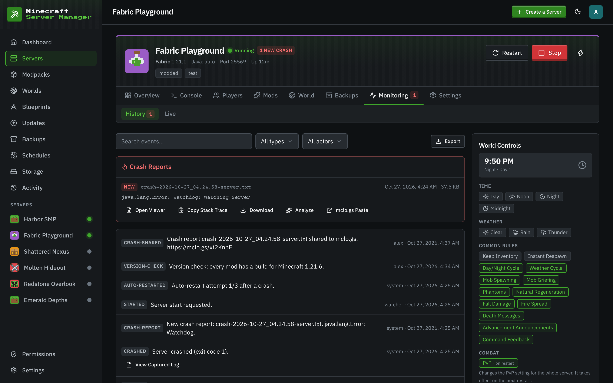

[← Kembali ke indeks docs](/docs/)

## Membuat server

Klik **Buat Server** (bilah atas) atau kartu **Buat server** untuk membuka wizard.

Wizard mengisi bidang memori, CPU, dan kuota disk dari **Default untuk server baru** di halaman Pengaturan, yang dapat diubah oleh admin kapan saja.

Anda memilih:

- **Nama** (dan ikon opsional, warna aksen, dan tag untuk mengatur armada Anda).
- **Jenis server** - vanilla, Paper, Fabric, Forge, NeoForge, dan lainnya, masing-masing dipetakan ke gambar itzg yang tepat di belakang layar.
- **Versi Minecraft** - `LATEST`, snapshot, atau versi tertentu.
- **Sumber daya** - RAM (heap), batas memori kontainer, CPU, dan kuota disk.

Lebih suka modpack? Tab **Dari modpack** menginstal paket CurseForge, Modrinth, FTB, atau GT New Horizons sebagai gantinya (lihat [Modpacks](/docs/modpacks/)), atau mengambil **zip kustom yang Anda unggah**: ekspor modpack CurseForge (`manifest.json`) atau zip apa pun dari jar mod. Manifest (atau suara mayoritas di seluruh jar yang teridentifikasi) mengisi loader dan versi Minecraft, dan setiap mod diinstal dalam satu tugas. Anda juga dapat memulai dari [Blueprint](/docs/blueprints/) yang disimpan.

Panel memilih runtime Java yang masuk akal untuk versi Anda secara otomatis, menarik gambar, membuat kontainer, dan (secara opsional) memulainya, semuanya dari satu formulir.

## Daftar server

Halaman **Server** mencantumkan seluruh armada Anda dengan status dan statistik cepat.

## Satu server

Membuka server memberi Anda ruang kerja bertab:

- **Ringkasan** - status, statistik langsung, waktu aktif, dan kontrol mulai / berhenti / mulai ulang utama.
- **Konsol** - aliran log langsung dan input perintah, ditambah obrolan dalam game ([detail](/docs/console-and-chat/)).
- **Pemain** - siapa yang online, ditambah inventaris, statistik, dan [perintah obrolan](/docs/console-and-chat/).
- **Mod** - daftar mod yang terinstal, [browser mod](/docs/modpacks/), dan pembaruan konten.
- **Dunia** - [dunia, peta langsung, dan pengelola file](/docs/worlds-and-files/).
- **Cadangan** - [snapshot dan pemulihan](/docs/backups/) untuk server ini.
- **Pemantauan** - riwayat per server dan metrik langsung, termasuk laporan crash (lihat di bawah).
- **Pengaturan** - semua tentang cara server berjalan, ditambah [integrasi](/docs/integrations/) (Discord, halaman status, undangan, chatbot).

Bilah **Kontrol Dunia** meluncur di setiap tab: jam dalam game, cuaca, gamerules umum sebagai chip toggle, dan "Tampilkan semua aturan dunia" untuk sisanya.

**Pemantauan → Langsung** menampilkan TPS dan milidetik per tick, kartu kesehatan dan stabilitas dengan 24 jam / 7 hari terakhir crash dan mulai ulang, dan ukuran per dunia.

## Pengaturan server

Tab **Pengaturan** adalah permukaan konfigurasi penuh: ganti nama, sumber daya, kebijakan pembaruan, mulai otomatis / mulai ulang otomatis, variabel lingkungan, dan penimpaan Docker lanjutan. Bidang yang mengubah cara kerja kontainer ditandai dengan jelas sebagai memerlukan mulai ulang.

**Tentang pengukur memori.** "RAM (heap Java)" diserahkan ke Java sebagai heap awal dan maksimumnya, dan Java mengisi heap yang diberikan di muka dalam menit pertama, dengan atau tanpa preset flag Aikar / MeowIce. Jadi pengukur memori menetap di sekitar ukuran heap dan tetap di sana bahkan ketika tidak ada yang bermain; tanda centang pada pengukur menandai di mana heap berada di bawah batas kontainer, dan catatan di bawahnya mengatakan demikian. Jika Anda lebih suka melihat memori mengikuti penggunaan sebenarnya, atur **Heap awal** yang lebih kecil (lanjutan): pada heap 2 GB yang membawa penggunaan idle dari 2,6 GB menjadi sekitar 1,3 GB dalam pengukuran kami. Java juga membutuhkan memori di luar heap (sekitar 0,5 GB pada vanilla, 1,5 hingga 2 GB pada modpack besar), yang merupakan tempat ruang kepala batas kontainer. Lihat "Dua batas memori" di README untuk angka-angkanya.

> Bidang penimpaan Docker lanjutan (nama kontainer kustom, port tambahan dan mount bind, dan penimpaan mentah) adalah **khusus admin**, karena mount bind ditambah akses Docker panel secara efektif adalah root pada host. Lihat [Pengguna & peran](/docs/users-and-roles/).

## Laporan crash & analisis mclo.gs

Laporan crash (`crash-reports/*.txt` dan file JVM `hs_err_pid*.log`) diambil secara otomatis, diurai menjadi ringkasan satu baris dengan pengecualian dan mod yang dicurigai, dan dicantumkan di bawah **Pemantauan → Riwayat**:

Setiap kartu laporan menawarkan penampil bawaan (dengan bagian yang dapat dilipat dan pengecualian yang disorot), salin-stack-trace, dan unduh, ditambah dua tindakan [mclo.gs](https://mclo.gs):

- **Bagikan ke mclo.gs** mempublikasikan laporan sebagai paste publik dan menyalin tautannya - hal yang persis diminta oleh penulis mod dan Discord dukungan. Tautan diingat pada laporan, jadi tidak ada yang pernah diunggah dua kali.
- **Analisis** menjalankan wawasan otomatis mclo.gs pada paste: masalah yang diketahui dengan perbaikan yang disarankan (dependensi yang hilang, ketidakcocokan versi, konflik mod umum), dirender langsung di panel.

Kedua tindakan tersebut berada di balik konfirmasi eksplisit, karena paste bersifat publik: laporan crash dapat menyertakan nama pemain dan daftar mod lengkap Anda. Panel tidak pernah mengunggah apa pun sendiri.
