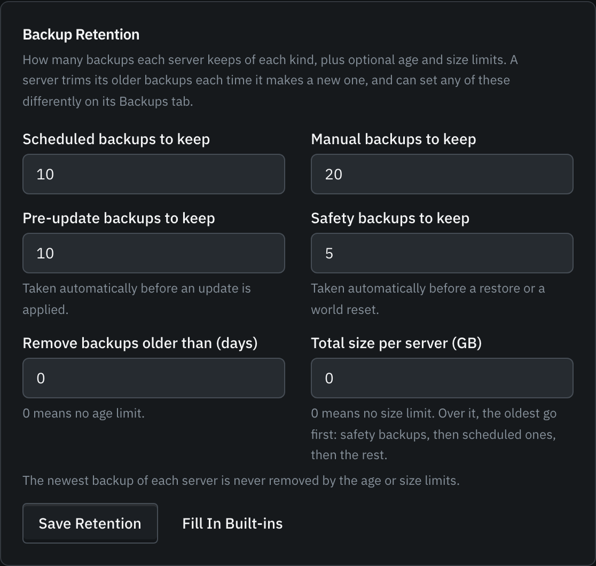

[← Indietro all'indice della documentazione](/docs/)

La pagina **Backup** elenca ogni snapshot dell'intera flotta, con dimensioni, motivo e anzianità, filtrabile per server e per motivo.

## Creazione di un backup

Dalla scheda **Backup** di un server (o tramite una [pianificazione](/docs/schedules/)) è possibile creare uno snapshot dell'intera directory del server con un clic. Il pannello mette in quiescenza il mondo (`save-off` → `save-all`), zippa i dati, quindi riabilita il salvataggio (`save-on`), in modo che i backup siano coerenti anche su un server in esecuzione. La compressione viene eseguita in un thread worker in background per non bloccare il pannello. Un backup avviato tramite API può includere una nota.

Ogni archivio viene **verificato nell'integrità** nel momento in cui viene scritto: il pannello riapre lo zip e legge la sua directory. Un archivio corrotto o non apribile viene eliminato e la chiamata di backup fallisce immediatamente, anziché far emergere il problema mesi dopo, quando un ripristino è l'unica cosa tra te e la perdita di dati. Un archivio con zero voci (un server che non è mai stato avviato) è consentito ma segnalato nell'evento.

Seleziona **"Riduci anche il mondo in seguito"** (nella scheda Backup o in una pianificazione di backup) per rimuovere i chunk visitati raramente una volta che l'archivio è stato scritto in modo sicuro (vedi **[Riduzione di un mondo](/docs/world-shrink/)**). La riduzione viene eseguita solo mentre il server è fermo; su un server in esecuzione il backup avviene comunque e la riduzione viene saltata.

## Motivi dei backup

I backup vengono contrassegnati in base al motivo per cui sono stati creati:

- **manuale**: hai fatto clic su **Esegui backup ora**. La sostituzione del mondo attivo di un server con uno dalla libreria esegue prima anche un backup `manuale`.
- **pianificato**: creato da una [pianificazione](/docs/schedules/). Ogni nuovo server riceve anche un backup pianificato giornaliero automatico (scaglionato tra le 02:00 e le 05:59), in modo che un server abbia una copertura automatica fin dal primo giorno, non solo prima degli aggiornamenti.
- **pre-aggiornamento**: eseguito automaticamente prima di un aggiornamento di pacchetto o di una modifica della versione di Minecraft, in modo che un aggiornamento sia sempre reversibile.
- **pre-ripristino**: eseguito automaticamente subito prima di un ripristino o di un reset del mondo, come rete di sicurezza nel caso in cui il ripristino non sia quello desiderato.

## Conservazione

La conservazione è limitata **per server, per motivo**: vengono conservati i più recenti in ogni gruppo, i più vecchi vengono potati automaticamente dopo ogni backup riuscito:

| Motivo            | Conservati per impostazione predefinita |
| ----------------- | --------------------------------------- |
| pianificato       | 10                                      |
| pre-aggiornamento | 10                                      |
| manuale           | 20                                      |
| pre-ripristino    | 5                                       |

`pre-ripristino` (chiamati backup di sicurezza nel pannello) ha il suo piccolo spazio dedicato proprio per evitare che un backup di sicurezza automatico possa sovrascrivere un backup `manuale` conservato deliberatamente.

Due limiti opzionali si applicano oltre ai conteggi per motivo, entrambi disattivati per impostazione predefinita: una **durata massima** (i backup più vecchi di N giorni vengono potati, indipendentemente dal motivo) e una **dimensione totale massima** per server (i più vecchi vengono potati fino a quando il totale non rientra nei limiti: prima i backup di sicurezza, poi quelli pianificati, poi il resto). Il backup più recente di un server non viene mai potato da nessuno dei due limiti.

### Modifica

Gli amministratori impostano la policy dell'intero pannello nella scheda **Conservazione Backup** nella pagina **Impostazioni** (**Inserisci valori predefiniti** reinserisce i valori predefiniti sopra nel modulo, pronti per il salvataggio). Un server può differire su uno qualsiasi dei sei valori: apri la sua scheda **Backup** ed espandi **Conservazione per questo server**. Ogni campo lì è vuoto a meno che quel server non lo imposti, e un campo vuoto segue il valore dell'intero pannello (mostrato al suo interno). Quindi un server può, ad esempio, conservare 3 backup pianificati e utilizzare i valori dell'intero pannello per tutto il resto; svuotare un campo lo riporta al valore dell'intero pannello.

Il salvataggio non elimina mai nulla da solo. Se i nuovi limiti dovessero lasciare backup esistenti oltre il limite, il pannello elenca, per server, quanti backup di ciascun tipo andrebbero persi, quanto spazio verrebbe liberato e quanti anni ha il più vecchio. Indica anche quando un server era già oltre i suoi limiti prima di questa modifica (ad esempio, dopo un precedente **Dal prossimo backup**), poiché l'applicazione ora tronca tutto ciò che supera il limite, non solo ciò che questa modifica aggiunge. Quindi chiede come applicarli:

- **Rimuovi ora** elimina esattamente i backup appena elencati, niente di più: un backup effettuato nel frattempo attende la prossima potatura. Dalla pagina Impostazioni, un server nel mezzo di un ripristino, backup o azione simile viene saltato e pota dopo il suo prossimo backup; nella scheda Backup di un server, ti viene chiesto di riprovare una volta terminata tale azione. Mentre i vecchi backup di un server vengono eliminati (solitamente secondi), altre azioni su quel server devono attendere: un backup o avvio pianificato che capita in quel momento riprova ogni minuto fino a quando non può (fino a 30 minuti), un server arrestato in modo anomalo viene riavviato entro circa 20 secondi dal termine (fino a 30 minuti), e un riavvio o arresto pianificato che vi si sovrappone viene saltato fino alla sua prossima volta.
- **Dal prossimo backup** li conserva per ora; ogni server pota i suoi backup la prossima volta che ne crea uno, come ha sempre fatto.

Un backup in fase di ripristino non viene mai rimosso mentre il ripristino è in corso: la conservazione lo ignora (e non elimina altri backup per far spazio), e la sua eliminazione manuale viene rifiutata fino al termine del ripristino.

Le stesse impostazioni sono disponibili per gli script come endpoint API admin: `GET`/`POST /api/backups/retention` e `/api/servers/:id/backups/retention`. I valori dell'intero pannello non possono essere `null`. Per un server, un valore di `null` (o `""`) rimuove quella singola chiave, facendolo seguire nuovamente il valore dell'intero pannello, e `{ "reset": true }` li rimuove tutti. Sotto ciascuno di questi due percorsi, `POST …/preview` segnala cosa una modifica rimuoverebbe senza rimuoverla (`backups`, `bytes`, `servers`, `ids` e una ripartizione per server `byServer`), e `POST …/apply` applica la policy salvata ora e risponde con `{ deleted, skipped }` per l'intero pannello (`skipped` conta i server occupati) o `{ deleted }` per un singolo server. Invia il `{ "token": "..." }` dell'anteprima (conservato per 10 minuti) o i suoi `{ "ids": [...] }` per eliminare solo quelli; senza nessuno dei due, tutto ciò che supera il limite viene eliminato. Un'applicazione per server su un server occupato risponde con 409.

I backup possono essere **rinominati** dall'elenco dei backup (il pulsante di rinomina su ogni riga). L'archivio sul disco e il record del pannello si spostano insieme, quindi download, ripristino e conservazione continuano a funzionare con il nuovo nome.

> La conservazione è limitata automaticamente, ma i grandi archivi moddati contano comunque ai fini della [quota disco](/docs/storage/) di un server, quindi tieni d'occhio il totale per i pacchetti di grandi dimensioni.

## Ripristino

Il ripristino di un backup arresta il server (verificando che il container sia effettivamente arrestato prima di toccare qualsiasi file), esegue un backup di sicurezza `pre-restore`, sostituisce l'**intera directory del server** con lo snapshot e lo lascia fermo affinché tu possa riavviarlo. L'archivio viene decompresso prima di lato e scambiato solo una volta estratto completamente, quindi un ripristino che fallisce a metà lascia i file correnti intatti. Poiché gli aggiornamenti dei pacchetti eseguono sempre prima un backup `pre-update`, è sempre possibile annullare un aggiornamento errato.

## Il database del pannello

I backup dei server coprono solo la cartella di ciascun server. Il database del pannello (`panel.db`, che contiene utenti, ruoli, segreti 2FA, pianificazioni, pin dei pacchetti e cronologia) viene sottoposto a snapshot separatamente tramite il timer di manutenzione giornaliero:

- `VACUUM INTO` scrive una copia coerente e deframmentata in `backups/_panel/` nella cartella dei dati; vengono conservate le **14** più recenti.
- All'avvio, il pannello esegue `PRAGMA integrity_check` e registra rumorosamente se fallisce, indirizzandoti a `backups/_panel` per la copia valida più recente.

Eseguendo il backup dell'intera cartella dei dati (che contiene anche `.secret-key`, la chiave di crittografia a riposo) avrai eseguito il backup di tutto.
