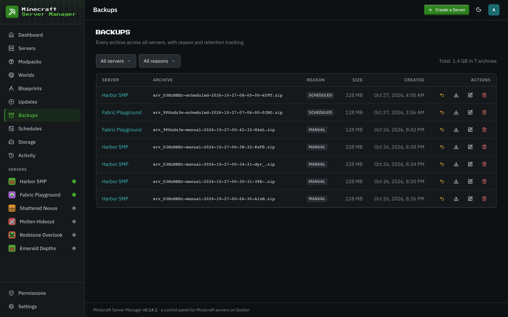

[← Indietro all'indice della documentazione](/docs/)

La pagina **Backup** contiene ogni snapshot della tua flotta, con dimensioni, motivo e data.

## Creazione di un backup

Dalla scheda **Backup** di un server (o tramite una [pianificazione](/docs/schedules/)) puoi creare uno snapshot dell'intera directory del server con un clic. Il pannello mette in quiescenza il mondo prima (`save-off` → `save-all`), zippa i dati, quindi riabilita il salvataggio (`save-on`), in modo che i backup siano coerenti anche su un server in esecuzione. La compressione viene eseguita in un thread worker in background in modo da non bloccare il pannello. Ogni backup può contenere una nota.

Ogni archivio viene **verificato per l'integrità** nel momento in cui viene scritto: il pannello riapre lo zip e legge la sua directory. Un archivio danneggiato o non apribile viene eliminato e la chiamata di backup fallisce immediatamente, anziché far emergere il problema mesi dopo, quando un ripristino è l'unica cosa tra te e la perdita di dati. Un archivio a zero voci (un server che non è mai stato avviato) è consentito ma segnalato nell'evento.

Seleziona **"Riduci anche il mondo in seguito"** (nella scheda Backup o in una pianificazione di backup) per rimuovere i chunk raramente visitati una volta che l'archivio è stato scritto in modo sicuro (vedi **[Riduzione di un mondo](/docs/world-shrink/)**). La riduzione viene eseguita solo mentre il server è fermo; su un server in esecuzione il backup avviene comunque e la riduzione viene saltata.

## Motivi dei backup

I backup vengono contrassegnati in base al motivo per cui sono stati creati:

- **manuale** - hai fatto clic sul pulsante.
- **pianificato** - creato da una [pianificazione](/docs/schedules/). Ogni nuovo server riceve anche un backup pianificato giornaliero automatico (scaglionato tra le 02:00 e le 05:59), in modo che un server abbia una copertura automatica dal primo giorno, non solo prima degli aggiornamenti.
- **pre-aggiornamento** - creato automaticamente prima di un aggiornamento del pacchetto, in modo che un aggiornamento sia sempre reversibile.
- **pre-ripristino** - creato automaticamente subito prima di un ripristino o di un reset del mondo, come rete di sicurezza nel caso in cui il ripristino non sia quello desiderato.

## Conservazione

La conservazione è limitata **per server, per motivo**: vengono conservati i più recenti in ogni gruppo, quelli più vecchi vengono eliminati automaticamente dopo ogni backup riuscito:

| Motivo            | Conservati |
| ----------------- | ---------- |
| pianificato       | 10         |
| pre-aggiornamento | 10         |
| manuale           | 20         |
| pre-ripristino    | 5          |

`pre-ripristino` ha il suo piccolo spazio dedicato proprio in modo che un backup di sicurezza automatico non possa mai sovrascrivere un backup `manuale` che hai conservato deliberatamente.

Due limiti opzionali si applicano oltre ai conteggi per motivo, entrambi disattivati per impostazione predefinita: una **durata massima** (i backup più vecchi di N giorni vengono eliminati, qualunque sia il loro motivo) e una **dimensione totale massima** per server (i backup più vecchi vengono eliminati fino a quando il totale non rientra, prima quelli `pre-ripristino`). Il backup più recente di un server non viene mai eliminato da nessuno dei due limiti. Tutti questi possono essere modificati globalmente nella pagina Impostazioni e sovrascritti per server nella sua scheda Backup.

I backup possono essere **rinominati** dall'elenco dei backup (il pulsante di rinomina su ogni riga). L'archivio sul disco e il record del pannello si spostano insieme, quindi download, ripristino e conservazione continuano a funzionare con il nuovo nome.

> La conservazione è limitata automaticamente, ma i grandi archivi moddati contano ancora ai fini della [quota disco](/docs/storage/) di un server, quindi tieni d'occhio il totale per i pacchetti di grandi dimensioni.

## Ripristino

Il ripristino di un backup ferma il server (verificando che il container si sia effettivamente fermato prima di toccare qualsiasi file), crea un backup di sicurezza `pre-ripristino`, sostituisce l'**intera directory del server** con lo snapshot e lo lascia fermo affinché tu possa riavviarlo. Poiché gli aggiornamenti dei pacchetti creano sempre prima un backup `pre-aggiornamento`, puoi sempre annullare un aggiornamento errato.

## Database del pannello

I backup dei server coprono solo le directory del mondo per server. Il database del pannello stesso (`panel.db`, che contiene utenti, ruoli, segreti 2FA, pianificazioni, pin dei pacchetti e cronologia) viene sottoposto a snapshot separatamente tramite il timer di manutenzione giornaliero:

- `VACUUM INTO` scrive una copia coerente e deframmentata in `data/backups/_panel/`; vengono conservati i **14** più recenti.
- All'avvio, il pannello esegue `PRAGMA integrity_check` e registra rumorosamente se fallisce, indirizzandoti a `data/backups/_panel` per la copia buona più recente.

Esegui il backup dell'intero albero `data/` (contiene anche `.secret-key`, la chiave di crittografia a riposo) e avrai eseguito il backup di tutto.
