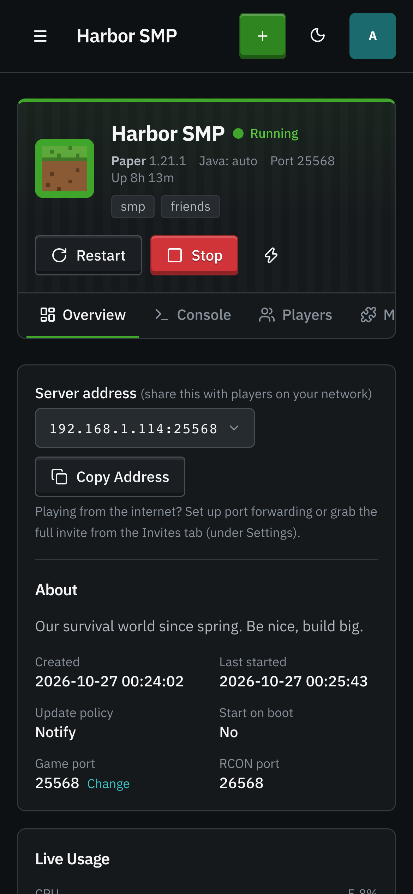

[← Indice della documentazione](/docs/)

## Configurazione iniziale

La prima volta che apri il pannello, ti viene chiesto di creare un account amministratore. Questo è l'unico account esistente finché non ne aggiungi altri e ha il controllo completo.

Scegli un nome utente e una password di almeno 8 caratteri. Fatto: sei connesso e verrai portato direttamente alla dashboard.

> **Le installazioni esposte sono protette da PIN.** Se avvii il pannello collegato a un indirizzo non di loopback (`PANEL_HOST` diverso da `127.0.0.1`), la pagina di configurazione richiederà anche un **PIN di 6 cifre**. Il pannello lo stampa nella sua console all'avvio. Inseriscilo insieme al tuo nome utente e password. Questo impedisce a uno sconosciuto che raggiunge per primo la porta di rivendicare l'account amministratore. Il PIN scompare una volta creato l'account amministratore.

## Accesso

Dopo la configurazione, il pannello è protetto da una schermata di accesso. Inserisci il tuo nome utente e password per continuare.

Se l'[autenticazione a due fattori](/docs/two-factor-authentication/) è abilitata sul tuo account, ti verrà richiesto un codice di 6 cifre dalla tua app di autenticazione subito dopo la password.

## Orientarsi

Tutto è gestito dalla barra laterale sinistra:

- **Dashboard** - tutti i server a colpo d'occhio ([dettagli](/docs/dashboard/)).
- **Server**, **Modpack**, **Mondi**, **Blueprint** - crea e gestisci server e i loro contenuti.
- **Aggiornamenti**, **Backup**, **Pianificazioni**, **Archiviazione**, **Attività** - il lato operativo: cosa è obsoleto, i tuoi snapshot, l'automazione, l'utilizzo del disco e il registro di controllo.
- **Impostazioni** (in basso): utenti, chiavi API e configurazione del pannello.

La barra superiore contiene il pulsante **Crea un server**, un **selettore di tema** (scuro/chiaro) e il tuo **menu account**, dove puoi gestire l'[autenticazione a due fattori](/docs/two-factor-authentication/) o disconnetterti.

## Su telefono o tablet

Ogni pagina è progettata prima per uno schermo stretto e poi si allarga: la barra laterale si nasconde dietro il pulsante del menu, le tabelle dati si impilano in schede, le barre degli strumenti vanno a capo e la barra dei controlli del mondo si collassa in una scheda che apri quando ne hai bisogno. Pulsanti e chip hanno una dimensione di destinazione tattile reale. Nulla è esclusivo per desktop.

  
  
  
  
  

## Cosa ti serve

Il pannello comunica con Docker per eseguire i server, quindi necessita di accesso a un demone Docker (Docker Desktop o un socket Docker Engine). Quando Docker è raggiungibile, il riquadro Docker della dashboard mostra **Connesso** e la sua versione. Se non lo è, il pannello continua a funzionare. Non potrai avviare i server finché il demone non sarà attivo.

## Prossimi passi

- [Crea il tuo primo server →](/docs/servers/)
- [Proteggi il tuo account con la 2FA →](/docs/two-factor-authentication/)
