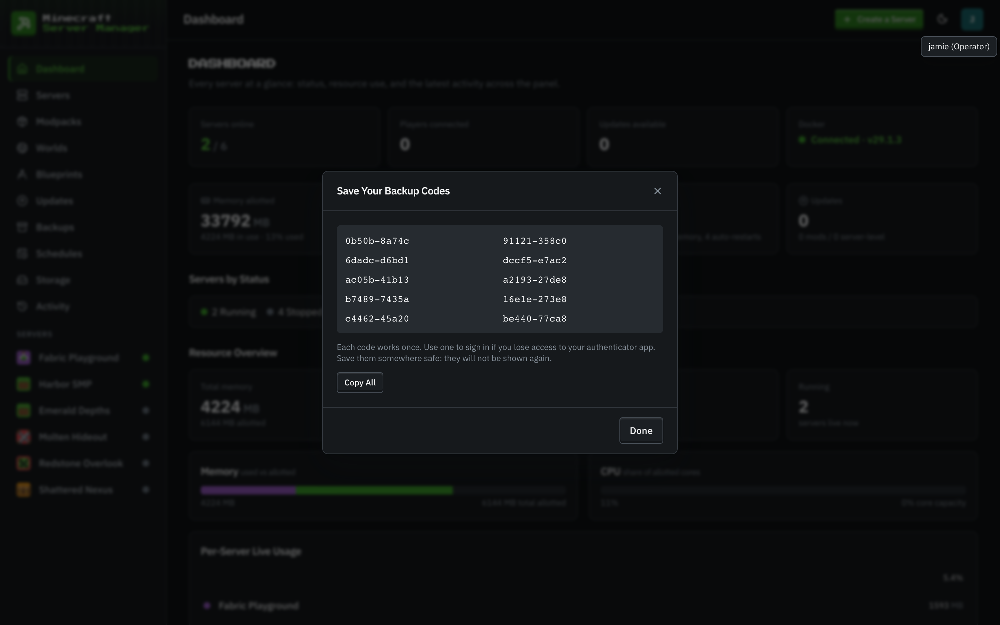

[← Indice della documentazione](/docs/)

L'autenticazione a due fattori (2FA) aggiunge un secondo passaggio all'accesso: dopo la password, inserisci un breve codice da un'app di autenticazione sul tuo telefono. Anche se qualcuno scopre la tua password, non potrà accedere senza il tuo dispositivo.

Funziona con qualsiasi autenticatore TOTP standard (Google Authenticator, Authy, 1Password, Microsoft Authenticator e altri), ed è disponibile per **tutti** gli account, non solo per gli amministratori. Proteggere il proprio accesso non è un'azione di gestione del server, quindi anche i visualizzatori e gli operatori possono abilitarla.

## Abilitare la 2FA

Apri il menu dell'account (la tua iniziale, in alto a destra) e scegli **Autenticazione a due fattori**.

Apparirà una finestra di registrazione:

1. **Scansiona il codice QR** con la tua app di autenticazione, oppure tocca **Copia** e inserisci la chiave manuale.
2. Digita il **codice di 6 cifre** che la tua app mostra ora.
3. **Conferma la tua password.** L'abilitazione della 2FA richiede nuovamente la password, quindi una sessione aperta non autorizzata non può attivarla con il dispositivo di qualcun altro.
4. Fai clic su **Abilita**.

### Salva i tuoi codici di backup

Nel momento in cui la 2FA viene abilitata, il pannello mostra un set di **codici di backup** monouso.

Ogni codice funziona **una volta sola**, per accedere se dovessi perdere l'accesso alla tua app di autenticazione. Salvali in un posto sicuro (un gestore di password è l'ideale) perché non verranno mostrati di nuovo. Puoi rigenerare un nuovo set in qualsiasi momento (il che invalida quelli vecchi).

## Accedere con la 2FA

D'ora in poi, l'accesso avrà un secondo passaggio. Dopo nome utente e password, il pannello richiederà il tuo codice:

Inserisci il codice corrente di 6 cifre dalla tua app (o uno dei tuoi codici di backup) e sei dentro. Finché non completi questo passaggio, la sessione **non** è attiva: non può accedere a nessuna pagina o API.

## Gestire o disabilitare la 2FA

Apri la stessa voce **Autenticazione a due fattori** nel menu dell'account mentre è abilitata. Dopo aver confermato la password puoi:

- **Rigenerare i codici di backup** - emette un nuovo set e ritira quello vecchio.
- **Disabilitare la 2FA** - la rimuove dal tuo account.

Entrambe le operazioni verificano prima la tua password attuale.

## Perso il telefono _e_ i codici di backup?

Un **amministratore** può reimpostare la 2FA di un altro utente da **Impostazioni → Utenti** (il pulsante **Reimposta** nella colonna 2FA). Questo cancella la 2FA per l'account in modo che l'utente possa accedere solo con la password e configurarla nuovamente. Gli amministratori non possono reimpostare la propria 2FA senza password. Passano attraverso la normale disabilitazione tramite password, quindi una sessione di amministrazione compromessa non può rimuovere il proprio secondo fattore.

## Buono a sapersi

- I codici sono basati sul tempo e ruotano ogni 30 secondi; il pannello accetta una piccola deriva dell'orologio e si recupera silenziosamente se l'orologio del server viene corretto in seguito.
- Un codice non può essere riutilizzato: una volta utilizzato per accedere, lo stesso codice non funzionerà più all'interno della sua finestra temporale.
- Codici errati sono soggetti a limitazione della frequenza. Il limite è **condiviso** con il passaggio della password (un blocco per account più un limite per IP `RATE_LIMIT_AUTH_PER_15MIN`), quindi l'inserimento di una password corretta non può resettare il contatore appena prima di indovinare il codice di 6 cifre.
- Le modifiche alla 2FA (abilitazione, disabilitazione, reimpostazione, utilizzo del codice di backup) sono tutte registrate nel [Log delle attività](/docs/activity/).
