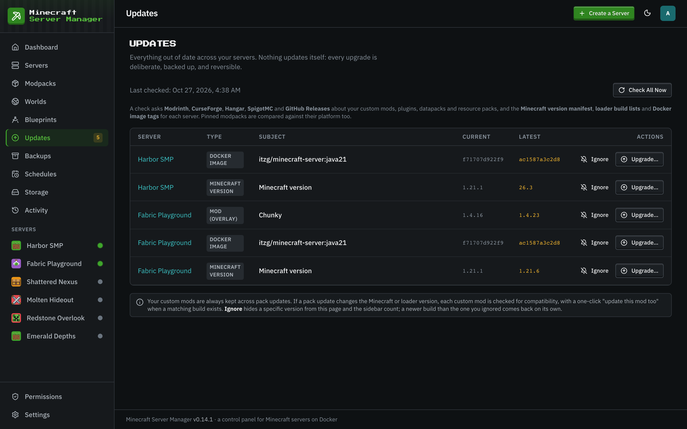

[← Torna all'indice della documentazione](/docs/)

La pagina **Aggiornamenti** tiene traccia di ciò che è obsoleto nella tua flotta in un unico posto:

- Versioni dei **Modpack** ([modpack](/docs/modpacks/)) rispetto a Modrinth / CurseForge / l'indice di rilascio GTNH.
- **Contenuti personalizzati** che hai aggiunto tu stesso (mod, datapack, resource pack, plugin), ciascuno rispetto alla sua origine: Modrinth, CurseForge, Hangar, SpigotMC (Spiget) o GitHub Releases. Le ricerche su GitHub utilizzano la rivalidazione ETag, quindi i controlli giornalieri toccano a malapena il suo limite di richieste.
- Obsolescenza dell'**immagine Docker**: l'ID dell'immagine di ogni container del server rispetto a un tag appena scaricato (deduplicato tra server con lo stesso tag), offerto come aggiornamento solo per la ricostruzione.
- **Fissaggio delle versioni standalone**: per un server senza modpack gestito, un pin esplicito `mc_version` rispetto al manifest di Mojang e una variabile d'ambiente esplicita per il loader-build (`PAPER_BUILD`, `FORGE_VERSION`, e simili) rispetto al registro del loader. I build di Paper provengono dall'attuale **Fill v3 API** di PaperMC (l'endpoint legacy v2 ha smesso di ricevere nuove versioni di Minecraft). Su un server con mod, una versione più recente di Minecraft viene offerta solo una volta che un [controllo versione](#minecraft-version-compatibility) ha mostrato che ogni mod installata ha un build per essa. Un server Forge fissato viene offerto il build consigliato da Forge, mai un build più vecchio di quello a cui è fissato, e un server fissato a una release non viene mai offerto una pre-release (uno già in beta può essere offerto una beta più recente o la release). L'applicazione di un build del loader esegue prima un backup pre-aggiornamento. Spostare un server Forge o NeoForge a una nuova versione di Minecraft cancella il suo numero di build del loader fissato, poiché un build è fatto per una versione di Minecraft; una parola chiave come `latest` viene mantenuta, poiché segue la versione da sola. Per scegliere tu stesso un build specifico, vedi [cambiare la versione del mod loader](#changing-the-mod-loader-version).

## Come funziona

Il pannello controlla le versioni fissate di ciascun server rispetto all'origine upstream e elenca tutto ciò che ha una nuova release. Un conteggio corrispondente appare anche nel riquadro "Aggiornamenti disponibili" della [dashboard](/docs/dashboard/).

I controlli vengono eseguiti quotidianamente secondo una [pianificazione](/docs/schedules/) predefinita e su richiesta con **Controlla tutto ora**. **Ignora** su una riga interrompe l'offerta di quella particolare versione; una più recente verrà offerta di nuovo. La **policy** di aggiornamento è per server: il pannello lascia tutto manuale (l'impostazione predefinita, che mantiene anche il server fuori da questa pagina), ti notifica semplicemente, oppure applica gli aggiornamenti del modpack da solo ([policy di aggiornamento](/docs/modpacks/#update-policy)).

## Compatibilità delle versioni di Minecraft

Una versione più recente di Minecraft non è un aggiornamento se le tue mod non possono venire con te. Ogni server ha la sua scheda **Versioni** (sotto Mod) che risponde a questa domanda:

- La versione che il server esegue ora e la **versione più alta per cui ogni mod installata ha un build**.
- Una riga comprimibile per ogni futura versione di Minecraft, con quanti mod sono pronti e quanti non hanno ancora nulla pubblicato. Apri una riga per vedere quali mod rimarrebbero indietro e quali vanno bene.

Premi **Controlla versioni future** per eseguirlo. Nulla viene scansionato da solo: un controllo legge ogni jar nella cartella mods del server e chiede a Modrinth e CurseForge di ciascuno, quindi accade solo quando lo chiedi tu. Il progresso e i risultati parziali vengono scritti man mano, quindi chiudere la pagina o aggiornarla non perde nulla, e un controllo interrotto da un riavvio del pannello lo dice e offre di eseguirlo di nuovo. Tutto ciò che un controllo interrotto aveva già elaborato viene mantenuto, quindi eseguirlo di nuovo non ripete quel lavoro.

Un report descrive solo il server per cui è stato creato. Cambia la versione di Minecraft, il loader o le mod stesse (aggiungine una, rimuovine una, aggiornane una) e il report viene contrassegnato come obsoleto e smette di essere utilizzato, finché non esegui di nuovo il controllo.

Le mod vengono identificate dall'elenco file del modpack stesso, dove presente, e altrimenti dal contenuto del file, nello stesso modo in cui un launcher riconosce un jar. Due tipi di mod non possono essere risposte e nessuno dei due viene indovinato:

- **Impossibile identificare**: un jar creato a mano o un build privato che nessun registro riconosce.
- **Impossibile controllare**: una mod da GitHub Releases, Hangar o SpigotMC, o una il cui progetto è stato rimosso. Questi non pubblicano un elenco di quale versione di Minecraft ogni build è destinato.

Finché uno dei due è installato, il pannello non offrirà un aggiornamento della versione di Minecraft con un clic, perché non può dire onestamente cosa si romperebbe. L'applicazione di una versione superiore a quella supportata dalle mod viene rifiutata e indica le mod che la bloccano.

Le mod che hai **disabilitato** non hanno alcun ruolo: il server non le carica, quindi disattivare una mod è un modo reale per superare un blocco. Attivare o disattivare una mod contrassegna il report per essere ricontrollato.

Questo copre i server che eseguono mod: Fabric, Forge, NeoForge e Quilt. I server di plugin in stile Paper mantengono il comportamento semplice della release più recente e non hanno una scheda Versioni, perché due dei registri da cui provengono i plugin non pubblicano nulla che un controllo possa leggere.

Aprire una versione elenca prima le mod senza un build per essa (quelle che determinano la risposta) e mantiene quelle pronte dietro un clic. I grandi modpack caricano una pagina di mod alla volta, quindi un server da 300 mod si apre velocemente come uno da cinque mod.

## Cambiare la versione del mod loader

La scheda **Versioni** ha anche una scheda **Versione Loader**. Mostra quale build di Forge, NeoForge, Fabric o Quilt il server ha installato e, dove può essere modificato, un selettore per passare a un altro.

- **Un server Forge, NeoForge, Fabric o Quilt** può eseguire qualsiasi build pubblicato. Il selettore elenca i build recenti per la versione di Minecraft del server, con i build consigliati e più recenti di Forge etichettati. **Altro Build…** accetta uno più vecchio per numero, e **Predefinito** torna a lasciare che sia il server a scegliere.
- **Un modpack Forge o Fabric CurseForge** installa la versione del loader dichiarata dal suo manifest, quindi il modo usuale per cambiarla è aggiornare il modpack. Quando il modpack stesso elenca la versione errata (una mod al suo interno richiede un Forge più recente di quello che il modpack installa), la scheda può sovrascriverlo, e **Versione del Modpack** rimuove nuovamente la sovrascrittura. L'aggiornamento del modpack lo rimuove anche, perché la nuova versione dichiara il suo loader. Se la nuova versione elenca ancora quella errata, imposta nuovamente la sovrascrittura.
- **Un modpack NeoForge CurseForge, o un modpack Modrinth,** mostra il suo loader ma non può essere sovrascritto: l'immagine del server applica la sovrascrittura solo ai modpack Forge e Fabric. Il suo loader segue la versione del modpack, quindi aggiorna il modpack invece. Il loader di un modpack FTB non può essere cambiato qui. La sua scheda di solito non appare, perché l'installer di FTB stesso mantiene registri che il pannello non legge.

Il pannello controlla che il build esista prima di chiederti qualsiasi cosa. Un build Forge o NeoForge è fatto per una versione di Minecraft, quindi su un server che segue la release più recente, fissarne uno mantiene anche il server sulla versione di Minecraft che esegue ora (la conferma lo dice). Scegliere **Predefinito** in seguito rimuove il pin ma mantiene quella versione di Minecraft. Un server che seguiva la release più recente può anche passare a un'immagine Java diversa quando viene ricostruito, quella di cui quella versione ha bisogno. Un tale server che non è mai stato avviato viene chiesto di avviarsi una volta prima, in modo che il pannello conosca quella versione. Forge salta i numeri di build (non c'è 47.4.14 tra 47.4.13 e 47.4.15), quindi una mod che "richiede 47.4.14 o superiore" è soddisfatta dal prossimo build successivo, e il rifiuto lo indica. Una modifica richiede un backup pre-aggiornamento, quindi ricostruisce il server. Il nuovo build viene installato la prossima volta che il server si avvia, e la scheda lo dice fino ad allora.

## Annullare un aggiornamento di mod

Ogni build da cui una mod viene aggiornata rimane nella libreria condivisa, quindi un aggiornamento che rompe qualcosa è reversibile. La riga della mod nella scheda **Mod** ottiene un pulsante **Ripristina** che rimette il build precedente. Non c'è download, quindi funziona anche se il progetto è stato nel frattempo rimosso dal suo registro. Il build da cui ti sei allontanato smette di essere offerto finché non appare uno più recente.

## Applicare un aggiornamento

Gli aggiornamenti non sono mai silenziosi. Quando scegli di aggiornare un modpack (o [passarlo a un'altra versione](/docs/modpacks/#changing-the-pack-version), incluse quelle più vecchie), il pannello:

1. Esegue un **backup pre-aggiornamento** (quindi è reversibile; per impostazione predefinita vengono conservati gli ultimi 10 backup pre-aggiornamento per server, vedi [conservazione](/docs/backups/#retention)).
2. Ripina la nuova versione esatta.
3. Ricostruisce il server, risolvendo nuovamente il runtime Java se necessario.
4. Monitora il primo avvio, con un budget di tempo per piattaforma.

Se non si avvia correttamente, esegui il rollback al backup pre-aggiornamento. A un server che segue la release stabile non viene mai offerta una beta, e il link al changelog punta alla vera differenza per versione dove la fonte la fornisce. Un aggiornamento fallito attiva anche un [allarme](/docs/integrations/) Discord se l'integrazione è configurata.
