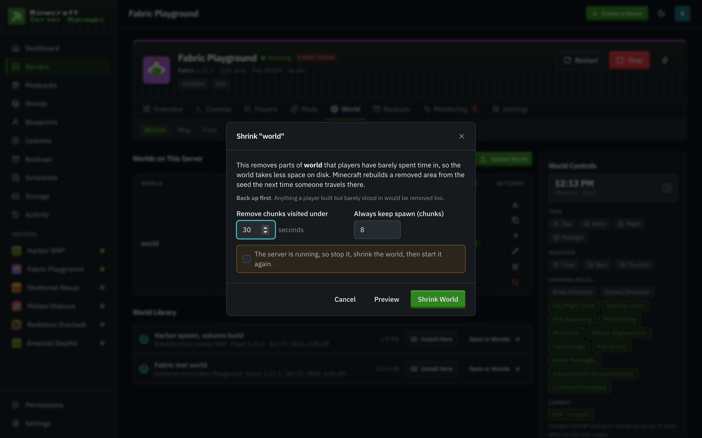

[← Indice della documentazione](/docs/)

Con il tempo un mondo si espande: ogni luogo in cui un giocatore ha mai camminato, volato o è stato trasportato da una perla dell'End lascia blocchi generati sul disco, anche se nessuno è mai tornato indietro. **Riduci mondo** rimuove i blocchi in cui quasi nessuno ha trascorso del tempo, in modo che il mondo occupi meno spazio. Minecraft ricostruisce un'area rimossa dal seme del mondo nel momento in cui qualcuno viaggia di nuovo lì, quindi questo è sicuro per la terra che nessuno sta usando, ma anche qualsiasi cosa un giocatore _abbia costruito_ in un posto in cui è stato appena, motivo per cui dovresti prima fare un backup (il backup è l'annullamento).

## Cosa conta come "raramente visitato"

Ogni blocco registra quanto tempo i giocatori hanno trascorso in piedi al suo interno (Minecraft chiama questo `InhabitedTime`). Riduci mondo rimuove qualsiasi blocco con meno di **30 secondi** di tempo totale del giocatore per impostazione predefinita; la finestra di dialogo di riduzione ti consente di modificare quella soglia (da 1 secondo a 1 ora) e quanti blocchi intorno allo spawn mantenere (predefinito 8, `0` disattiva la protezione dello spawn).

Ciò che viene mantenuto, sempre:

- L'area intorno al **punto di spawn** del mondo (letto da `level.dat`) nell'overworld. Il Nether, l'End e le dimensioni personalizzate non hanno aree di spawn.
- Qualsiasi blocco il cui tempo di visita non è stato letto, ad esempio un mondo salvato con un formato di compressione che il pannello non decodifica (LZ4). L'anteprima e il risultato ti dicono quanti blocchi di questo tipo sono stati saltati.

Ogni dimensione del mondo è coperta: cartelle secondarie in stile Bukkit (`world_nether`, `world_the_end`) così come il layout vanilla e Forge/Fabric (`world/DIM-1`, `world/DIM1`, `world/dimensions/<namespace>/<name>`).
Quando un blocco viene rimosso, le sue entità e i punti di interesse dei villici scompaiono con esso, quindi un blocco rigenerato non eredita mob, carrelli da miniera o siti di lavoro obsoleti.

## Farlo dalla scheda Mondi

1. Esegui un backup dalla scheda **Backup**. La riduzione dalla scheda Mondi non ne esegue uno per te.
2. Apri **Mondo → Mondi**, trova il mondo e fai clic sull'icona di riduzione.
3. Fai clic su **Anteprima** per vedere approssimativamente quanti blocchi (e quanti megabyte) verrebbero rimossi. Nulla è ancora cambiato; un'anteprima funziona mentre il server è in esecuzione.
4. Fai clic su **Riduci Mondo**. La riduzione modifica direttamente i file del mondo, quindi il server deve essere arrestato: arrestalo prima, oppure seleziona l'opzione per arrestarlo, ridurlo e riavviarlo in un'unica operazione (il server viene riavviato anche se la riduzione fallisce). Il progresso viene visualizzato nella barra delle attività.

## Farlo come parte di un backup

Nella scheda **Backup**, seleziona **"Riduci anche il mondo in seguito"** prima di **Esegui backup ora**. L'archivio di backup viene scritto per primo (quell'archivio è il tuo annullamento), quindi il mondo viene ridotto, ma solo se il server è arrestato. Se il server è in esecuzione, il backup viene comunque eseguito e la riduzione viene saltata con una nota.

I backup pianificati hanno la stessa opzione: nell'editor di pianificazione, scegli l'attività **Backup** e seleziona **"Riduci il mondo dopo ogni backup"**. Abbinalo a una pianificazione **Arresta server** qualche minuto prima se desideri che venga eseguito senza supervisione.
