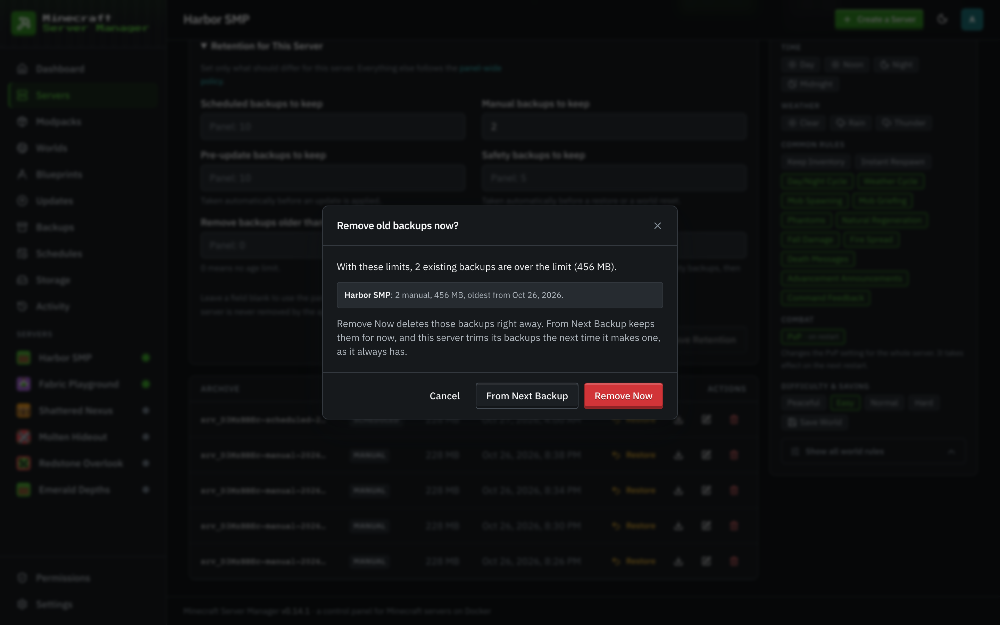

[ドキュメントインデックスへ戻る](/docs/)

**バックアップ**ページには、サーバーと理由でフィルタリング可能な、サイズ、理由、経過時間を示すフリート全体のすべてのスナップショットが表示されます。

## バックアップの作成

サーバーの**バックアップ**タブ（または[スケジュール](/docs/schedules/)経由）から、ワンクリックでサーバー全体のスナップショットを作成できます。パネルはまずワールドを静止状態にし（`save-off` → `save-all`）、データをzip化してから保存を再度有効にします（`save-on`）。これにより、実行中のサーバーでも一貫性のあるバックアップが可能です。API経由で開始されたバックアップにはメモを付けることができます。

すべてのアーカイブは、書き込まれた瞬間に**整合性チェック**されます。パネルはzipファイルを再度開き、そのディレクトリを読み取ります。破損または開けないアーカイブは削除され、復元が必要になるまで問題が表面化しないように、バックアップ呼び出しはその場で失敗します。エントリがゼロのアーカイブ（起動したことのないサーバー）は許可されますが、イベントでフラグが立てられます。

アーカイブが安全に書き込まれた後で、滅多にアクセスされないチャンクを削除するには、**「ワールドの縮小も後で行う」**（バックアップタブまたはバックアップスケジュールで）にチェックを入れます（**[ワールドの縮小](/docs/world-shrink/)**を参照）。縮小はサーバーが停止している間のみ実行されます。実行中のサーバーでは、バックアップは引き続き行われ、縮小はスキップされます。

## バックアップの理由

バックアップは、作成された理由によってタグ付けされます。

- **手動**: **今すぐバックアップ**をクリックしました。サーバーのアクティブなワールドをライブラリから置き換える場合も、最初に`手動`バックアップが取られます。
- **スケジュール**: [スケジュール](/docs/schedules/)によって作成されました。新しいサーバーはすべて、毎日スケジュールされたバックアップも自動的にシードされます（02:00から05:59の間でランダム）。これにより、サーバーは初日から自動的に保護され、アップデート前だけでなく、常に自動バックアップが行われます。
- **アップデート前**: パックのアップグレードまたはMinecraftバージョンの変更の前に自動的に取得されるため、アップグレードは常に元に戻すことができます。
- **復元前**: 復元またはワールドリセットの直前に自動的に取得されるため、復元が意図したものでなかった場合のセーフティネットとなります。

## 保留期間

保留期間は**サーバーごと、理由ごとに**上限が設けられています。各グループで最も新しいものが保持され、各バックアップが成功した後、古いものは自動的に削除されます。

| 理由           | デフォルトで保持 |
| -------------- | ---------------- |
| スケジュール   | 10               |
| アップデート前 | 10               |
| 手動           | 20               |
| 復元前         | 5                |

`復元前`（パネルではセーフティバックアップと呼ばれます）は、自動セーフティバックアップが意図的に保持した`手動`バックアップを上書きしないように、独自の小さなバケットを持っています。

理由ごとのカウントに加えて、2つのオプションの天井が適用されます。どちらもデフォルトではオフになっています。**最大経過時間**（理由に関係なく、N日より古いバックアップは削除されます）と、サーバーあたりの**最大合計サイズ**（合計サイズに収まるまで最も古いものが削除されます。セーフティバックアップが優先され、次にスケジュールされたもの、その後残りが削除されます）。サーバーの最も新しいバックアップは、どちらの天井によっても削除されません。

### 変更方法

管理者は、**設定**ページの**バックアップ保留期間**カードでパネル全体のポリシーを設定します（**組み込みを埋める**は、上記のデフォルト値をフォームに再度入力し、保存できるようにします）。サーバーは、6つの値のいずれかで異なる設定が可能です。そのサーバーの**バックアップ**タブを開き、**このサーバーの保留期間**を展開します。そこにある各フィールドは、そのサーバーが設定しない限り空白であり、空白フィールドはパネル全体の値を継承します（フィールド内に表示されます）。したがって、サーバーは例えば、3つのスケジュールされたバックアップを保持し、他のすべてにはパネル全体の値を使用できます。フィールドをクリアすると、パネル全体の値を参照するようになります。

保存しても何も削除されません。新しい制限により既存のバックアップが上限を超えた場合、パネルはサーバーごとに、どの種類のバックアップがいくつ削除されるか、どれだけのスペースが解放されるか、最も古いものの経過時間を示します。また、以前の**次のバックアップから**適用した後など、サーバーが既に上限を超えていた場合も表示されます。これは、現在の設定を適用すると、この編集で追加されたものだけでなく、上限を超えているすべてがトリミングされるためです。その後、適用方法を尋ねられます。

- **今すぐ削除**: リストされたバックアップのみを削除します。それ以外は削除しません。その間に作成されたバックアップは、次のトリミングまで待機します。設定ページから、復元中、バックアップ中などのアクションを実行中のサーバーはスキップされ、次のバックアップ後にトリミングされます。サーバー自身のバックアップタブでは、そのアクションが終了するまで再試行するように求められます。サーバーの古いバックアップが削除されている間（通常は数秒）、そのサーバーでの他のアクションは待機する必要があります。スケジュールされたバックアップまたは開始がその間に発生した場合、実行可能になるまで1分ごとに再試行します（最大30分）。クラッシュしたサーバーは、終了後約20秒で再起動します（最大30分）。スケジュールされた再起動または停止がそれに衝突した場合、次の時刻までスキップされます。
- **次のバックアップから**: 現在は保持します。各サーバーは、これまで通り、次のバックアップ時にバックアップをトリミングします。

復元中のバックアップは、復元が実行されている間は決して削除されません。保留期間はそれをそのままにし（スペースを確保するために他のバックアップを削除せず）、復元が完了するまで手動での削除は拒否されます。

同じ設定が、管理APIエンドポイントとしてもスクリプトで利用可能です。`GET`/`POST /api/backups/retention` および `/api/servers/:id/backups/retention`。パネル全体の値は`null`にできません。サーバーの場合、`null`（または`""`）の値は、そのキーを削除し、パネル全体の値を参照するようにします。`{ "reset": true }`はすべて削除します。これら2つのパスの下には、`POST …/preview`があり、変更が削除する内容を削除せずに報告します（`backups`、`bytes`、`servers`、`ids`、およびサーバーごとの`byServer`の内訳）。`POST …/apply`は、保存されたポリシーをすぐに適用し、`{ deleted, skipped }`（パネル全体の場合、「skipped」はビジーサーバーの数）または`{ deleted }`（1つのサーバーの場合）を返します。プレビューの`{ "token": "..." }`（10分間保持）または`{ "ids": [...] }`を送信して、それらのみを削除します。どちらもない場合、上限を超えているすべてが削除されます。ビジーサーバーでのサーバーごとの適用は409を返します。

バックアップは、バックアップリストから**名前を変更**できます（各行の「名前変更」ボタン）。ディスク上のアーカイブとパネルの記録は一緒に移動するため、ダウンロード、復元、保留期間は新しい名前で引き続き機能します。

> 保留期間は自動的に制限されますが、大規模なMOD入りアーカイブはサーバーの[ディスククォータ](/docs/storage/)にカウントされるため、大規模パックの合計に注意してください。

## 復元

バックアップの復元はサーバーを停止し（ファイルに触れる前にコンテナが本当に停止したことを確認）、`復元前`のセーフティバックアップを取得し、**サーバー全体ディレクトリ**をスナップショットで置き換え、停止したままにして再度起動できるようにします。アーカイブは最初に横に展開され、完全に展開された後にのみスワップインされるため、途中で失敗した復元でも現在のファイルは変更されません。パックのアップグレードは常に`アップデート前`のバックアップを最初に取得するため、悪いアップグレードはいつでも元に戻すことができます。

## パネル自身のデータベース

サーバーバックアップは、各サーバー自身のフォルダのみをカバーします。パネル自身のデータベース（`panel.db`、ユーザー、ロール、2FAシークレット、スケジュール、パックピン、履歴を保持）は、毎日のメンテナンスタイマーで個別にスナップショットが取られます。

- `VACUUM INTO`は、データフォルダの`backups/_panel/`に、一貫性があり、断片化されていないコピーを書き込みます。最も新しい**14**個が保持されます。
- 起動時にパネルは`PRAGMA integrity_check`を実行し、失敗した場合は大声でログに記録し、最も新しい正常なコピーについては`backups/_panel`を指します。

データフォルダ全体（ディスク上の暗号化キーである`.secret-key`も含まれています）をバックアップすれば、すべてをバックアップしたことになります。
