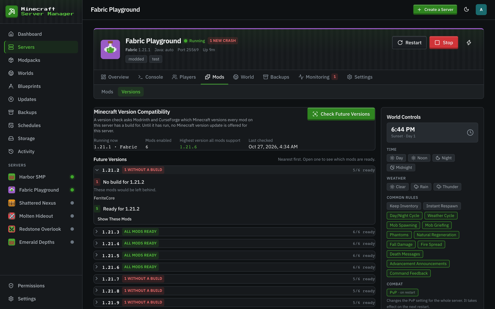

[ドキュメントインデックスへ戻る](/docs/)

**アップデート**ページでは、フリート全体で何が古いかを一箇所で追跡します。

- **Modpack**のバージョン（[modpacks](/docs/modpacks/)）を、Modrinth / CurseForge / GTNHリリースインデックスと比較します。
- ご自身で追加した**カスタムコンテンツ**（mod、データパック、リソースパック、プラグイン）を、それぞれのソース（Modrinth、CurseForge、Hangar、SpigotMC (Spiget)、またはGitHub Releases）と比較します。GitHubのルックアップはETag再検証を使用するため、毎日のチェックでレート制限にほとんど影響しません。
- **Dockerイメージ**の陳腐化：各サーバーコンテナのイメージIDを、新しくプルしたタグ（同じタグのサーバー間で重複排除）と比較し、再ビルドのみのアップグレードとして提供します。
- **スタンドアロンバージョンピン**：管理されたパックがないサーバーの場合、明示的な`mc_version`ピンをMojangのマニフェストと比較し、明示的なローダービルド環境変数（`PAPER_BUILD`、`FORGE_VERSION`など）をローダーのレジストリと比較します。PaperビルドはPaperMCの現在の**Fill v3 API**から取得されます（レガシーv2エンドポイントは新しいMinecraftバージョンの受信を停止しました）。modがあるサーバーでは、[バージョンチェック](#minecraft-version-compatibility)ですべてのインストール済みmodにビルドが存在することが示されてから、新しいMinecraftバージョンが提供されます。ピン留めされたForgeサーバーには、Forgeの推奨ビルドが提供され、ピン留めされているビルドよりも古いビルドは提供されません。リリースにピン留めされたサーバーには、プレリリース（すでにベータ版にあるものは、新しいベータ版またはリリースが提供される可能性があります）は提供されません。ローダービルドの適用は、まずアップデート前のバックアップを取得します。ForgeまたはNeoForgeサーバーを新しいMinecraftバージョンに移動すると、ピン留めされたローダービルド番号がクリアされます。ビルドは1つのMinecraftバージョン用に作成されるためです。`latest`のようなキーワードは、バージョン自体に続くため保持されます。特定のビルドを自分で選択するには、[modローダーバージョンの変更](#changing-the-mod-loader-version)を参照してください。

## 仕組み

パネルは各サーバーのピン留めされたバージョンをアップストリームソースと比較し、新しいリリースがあるものをリストします。一致するカウントは、[ダッシュボード](/docs/dashboard/)の「アップデートあり」タイルにも表示されます。

チェックはデフォルトの[スケジュール](/docs/schedules/)で毎日実行され、**すべてを今すぐチェック**でオンデマンドでも実行できます。行の**無視**は、その特定のバージョンの提供を停止します。新しいバージョンは再度提供されます。アップデート**ポリシー**はサーバーごとです。パネルはすべて手動のまま（デフォルト。これもサーバーをこのページに表示しないようにします）、通知するだけか、パックのアップデートを自分で適用します（[アップデートポリシー](/docs/modpacks/#update-policy)）。

## Minecraftバージョン互換性

modが一緒に移動できない場合、新しいMinecraftバージョンはアップグレードではありません。各サーバーには独自の**バージョン**タブ（Modsの下）があり、その質問に答えます。

- サーバーが現在実行しているバージョンと、**すべてのインストール済みmodがビルドを持っている最高のバージョン**。
- 将来の各Minecraftバージョンごとに折りたたみ可能な行があり、準備ができているmodの数と、まだ何も公開されていないmodの数を示します。行を開くと、どのmodが取り残され、どのmodが問題ないかを確認できます。

**将来のバージョンをチェック**を押して実行します。何も自動的にスキャンされるわけではありません。チェックはサーバーのmodsフォルダ内のすべてのjarをスキャンし、それぞれについてModrinthとCurseForgeに問い合わせるため、要求したときにのみ発生します。進行状況と部分的な結果は実行中に書き込まれるため、ページを閉じたり更新したりしても何も失われず、パネルの再起動によって中断されたチェックは、その旨を示して再度実行するように求めます。中断されたチェックがすでに処理したすべては保持されるため、再度実行してもその作業は繰り返されません。

レポートは、それが作成されたサーバーについてのみ記述します。Minecraftバージョン、ローダー、またはmod自体を変更した場合（modを追加、削除、または更新した場合）、レポートは期限切れとしてマークされ、再度実行するまで使用されなくなります。

modは、modpack自体のファイルリストに存在する場合はそこから識別され、それ以外の場合はファイルの内容によって、ランチャーがjarを認識するのと同じ方法で識別されます。2種類のmodは回答できず、推測もされません。

- **識別できませんでした**：手動でビルドされたjarまたはレジストリが認識しないプライベートビルド。
- **チェックできませんでした**：GitHub Releases、Hangar、またはSpigotMCからのmod、またはプロジェクトが削除されたmod。これらは、各ビルドがどのMinecraftバージョン用であるかのリストを公開しません。

いずれかがインストールされている間、パネルはワンクリックのMinecraftバージョンアップデートを一切提供しません。なぜなら、何が壊れるかを正直に言うことができないからです。modがサポートするものより高いバージョンを適用することは拒否され、それをブロックしているmodの名前が表示されます。

**無効にした**modは関係ありません。サーバーはそれらをロードしないため、modをオフにすることはブロッカーを回避する実際の方法です。modをオンまたはオフにすると、レポートが再チェックのためにマークされます。

これはmodを実行するサーバー（Fabric、Forge、NeoForge、Quilt）を対象としています。Paperスタイルのプラグインサーバーは、プレーンな最新リリース動作を維持し、バージョンタブはありません。なぜなら、プラグインのソースである2つのレジストリは、チェックが読み取れるものを何も公開しないからです。

バージョンを開くと、ビルドがないmodが最初にリストされ（回答を決定するもの）、準備ができているものはクリックで隠されます。大きなパックは一度に1ページずつmodをロードするため、300個のmodがあるサーバーも5個のmodがあるサーバーと同じくらい速く開きます。

## Modローダーバージョンの変更

**バージョン**タブには**ローダーバージョン**カードもあります。サーバーにインストールされているForge、NeoForge、Fabric、またはQuiltのビルドを示し、変更可能な場合は別のビルドに切り替えるためのピッカーが表示されます。

- **Forge、NeoForge、Fabric、またはQuiltサーバー**は、公開されている任意のビルドを実行できます。ピッカーには、サーバーのMinecraftバージョン用の最近のビルドがリストされ、Forgeの推奨ビルドと最新ビルドがラベル付けされています。**その他のビルド…**は、番号で古いビルドを受け入れ、**デフォルト**はサーバーに選択させるように戻ります。
- **ForgeまたはFabricのCurseForge modpack**は、独自のManifestが宣言するローダーバージョンをインストールするため、通常の方法で変更するにはパックをアップデートします。パック自体が間違ったバージョンをリストしている場合（パック内のmodがパックがインストールするものよりも新しいForgeを要求している場合）、カードでオーバーライドでき、**Modpackのバージョン**でオーバーライドを削除できます。パックのアップデートでも削除されます。新しいバージョンが独自のローダーをリストしている場合でも、オーバーライドを再度設定します。
- **NeoForgeのCurseForge modpack、またはModrinth modpack**はローダーを表示しますが、オーバーライドできません。サーバーイメージはForgeおよびFabricパックにのみオーバーライドを適用します。ローダーはパックバージョンに従うため、代わりにパックをアップデートします。FTBパックのローダーもここで変更できません。そのカードは通常表示されません。FTB独自のインストーラーがパネルが読み取れないレコードを保持しているためです。

パネルは、何かを尋ねる前にビルドが存在することを確認します。ForgeまたはNeoForgeのビルドは1つのMinecraftバージョン用に作成されるため、最新リリースに従うサーバーでは、それをピン留めするとサーバーも現在実行中のMinecraftバージョンに留まります（確認画面に表示されます）。その後**デフォルト**を選択すると、ピンは削除されますが、そのMinecraftバージョンは保持されます。最新リリースに従っていたサーバーは、再ビルド時に別のJavaイメージに移動する可能性もあります。そのようなサーバーでまだ起動したことがない場合は、まず一度起動するように求められます。これにより、パネルはそのバージョンを認識できます。Forgeはビルド番号をスキップします（47.4.13と47.4.15の間に47.4.14はありません）。そのため、「47.4.14以上が必要」なmodは、次のビルドで満たされ、拒否された場合にその名前が表示されます。変更はアップデート前のバックアップを取得し、サーバーを再ビルドします。新しいビルドは、サーバーが次に起動するときにインストールされ、それまでカードに表示されます。

## Modアップデートの取り消し

modがアップデートされる前のすべてのビルドは共有ライブラリに残るため、何かを壊すアップデートは元に戻すことができます。**Mods**タブのmodの行に**元に戻す**ボタンが表示され、前のビルドを元に戻します。ダウンロードがないため、プロジェクトがレジストリから削除された後でも機能します。元に戻されたビルドは、新しいビルドが表示されるまで提供されなくなります。

## アップデートの適用

アップデートは決してサイレントではありません。パックのアップグレードを選択したとき（または[別のバージョンに切り替えたとき](/docs/modpacks/#changing-the-pack-version)）、パネルは次のことを行います。

1. **アップデート前のバックアップ**を取得します（元に戻せるようにするため。デフォルトではサーバーごとに最後の10個のアップデート前バックアップが保持されます。[保持期間](/docs/backups/#retention)を参照）。
2. 正確な新しいバージョンを再ピン留めします。
3. サーバーを再ビルドし、必要に応じてJavaランタイムを再解決します。
4. プラットフォームごとの時間予算で、最初の起動を監視します。

正常に起動しない場合は、アップデート前のバックアップにロールバックします。安定版を追跡するサーバーにはベータ版は提供されず、変更ログリンクはソースが提供する場合の実際のバージョンごとの差分を指します。失敗したアップデートは、統合が構成されていれば、Discord [アラート](/docs/integrations/)もトリガーします。
