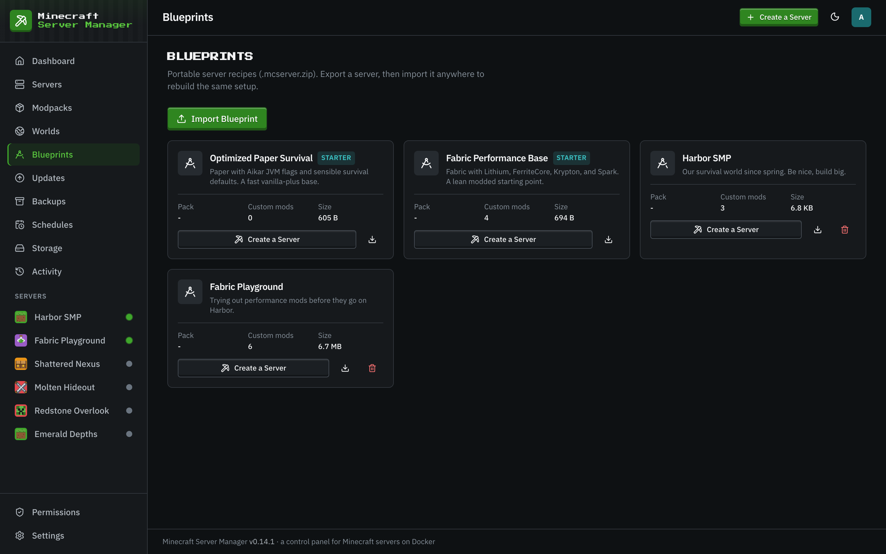

[← 문서 색인으로 돌아가기](/docs/)

**블루프린트**는 서버의 전체 구성(유형, 버전, 리소스, 환경, 팩 고정, 선택적으로 구성 및 월드)을 단일 이식 가능한 파일로 캡처하여 새 서버를 찍어낼 수 있게 합니다.

## 내보내기

서버에서 블루프린트를 내보내고 포함할 내용을 선택하세요: 구성은 항상 포함되며, 선택적으로 임베드된 파일과 월드를 포함할 수 있습니다. 결과는 블루프린트 라이브러리에 저장되며 공유를 위해 다운로드할 수 있습니다.

## 블루프린트에서 가져오기 및 생성

블루프린트 파일을 가져오거나(라이브러리에서 선택) 새 서버를 생성하여 원본과 정확히 동일하게 사전 구성할 수 있습니다. 다음을 위한 가장 빠른 방법입니다:

- 동일한 서버 실행(미니게임 서버 네트워크, 프로덕션의 스테이징 복사본).
- 패널 간 서버 이동.
- 언제든지 되돌아갈 수 있는 알려진 좋은 템플릿 유지.

블루프린트는 정확한 [팩 고정](/docs/modpacks/)을 기록하므로, 블루프린트에서 다시 생성된 모드팩 서버는 놀라운 업그레이드 없이 동일한 고정 버전을 설치합니다.
