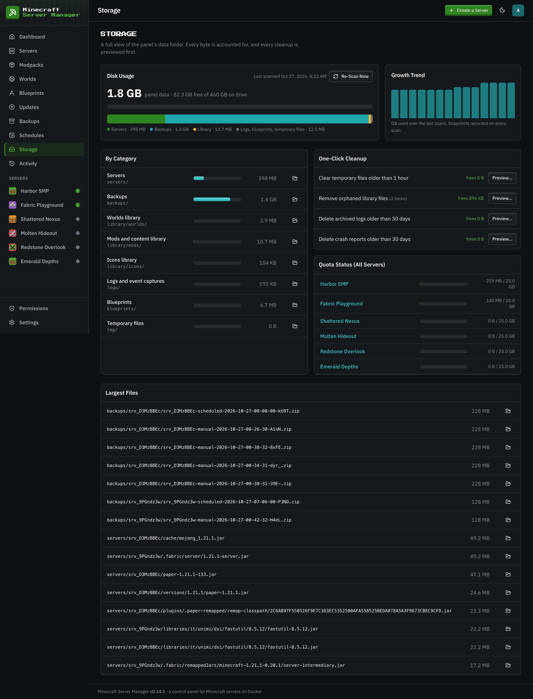

[← 문서 색인으로 돌아가기](/docs/)

**저장소** 페이지에서는 디스크 사용량 추세를 카테고리별, 서버별 할당량 대비 사용량, 가장 큰 파일, 그리고 최근 스캔에 따른 총 사용량 추세를 보여줍니다. 관리자 전용입니다.

## 디스크 할당량은 패널에서 강제 적용됩니다

Docker는 바인드 마운트의 디스크 사용량을 제한할 수 없으므로 패널에서 이를 관리합니다. 백그라운드에서 실행되는 크기 인덱서가 데이터 폴더를 주기적으로 (15분마다, 변경 후 또는 **지금 다시 스캔**을 누를 때) 스캔하고 각 서버의 사용량을 캐싱하여 서버별로 설정한 디스크 할당량을 강제 적용합니다. 모드를 설치하거나 월드를 추가하거나 파일을 업로드하는 등 서버 폴더(월드, 모드, 설정, 로그 및 기타 모든 파일)가 할당량을 초과하게 되는 작업은, 하나의 서버가 호스트를 가득 채우는 것을 방지하기 위해 공간이 확보되거나 할당량이 늘어날 때까지 차단됩니다.

서버의 할당량은 해당 서버의 [설정](/docs/servers/#server-settings)에서 설정할 수 있습니다. 여기서 **할당량 초과 시 서버 중지**를 활성화하면, 서버 폴더가 할당량의 10%를 초과하여 커질 경우 실행 중인 서버가 중지되고 서버 기록에 해당 내용이 기록됩니다. 모드가 적용된 서버는 용량이 클 수 있으므로 충분한 공간을 확보해 주세요. [백업](/docs/backups/)은 별도로 저장되며 할당량에 포함되지 않습니다.

## 정리

**원클릭 정리** 카드는 패널이 안전하게 회수할 수 있는 공간을 확보해 줍니다. 여기에는 1시간 이상 된 임시 파일, 고아 라이브러리 파일, 30일 이상 된 아카이브 로그 및 크래시 보고서가 포함됩니다. 각 항목은 얼마나 많은 공간을 확보할 수 있는지 보여주며, 삭제 전에 미리보기를 제공합니다. **카테고리별** 및 **가장 큰 파일** 목록은 파일 관리자로 바로 연결되므로, 공간이 부족하기 전에 정리할 다른 항목을 찾을 수 있습니다.
