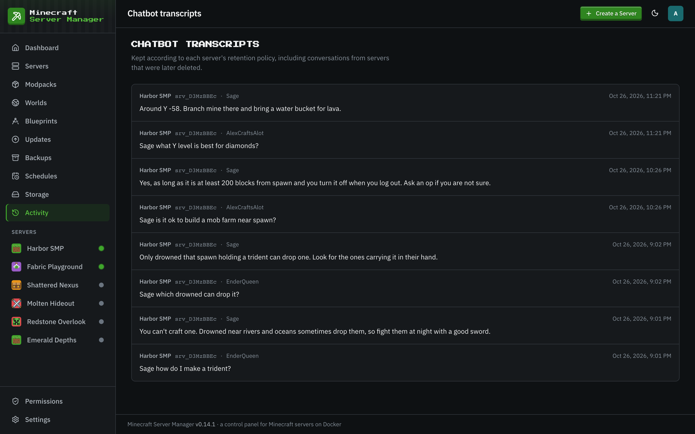

[← Tilbake til dokumentindeks](/docs/)

Panelet tilbyr en admin-konfigurert chatbot for hver administrerte Minecraft-server, satt opp under fanen **Innstillinger → Chatbot** på serveren. Den kobler til et
OpenAI-kompatibelt chat-completions-endepunkt, inkludert Ollama på en annen LAN-vert. Hver server har
sitt eget endepunkt, modell, invokasjonsnavn, persona, transkripsjonspolicy, utgående meldinger og
maktpolicy. Standardinvokasjonen er `@wizard`, og standardpersonaen demonstrerer en eldgammel,
leken trollmann i spillet; begge kan redigeres.

## Spillerens opplevelse

- Enhver spiller kan bruke `@wizard <melding>` (eller den konfigurerte invokasjonen) for samtale og
  deterministisk, Minecraft-versjonsbevisst hjelp til vanlige oppskrifter.
- Hilsener ved innlogging og en konfigurerbar engangs-sjekk-inn for spilløkten minner spillere om at chatboten er
  tilgjengelig. `@wizard chat` åpner et kort samtalevindu for opt-in; `@wizard bye` lukker det.
- **Grunnleggende brukere** kan utløse aktiverte selv/verdens-makter. **Maktkontrollere** kan utløse separat
  validerte handlinger som påvirker en annen online spiller. Spillere i ingen av gruppene forblir
  kun for samtale.
- Grunnleggende brukeres selv-gaver bruker en tillatt liste for gjenstander. Kontrollere kan gi en annen spiller enhver gyldig
  navneromsbasert vanilla eller modifisert gjenstand, underlagt mengdebegrensningen og andre makt-sikkerhetstiltak.

## Design og sikkerhet

Konfigurasjon og transkripsjoner er kun for administratorer. Modellen mottar aldri rå RCON eller vilkårlig
kommandoeksekvering. En melding eksponerer kun det ene faste verktøyet som samsvarer med dens eksplisitte intensjon;
serverkoden validerer autorisasjon, argumenter, flagg, mengder, nedkjølingstider og nøyaktige online
spillernavn før den utfører en eksisterende tjenesteoperasjon. Minecraft-selektorer avvises,
kryss-spillerhandlinger kan ikke målrette den som kaller, makter starter i tørrkjøringsmodus, og hver forsøkte
makt blir revidert. Modeller som ikke støtter verktøykalling, faller tilbake til kun samtale.

Svar er begrenset for Minecraft-chat. Kjente vanilla-oppskrifter kommer fra medfølgende versjonsbaserte oppskriftsdata og gjengis som stabile 2x2/3x3 rader; LLM-en stoles ikke på til å finne opp oppskriftslayout. Ukjente eller modifiserte oppskrifter henviser spilleren til JEI/REI i stedet for å fabrikkere et svar.

## Hovedimplementasjonsfiler

- `src/services/wizard.js`: konfigurasjon per server, OpenAI-kompatible forespørsler, chatthåndtering,
  utgående meldinger, transkripsjonslagring og svargrenser.
- `src/services/wizardPowers.js`: rolle-sjekker, intensjonsspesifikke verktøyskjemaer, validering, eksekvering,
  nedkjølingstider og makt-revisjon.
- `src/services/wizardRecipes.js`: deterministisk versjonsbasert oppslag av oppskrifter og rutenettformatering. Oppskrifts-
  og gjenstandsdata kommer fra den medfølgende [`minecraft-data`](https://github.com/PrismarineJS/minecraft-data)
  pakken. (Et tidligere utkast til dette dokumentet pekte på en `src/data/recipes/`-mappe som aldri ble
  innsjekket; det finnes ingen slik mappe, og dataene ligger i pakken. Se "Avhengighetsavtrykk".)
- `src/analytics/ingest.js`: videresender parsede innlogginger, utlogginger og spillerchatter til chatboten.
- `src/web/routes/wizard.js`, `public/js/pages/integrations.js`, og
  `views/partials/server/integrations.hbs` (via `chatbot.hbs`): admin API og fanen Innstillinger → Chatbot per server.
- `src/db/migrations/011_wizard_chat.js`, `013_wizard_invocation_name.js`, `015_wizard_powers.js`,
  `017_wizard_outreach.js`, og `019_wizard_power_controllers.js`: persistent skjema.
- `test/wizard.test.js`: autorisasjon, verktøy-grenser, lagring, utgående meldinger og chatteatferds-tester.

De interne `wizard`-rute/modul/tabellnavnene beholdes for oppgraderings- og API-kompatibilitet;
"chatbot" er produkttermen som vendes mot brukeren. Tilsvarende mapper `power_testers_json`-feltet til
brukergrensesnittets gruppe **Grunnleggende brukere**.

## Avhengighetsavtrykk (`minecraft-data`)

Hjelp til oppskrifter bruker `minecraft-data`-pakken. Den er stor på disk (ca. 429 MB installert), og den
leveres inne i produksjonsimaget fordi den er en kjøretidsavhengighet, ikke en utviklingsavhengighet. Vi beholder den
med vilje slik at oppskriftshjelp fungerer offline for alle Minecraft-utgivelser uten nettverkskall.

Merknader for den som ser på dette neste (menneske eller AI), slik at størrelsen ikke blir en overraskelse:

- Kun Java (`pc`)-dataene brukes for øyeblikket. `wizardRecipes.js` leser `minecraftData.versions.pc`
  og tabellene `recipes`, `items` og `blocks` per versjon. Filene den faktisk berører, summerer seg til
  omtrent 15 MB på tvers av alle pc-versjoner.
- Rundt 330 MB av pakken er `data/bedrock`, og ingenting her leser den ennå. Vi lar den være
  på plass med vilje. Hvis panelet noen gang legger til støtte for Bedrock Minecraft, er Bedrock-oppskriften og gjenstandsdataene
  allerede her, så oppskriftsfunksjonen kan utvides til å dekke Bedrock-servere uten å legge til en ny
  avhengighet. Start fra `minecraftData.versions.bedrock` og følg samme form som pc-stien.
- Hvis størrelsen noen gang må reduseres før Bedrock-støtte kommer, finnes det allerede et mønster for det
  i dette depotet. `src/services/itemRegistry.js` henter `minecraft-data`-filer fra jsDelivr CDN
  når den trenger dem og cacher dem i `api_cache`. Enten den tilnærmingen, eller en liten håndplukket
  undergruppe `src/data/recipes/` som dekker noen vanlige versjoner, ville krympet imaget betraktelig.

## Lokal lagring og manuell inspeksjon

Alle innstillinger og lagrede transkripsjoner ligger i panelets SQLite-database på `/data/panel.db` inne
i panelcontaineren. Med standard Compose-montering er vertsbanen
`${DATA_DIR_HOST}/panel.db` (for eksempel `/opt/msm/data/panel.db`). Relevante tabeller er
`wizard_configs`, `wizard_transcripts` og `wizard_outreach`; makt-revisjoner er rader i `events`-tabellen
med typen `wizard-power`. Den valgfrie LLM API-nøkkelen er AES-256-GCM-kryptert med panelets
hviletilstands-nøkkel, `.secret-key` i datamappen (separat fra `SESSION_SECRET`).

Sikkerhetskopier databasen og stopp panelet før direkte SQLite-redigeringer slik at WAL-en håndteres trygt.
Bruke admin-UI/API er foretrukket fordi det bruker validering og kryptering. Hold
`panel.db`, `panel.db-wal` og `panel.db-shm`-filene samlet når du kopierer en live database.
