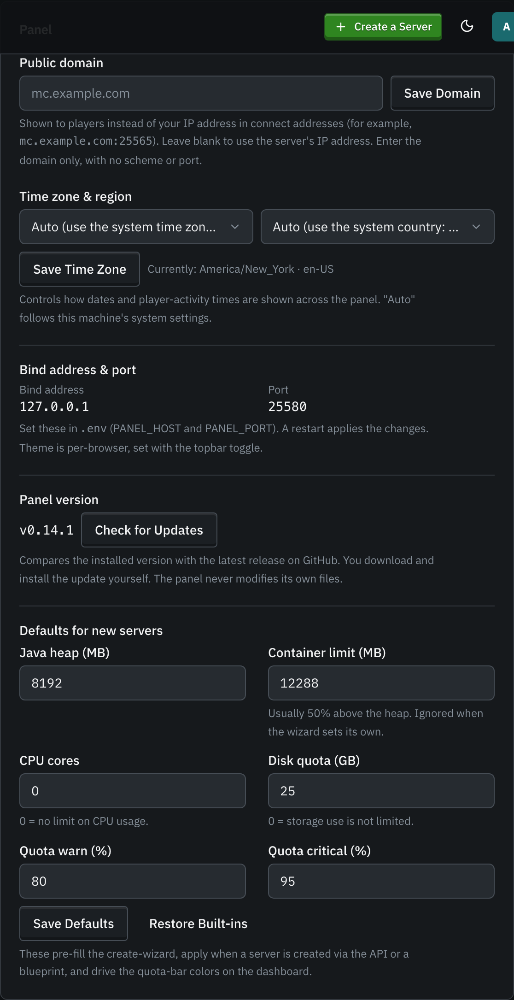

[← Tilbake til dokumentindeks](/docs/)

## Opprette en server

Klikk **Create a Server** (øverst på siden) eller kortet **Create a Server** for å åpne veiviseren.

Veiviseren forhåndsutfyller Java heap og diskkvote fra **Defaults for new servers** på Innstillinger-siden, som en administrator kan endre når som helst. En ny server henter CPU-grensen sin derfra også.

Du velger:

- Et **navn** (og en valgfri beskrivelse, ikon og aksentfarge). Merkelapper for å organisere flåten din legges til senere, på serverens innstillinger.
- En **servertype**: Vanilla, Paper, eller Purpur på **Vanilla**-fanen. For en moddet server, velger **From Mods**-fanen lastemodulen (Fabric, Forge, NeoForge, eller Quilt), Minecraft-versjonen, og en lastemodul-build (den siste, eller en spesifikk), deretter lar deg søke etter mods.
- En **Minecraft-versjon**: `LATEST`, en snapshot, eller en spesifikk versjon (betaer og alfer inkludert).
- En **spillport**: en ledig port foreslås. Fjernkontrollen (RCON) bruker porten 1000 høyere (som standard). Du kan endre den senere (se [Endre spillporten](#changing-the-game-port)).
- **Ressurser**: Java heap (containerens minnegrense settes 50 % over den) og en diskkvote.

**Advanced Options** åpner alle andre innstillinger serverbildet støtter, pluss ekstra miljøvariabler og (for administratorer) de avanserte Docker-innstillingene.

Foretrekker du en modpack? **From Modpack**-fanen installerer en CurseForge, Modrinth, eller GT New Horizons-pakke i stedet (se [Modpacks](/docs/modpacks/)), eller tar en **tilpasset zip du laster opp**: en Modrinth `.mrpack`, en CurseForge modpack-eksport (`manifest.json`), eller en hvilken som helst zip med mod-filer. Manifestet (eller et flertall av de identifiserte filene) fyller inn lastemodulen og Minecraft-versjonen, og alle mods installeres i én oppgave. Du kan også starte fra en lagret [Blueprint](/docs/blueprints/) på **From Blueprint**-fanen.

Panelet velger en fornuftig Java-kjøretid for versjonen din automatisk, henter bildet, oppretter containeren og starter den, alt fra ett skjema.

## Serverlisten

**Servers**-siden lister opp hele flåten din med status og raske statistikker.

## En enkelt server

Åpning av en server gir deg et arbeidsområde med faner:

- **Overview**: adressen å dele med spillere, beskrivelsen, sanntidsbruk, og hvem som er pålogget.
- **Console**: sanntidsloggstrømmen og kommandolinjen, chat i spillet, og [chatkommandoer](/docs/console-and-chat/).
- **Players**: listen over spillere, pluss inventar og statistikk.
- **Mods**: listen over installerte mods, [mod-leseren](/docs/modpacks/), og innholdsoppdateringer. På en moddet server, sjekker underfanen **Versions** hvilke fremtidige Minecraft-versjoner modsene dine har builds for ([oppdateringer](/docs/updates/#minecraft-version-compatibility)).
- **World**: [verdener, sanntidskartet og filbehandleren](/docs/worlds-and-files/).
- **Backups**: [øyeblikksbilder og gjenoppretting](/docs/backups/) for denne serveren.
- **Monitoring**: historikk og sanntidsmålinger per server, inkludert krasjrapporter (se nedenfor).
- **Settings**: **Configuration** (alt om hvordan serveren kjører), pluss [integrasjonene](/docs/integrations/) (Discord, Status Page, Invites, og, for administratorer, Chatbot).

Start-, stopp- og omstartkontrollene sitter i toppteksten over hver fane. Hva du kan gjøre på hver fane avhenger av [tillatelsene dine på den serveren](/docs/users-and-roles/#per-server-permissions): for eksempel, underfanen **Files** krever Files-tillatelsen, og å sende konsollkommandoer krever Console.

**World Controls**-panelet følger med på hver fane: spillets klokke, vær, vanlige gamerules som vekslebrikker, og "Show all world rules" for resten.

**Monitoring → Live** viser TPS og millisekunder per tick, et helse- og stabilitetskort med krasj (siste 24 timer og 7 dager), minnefeil, og automatiske omstarter, og størrelser per verden.

## Serverinnstillinger

**Settings → Configuration** er den komplette konfigurasjonsflaten: navn, beskrivelse, MOTD, ikon, farge og merkelapper, ressurser, spillporten, oppdateringspolicy, start ved paneloppstart og automatisk omstart ved krasj, alle miljøvariabler serverbildet støtter, de avanserte Docker-innstillingene, og eksport, kloning, gjenoppbygging og sletting av blueprints. Endringer som bare trer i kraft når serveren er gjenoppbygd, lagres umiddelbart og venter: en **Apply Changes**-knapp vises i serverens topptekst, og de blir også brukt neste gang serveren starter.

**Auto-restart on crash** starter en krasjet server på nytt, venter lengre mellom hvert forsøk (5, 10, deretter 20 sekunder) og stopper etter 3 forsøk innen 10 minutter. Den hopper over krasj som panelet gjenkjenner som et oppsettproblem (EULA, feil Java, en verden fra en nyere versjon, en port i bruk, minnemangel, en manglende CurseForge-nøkkel), fordi de krever en fiks først. Hvis en annen handling er opptatt med serveren (en sikkerhetskopi, en gjenoppretting, en portendring), venter den opptil 30 minutter, og den gir opp så snart noen stopper eller starter serveren selv.

Direkte endringer av innstillinger sitter alltid fast på tvers av omstarter. En PvP- eller vanskelighetsgradsendring gjort med **World Controls**-panelet, en whitelist-veksling på **Players**-fanen, eller en `server.properties`-redigering i **Files**-editoren fjerner den tilsvarende miljøvariabelen (hvis en var satt) og markerer serveren for gjenoppbygging, slik at verdien på disken vinner i stedet for å bli re-asserted av containerbildet ved neste oppstart.

**Om minnemåleren.** "RAM (Java heap)" gis til Java som både start- og maksimale heap, og Java fyller en heap den fikk på forhånd innen det første minuttet, med eller uten Aikar / MeowIce flagg-forhåndsinnstillingene. Så minnemåleren stabiliserer seg på omtrent heap-størrelsen og blir der selv når ingen spiller; hakket på måleren markerer hvor heapen ligger under containergrensen, og merknaden under sier det. Hvis du heller vil se minnet følge reell bruk, gi serveren en mindre start-heap med **Initial heap** i Resources-kortet på **Settings → Configuration** (eller under **Advanced Options** i veiviseren), for eksempel 512 MB: på en 2 GB heap som reduserte inaktiv bruk fra 2,6 GB til omtrent 1,3 GB i våre målinger. Java trenger også minne utenfor heapen (omtrent 0,5 GB på vanilla, 1,5 til 2 GB på en stor modpack), som er det containergrensens slingringsmonn er til for. Se READMEs "Two memory limits" for tallene.

> **Advanced Docker Settings** (containernavn, Docker-nettverk, ekstra portmappinger og ekstra volum-bind) er **kun for administratorer**, fordi en bind mount pluss panelets Docker-tilgang er effektivt root på verten. Se [Users & roles](/docs/users-and-roles/).

### Endre spillporten

**Game Port**-kortet på **Settings → Configuration** flytter en server til en annen port når som helst, med sin egen **Save Port**-knapp. **Use Next Free Port** velger den laveste ledige, og kortet sjekker enhver port du skriver inn før du lagrer den. RCON følger alltid 1000 over spillporten (standardforskyvningen). Administratorer kan velge hvilken som helst port fra 1024 og oppover; alle andre velger fra den første spillporten (25565 som standard) og oppover. Lagring bruker endringen umiddelbart: en stoppet server flyttes bare, og en kjørende server spør først, deretter starter den på nytt på den nye porten (verden lagres først, og spillere kobler til igjen på den nye porten). Hvis serveren ikke kan starte på den nye porten, går den tilbake til den gamle. Endringen nektes mens andre endringer venter på **Apply Changes**, så bruk dem først. Å endre porten krever Settings-tillatelsen på den serveren.

## Krasjrapporter & mclo.gs-analyse

Krasjrapporter (`crash-reports/*.txt` og JVM `hs_err_pid*.log`-filer) plukkes opp automatisk, parses til en enlinjers oppsummering med unntak og mistenkte mods, og listes under **Monitoring → History**:

Hvert rapportkort tilbyr en innebygd seer (med sammenleggbare seksjoner og uthevede unntak), kopier-stack-trace, og nedlasting, pluss to [mclo.gs](https://mclo.gs)-handlinger:

- **Share to mclo.gs** publiserer rapporten som en offentlig paste og kopierer lenken: akkurat det mod-forfattere og support Discords ber om. Lenken huskes på rapporten, så ingenting blir noen gang lastet opp to ganger.
- **Analyze** kjører mclo.gs's automatiserte innsikter over pasten: kjente problemer med foreslåtte løsninger (manglende avhengigheter, versjonskonflikter, vanlige mod-konflikter), gjengitt rett i panelet.

Begge handlingene er bak en eksplisitt bekreftelse, fordi en paste er offentlig: krasjrapporter kan inneholde spillernavn og hele mod-listen din. Panelet laster aldri opp noe på egen hånd.
