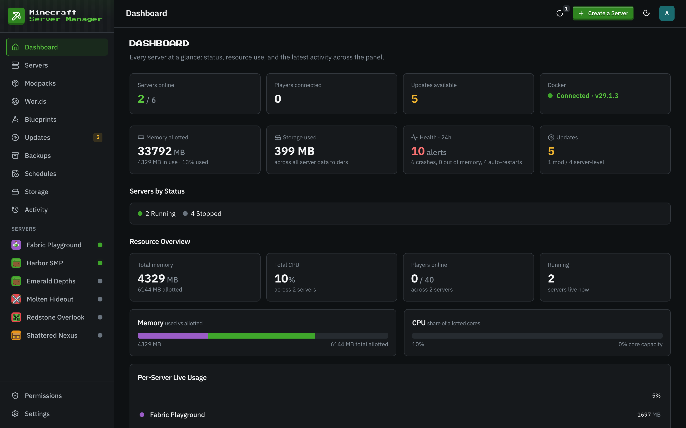

Kompleksowy, samodzielnie hostowany panel sterowania dla [itzg/docker-minecraft-server](https://github.com/itzg/docker-minecraft-server). Twórz, uruchamiaj i zarządzaj serwerami Minecraft z przeglądarki. Bez linii poleceń, bez ręcznej edycji YAML.

## Zacznij tutaj

- **[Pierwsze kroki](/docs/getting-started/)** - konfiguracja początkowa, logowanie i zapoznanie się z interfejsem.
- **[Panel sterowania](/docs/dashboard/)** - szybki podgląd wszystkich serwerów, graczy i aktywności.

## Uruchomione serwery

- **[Tworzenie i zarządzanie serwerami](/docs/servers/)** - kreator tworzenia, typy serwerów, wersje i ustawienia dla poszczególnych serwerów.
- **[Konsola i polecenia czatu](/docs/console-and-chat/)** - konsola na żywo i niestandardowe polecenia czatu w grze, które działają jako gracz.
- **[Modpacki](/docs/modpacks/)** - instaluj paczki CurseForge, Modrinth, FTB i GT New Horizons, zawsze przypięte do dokładnej wersji.
- **[Światy i pliki](/docs/worlds-and-files/)** - zamieniaj światy, zarządzaj modami i edytuj pliki bezpośrednio w przeglądarce.
- **[Zmniejszanie świata](/docs/world-shrink/)** - odzyskaj miejsce na dysku, usuwając nieodwiedzane fragmenty, samodzielnie lub jako część kopii zapasowej.
- **[Mapa na żywo](/docs/live-map/)** - jednoklikowa, trójwymiarowa mapa świata BlueMap, dostępna za panelem logowania.
- **[Zaproszenia i strona statusu](/docs/invites-and-status-page/)** - adres, tekst zaproszenia i paczka modów klienta dla znajomych oraz publiczna strona statusu.

## Dane i automatyzacja

- **[Chatbot dla każdego serwera](/docs/chatbot/)** - lokalna rozmowa zgodna z OpenAI, powiadomienia, zapisane transkrypcje i ograniczone uprawnienia do rozgrywki.
- **[Kopie zapasowe](/docs/backups/)** - migawki jednym kliknięciem, zaplanowane kopie zapasowe, liczba przechowywanych kopii (globalnie lub na serwer) i przywracanie.
- **[Schematy](/docs/blueprints/)** - przechwyć całą konfigurację serwera i twórz na jej podstawie nowe.
- **[Harmonogramy](/docs/schedules/)** - restarty, kopie zapasowe i polecenia sterowane przez cron.
- **[Przestrzeń dyskowa](/docs/storage/)** - wykorzystanie dysku przez serwer i narzucone przez panel limity.
- **[Aktualizacje](/docs/updates/)** - śledź nowe wersje serwerów, paczek, obrazów i modów, sprawdzaj, które wersje Minecrafta obsługują Twoje mody, i cofaj aktualizacje modów.
- **[Dziennik aktywności](/docs/activity/)** - ścieżka audytu wszystkiego, co się wydarzyło.
- **[Integracje](/docs/integrations/)** - powiadomienia przez webhook Discord i kategoria Alertów.
- **[Publiczne API](/docs/public-api/)** - tylko do odczytu, uwierzytelnione tokenem API HTTP do pobierania statusu serwera spoza panelu.

## Konta i bezpieczeństwo

- **[Użytkownicy i role](/docs/users-and-roles/)** - administrator, operator i widz, co każdy może zrobić, oraz uprawnienia dla poszczególnych serwerów, które je doprecyzowują.
- **[Uwierzytelnianie dwuskładnikowe](/docs/two-factor-authentication/)** - zabezpiecz swoje logowanie za pomocą aplikacji uwierzytelniającej.

## Poradniki

Nie dotyczą specyficznie tego panelu: pytania, z którymi każdy właściciel serwera Minecraft się spotyka.

- **[Ile RAM-u potrzebuje serwer?](/docs/guide-server-memory/)** - dwie liczby do ustawienia i dlaczego bezczynny serwer zużywa 12 GB.
- **[Vanilla, Paper, Fabric, Forge, NeoForge, Quilt](/docs/guide-choosing-a-loader/)** - który wybrać i różnica między wtyczkami/modami stojąca za tym wyborem.
- **[Twój serwer się nie uruchamia](/docs/guide-server-wont-start/)** - czytanie logów i garstka przyczyn większości błędów.
- **[Kopie zapasowe, które faktycznie się przywracają](/docs/guide-backups/)** - spójne kopie, co jeszcze zachować i przetestowanie jednej przed potrzebą.
- **[Przenoszenie serwera na innego hosta](/docs/guide-moving-a-server/)** - kolejność, która skraca czas przestoju i zachowuje nienaruszone ekwipunki.

## Pod maską

- **[Architektura](/docs/architecture/)** - jak panel jest zbudowany.
- **[Strona internetowa](/docs/website/)** - jak strona minecraft-server-manager.com jest budowana, tłumaczona i wdrażana z tego repozytorium.

---

> Zrzuty ekranu w tych dokumentach są wykonane w ciemnym motywie panelu. Panel domyślnie uruchamia się w trybie ciemnym, chyba że Twój system operacyjny preferuje jasny; użyj przełącznika motywu w górnym pasku, aby zmienić.
