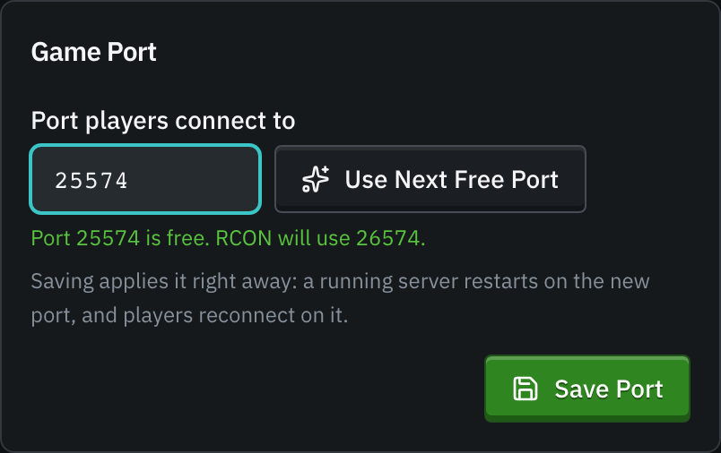

[← Wróć do spisu dokumentacji](/docs/)

## Tworzenie serwera

Kliknij **Utwórz serwer** (górny pasek) lub kartę **Utwórz serwer**, aby otworzyć kreatora.

Kreator wstępnie wypełnia stertę Javy i limit dysku z sekcji **Domyślne ustawienia dla nowych serwerów** na stronie Ustawienia, które administrator może zmienić w dowolnym momencie. Nowy serwer pobiera z niej również limit CPU.

Wybierasz:

- **Nazwę** (oraz opcjonalny opis, ikonę i kolor akcentu). Tagi do organizacji floty dodasz później, w ustawieniach serwera.
- **Typ serwera**: Vanilla, Paper lub Purpur w zakładce **Vanilla**. Dla serwera z modami, zakładka **Z modami** wybiera loader (Fabric, Forge, NeoForge lub Quilt), wersję Minecrafta i wersję loadera (najnowszą lub konkretną), a następnie pozwala wyszukać mody.
- **Wersję Minecrafta**: `LATEST`, snapshot lub konkretną wersję (w tym bety i alfy).
- **Port gry**: sugerowany jest wolny port. Konsola zdalna (RCON) używa portu o 1000 wyższego (domyślnie). Możesz go później zmienić (patrz [Zmiana portu gry](#changing-the-game-port)).
- **Zasoby**: stertę Javy (limit pamięci kontenera jest ustawiony o 50% wyżej) i limit dysku.

**Opcje zaawansowane** otwierają wszystkie inne ustawienia obsługiwane przez obraz serwera, a także dodatkowe zmienne środowiskowe i (dla administratorów) zaawansowane ustawienia Dockera.

Wolisz modpack? Zakładka **Z modpackiem** instaluje zamiast tego paczkę CurseForge, Modrinth lub GT New Horizons (patrz [Modpacki](/docs/modpacks/)), lub przyjmuje **niestandardowy plik zip, który przesyłasz**: Modrinth `.mrpack`, eksport modpacka CurseForge (`manifest.json`) lub dowolny plik zip z modami. Manifest (lub większość głosów spośród zidentyfikowanych plików jar) wypełnia loader i wersję Minecrafta, a każdy mod jest instalowany w jednym zadaniu. Możesz również zacząć od zapisanego [Szkicu](/docs/blueprints/) w zakładce **Ze szkicu**.

Panel automatycznie wybiera odpowiednie środowisko uruchomieniowe Javy dla Twojej wersji, pobiera obraz, tworzy kontener i uruchamia go, wszystko z jednego formularza.

## Lista serwerów

Strona **Serwery** wyświetla całą Twoją flotę ze statusem i szybkimi statystykami.

## Pojedynczy serwer

Otwarcie serwera daje Ci przestrzeń roboczą podzieloną na zakładki:

- **Przegląd**: adres do udostępnienia graczom, opis, bieżące użycie i kto jest online.
- **Konsola**: strumień logów na żywo i pole wprowadzania poleceń, czat w grze i [polecenia czatu](/docs/console-and-chat/).
- **Gracze**: lista graczy, a także ekwipunek i statystyki.
- **Mody**: lista zainstalowanych modów, [przeglądarka modów](/docs/modpacks/) i aktualizacje zawartości. Na serwerze z modami, jego podzakładka **Wersje** sprawdza, dla których przyszłych wersji Minecrafta istnieją wersje modów ([aktualizacje](/docs/updates/#minecraft-version-compatibility)).
- **Świat**: [światy, mapa na żywo i menedżer plików](/docs/worlds-and-files/).
- **Kopie zapasowe**: [migawki i przywracanie](/docs/backups/) dla tego serwera.
- **Monitorowanie**: historia i metryki na żywo dla poszczególnych serwerów, w tym raporty o awariach (patrz poniżej).
- **Ustawienia**: **Konfiguracja** (wszystko o tym, jak działa serwer), plus [integracje](/docs/integrations/) (Discord, Strona statusu, Zaproszenia i, dla administratorów, Chatbot).

Kontrolki startu, stopu i restartu znajdują się w nagłówku nad każdą zakładką. To, co możesz zrobić na każdej zakładce, zależy od Twoich [uprawnień na tym serwerze](/docs/users-and-roles/#per-server-permissions): na przykład podzakładka **Pliki** wymaga uprawnienia Pliki, a wysyłanie poleceń konsoli wymaga Konsoli.

Szyna **Kontrolki świata** przesuwa się po każdej zakładce: zegar w grze, pogoda, typowe zasady gry jako przełączane żetony i "Pokaż wszystkie zasady świata" dla pozostałych.

**Monitorowanie → Na żywo** pokazuje TPS i milisekundy na tick, kartę zdrowia i stabilności z awariami (ostatnie 24h i 7d), zabicia z powodu braku pamięci i automatyczne restarty, oraz rozmiary poszczególnych światów.

## Ustawienia serwera

**Ustawienia → Konfiguracja** to pełne narzędzie konfiguracyjne: nazwa, opis, MOTD, ikona, kolor i tagi, zasoby, port gry, polityka aktualizacji, uruchamianie przy starcie panelu i automatyczny restart po awarii, każda zmienna środowiskowa obsługiwana przez obraz serwera, zaawansowane ustawienia Dockera oraz eksport, klonowanie, przebudowa i usuwanie szkicu. Zmiany, które zaczną obowiązywać dopiero po przebudowie serwera, są zapisywane od razu i czekają: przycisk **Zastosuj zmiany** pojawia się w nagłówku serwera, a zmiany są również stosowane przy następnym uruchomieniu serwera.

**Automatyczny restart po awarii** ponownie uruchamia awaryjny serwer, czekając dłużej między próbami (5, 10, a następnie 20 sekund) i zatrzymując się po 3 próbach w ciągu 10 minut. Pomija awarie, które panel rozpoznaje jako problem z konfiguracją (EULA, niewłaściwa wersja Javy, świat z nowszej wersji, zajęty port, brak pamięci, brak klucza CurseForge), ponieważ te wymagają najpierw naprawy. Jeśli inna akcja jest zajęta serwerem (kopia zapasowa, przywracanie, zmiana portu), czeka do 30 minut i rezygnuje, gdy tylko ktoś sam zatrzyma lub uruchomi serwer.

Bezpośrednie zmiany ustawień zawsze pozostają aktywne po restartach. Zmiana PvP lub poziomu trudności dokonana za pomocą szyny **Kontrolki świata**, przełączenie białej listy na karcie **Gracze** lub edycja `server.properties` w edytorze **Pliki** usuwa odpowiadającą zmienną środowiskową (jeśli była ustawiona) i oznacza serwer do przebudowy, dzięki czemu wartość na dysku ma pierwszeństwo zamiast być ponownie narzucona przez obraz kontenera przy następnym uruchomieniu.

**Informacje o wskaźniku pamięci.** "RAM (sterta Javy)" jest przekazywana Javie jako jej początkowa i maksymalna sterta, a Java wypełnia przydzieloną jej stertę w ciągu pierwszej minuty, z flagami Aikar / MeowIce lub bez nich. Dlatego wskaźnik pamięci stabilizuje się na około rozmiarze sterty i pozostaje tam nawet wtedy, gdy nikt nie gra; znacznik na wskaźniku oznacza, gdzie sterta znajduje się poniżej limitu kontenera, a notatka pod nim to potwierdza. Jeśli wolisz, aby pamięć podążała za rzeczywistym użyciem, ustaw mniejszą początkową stertę serwera za pomocą **Początkowa sterta** w karcie Zasoby na **Ustawienia → Konfiguracja** (lub w **Opcjach zaawansowanych** w kreatorze), na przykład 512 MB: na stercie 2 GB zmniejszyło to użycie w spoczynku z 2,6 GB do około 1,3 GB według naszych pomiarów. Java potrzebuje również pamięci poza stertą (około 0,5 GB dla wersji vanilla, 1,5 do 2 GB dla dużego modpacka), do czego służy zapas limitu kontenera. Szczegóły znajdziesz w README w sekcji "Dwa limity pamięci".

> **Zaawansowane ustawienia Dockera** (nazwa kontenera, sieć Docker, dodatkowe mapowania portów i dodatkowe powiązania woluminów) są dostępne **tylko dla administratorów**, ponieważ powiązanie woluminu wraz z dostępem panelu do Dockera jest równoznaczne z uprawnieniami roota na hoście. Patrz [Użytkownicy i role](/docs/users-and-roles/).

### Zmiana portu gry

Karta **Port gry** w **Ustawienia → Konfiguracja** pozwala w dowolnym momencie przenieść serwer na inny port, z własnym przyciskiem **Zapisz port**. **Użyj następnego wolnego portu** wybiera najniższy wolny port, a karta sprawdza każdy wprowadzony port przed jego zapisaniem. RCON zawsze podąża o 1000 wyżej niż port gry (domyślne przesunięcie). Administratorzy mogą wybrać dowolny port od 1024 wzwyż; wszyscy inni wybierają od pierwszego portu gry (domyślnie 25565) wzwyż. Zapisanie natychmiast stosuje zmianę: zatrzymany serwer po prostu się przenosi, a uruchomiony serwer najpierw pyta, a następnie restartuje na nowym porcie (świat jest najpierw zapisywany, a gracze łączą się ponownie na nowym porcie). Jeśli serwer nie może zostać uruchomiony na nowym porcie, wraca do starego. Zmiana jest odrzucana, gdy inne zmiany czekają na **Zastosuj zmiany**, więc najpierw zastosuj te zmiany. Zmiana portu wymaga uprawnienia Ustawienia na tym serwerze.

## Raporty o awariach i analiza mclo.gs

Raporty o awariach (`crash-reports/*.txt` i pliki JVM `hs_err_pid*.log`) są automatycznie pobierane, analizowane do jednoliniowego podsumowania z wyjątkiem i podejrzanymi modami, i wyświetlane w sekcji **Monitorowanie → Historia**:

Każda karta raportu oferuje wbudowaną przeglądarkę (z rozwijanymi sekcjami i podświetlonymi wyjątkami), kopiowanie śladu stosu i pobieranie, a także dwie akcje [mclo.gs](https://mclo.gs):

- **Udostępnij na mclo.gs** publikuje raport jako publiczny wklejony tekst i kopiuje link: dokładnie to, o co proszą autorzy modów i kanały wsparcia na Discordzie. Link jest zapamiętywany dla raportu, więc nic nie jest nigdy przesyłane dwukrotnie.
- **Analizuj** uruchamia zautomatyzowane analizy mclo.gs na wklejonym tekście: znane problemy z sugerowanymi poprawkami (brakujące zależności, niezgodności wersji, typowe konflikty modów), wyświetlane bezpośrednio w panelu.

Obie akcje są chronione wyraźnym potwierdzeniem, ponieważ wklejony tekst jest publiczny: raporty o awariach mogą zawierać nazwy graczy i pełną listę modów. Panel nigdy niczego nie przesyła samodzielnie.
