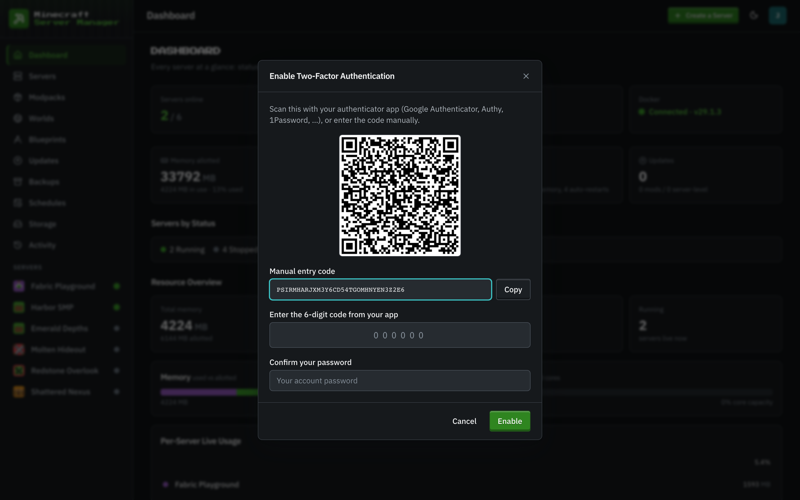

[← Powrót do spisu dokumentacji](/docs/)

Dwuskładnikowe uwierzytelnianie (2FA) dodaje drugi krok do logowania: po podaniu hasła wprowadzasz krótki kod z aplikacji uwierzytelniającej na swoim telefonie. Nawet jeśli ktoś pozna Twoje hasło, nie będzie mógł się zalogować bez Twojego urządzenia.

Działa z każdym standardowym uwierzytelniającym TOTP (Google Authenticator, Authy, 1Password, Microsoft Authenticator i inne) i jest dostępne dla **każdego** konta, nie tylko administratorów. Ochrona własnego logowania nie jest czynnością związaną z zarządzaniem serwerem, więc widzowie i operatorzy również mogą ją włączyć.

## Włączanie 2FA

Otwórz menu konta (Twoje inicjały lub zdjęcie profilowe, w prawym górnym rogu) i wybierz **2FA**.

Pojawi się okno rejestracji:

1. **Zeskanuj kod QR** za pomocą swojej aplikacji uwierzytelniającej lub kliknij **Kopiuj** i wprowadź klucz ręcznie.
2. Wpisz **6-cyfrowy kod**, który teraz wyświetla Twoja aplikacja.
3. **Potwierdź swoje hasło.** Włączenie 2FA ponownie sprawdza Twoje hasło, więc przypadkowa otwarta sesja nie może go włączyć na urządzeniu innej osoby.
4. Kliknij **Włącz**.

### Zapisz swoje kody zapasowe

W momencie włączenia 2FA panel wyświetla zestaw jednorazowych **kodów zapasowych**.

Każdy kod działa **raz**, umożliwiając zalogowanie się, jeśli kiedykolwiek stracisz dostęp do swojej aplikacji uwierzytelniającej. Zapisz je w bezpiecznym miejscu (menedżer haseł jest idealny), ponieważ nie zostaną one ponownie wyświetlone. Możesz wygenerować nowy zestaw w dowolnym momencie (co unieważni stare kody).

## Logowanie z 2FA

Od tego momentu logowanie będzie miało drugi krok. Po podaniu nazwy użytkownika i hasła panel poprosi o kod:

Wprowadź aktualny 6-cyfrowy kod z aplikacji (lub jeden z kodów zapasowych) i jesteś zalogowany. Dopóki nie wykonasz tego kroku, sesja **nie** jest zalogowana: nie może uzyskać dostępu do żadnej strony ani API.

## Zarządzanie lub wyłączanie 2FA

Otwórz tę samą opcję **2FA** w menu konta, gdy jest włączona. Po potwierdzeniu hasła możesz:

- **Wygeneruj ponownie kody zapasowe** – wydaje nowy zestaw i unieważnia stary.
- **Wyłącz 2FA** – usuwa je z Twojego konta.

Obie opcje najpierw ponownie sprawdzają Twoje aktualne hasło.

## Zgubiono telefon _i_ kody zapasowe?

**Administrator** może zresetować 2FA innego użytkownika z poziomu **Ustawienia → Użytkownicy** (**Resetuj 2FA** w menu akcji tego użytkownika). To czyści 2FA dla konta, dzięki czemu użytkownik może zalogować się tylko za pomocą hasła i skonfigurować je od nowa. Administratorzy nie mogą resetować _własnego_ 2FA bez hasła. Przechodzą przez normalny proces wyłączania z potwierdzeniem hasła, więc przejęta sesja administratora nie może usunąć własnego drugiego składnika.

## Warto wiedzieć

- Kody są oparte na czasie i zmieniają się co 30 sekund; panel akceptuje niewielkie przesunięcie zegara i cicho się odzyskuje, jeśli zegar serwera zostanie później poprawiony.
- Kod nie może zostać powtórzony: po użyciu do zalogowania ten sam kod nie zadziała ponownie w swoim oknie czasowym.
- Błędne kody podlegają limitom. Limit jest **współdzielony** z etapem hasła (blokada na konto plus limit `RATE_LIMIT_AUTH_PER_15MIN` na adres IP), więc wprowadzenie poprawnego hasła nie może zresetować licznika tuż przed odgadnięciem 6-cyfrowego kodu.
- Zmiany 2FA (włączenie, wyłączenie, resetowanie, użycie kodu zapasowego) są rejestrowane w [Dzienniku aktywności](/docs/activity/).
