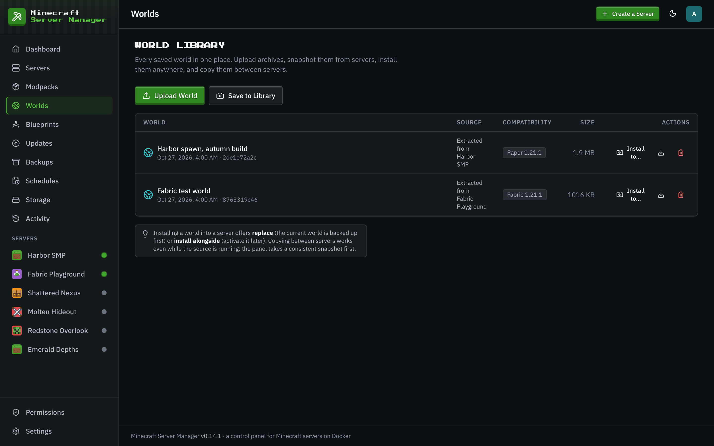

[← Powrót do spisu dokumentacji](/docs/)

## Światy

Strona **Światy** zarządza danymi światów na twoich serwerach: przełączaj aktywny świat, przesyłaj świat lub pobieraj go.

## Menedżer plików

W sekcji **Świat** serwera, zakładka **Pliki** to pełnoprawny menedżer plików w przeglądarce dla katalogu danych tego serwera. Listuj, czytaj, edytuj, twórz, zmieniaj nazwy, przenoś, kopiuj, usuwaj i przesyłaj pliki: wszystko, co normalnie robiłbyś przez SSH, z poziomu przeglądarki.

Pliki tekstowe otwierają się w edytorze z limitem 2 MB; większe pliki można pobrać. Przesyłanie plików akceptuje wiele plików jednocześnie.

### Pozostawanie w piaskownicy

Każda operacja na plikach jest ograniczona do katalogu danych serwera. Panel rozwiązuje każdą ścieżkę i odrzuca wszystko, co próbowałoby ją opuścić: przejścia `..`, ścieżki bezwzględne, a nawet dowiązania symboliczne wskazujące poza katalog (w tym wiszące, które jeszcze nie istnieją). Modyfikacja lub wtyczka nie może umieścić linku, aby oszukać menedżera plików i odczytać lub zapisać dane gdzie indziej na hoście.

## Mody

Dla serwerów z modami, zakładka **Mody** (własna grupa w bocznym menu serwera) zarządza zestawem modów: przeglądaj i dodawaj mody, oraz zobacz, co jest zainstalowane. Aktualizacje modów i paczek pojawiają się na stronie [Aktualizacje](/docs/updates/).

### Dodawanie modów

Cztery sposoby dodawania, wszystkie z paska narzędzi zakładki Mody:

- **Szukaj modów** - przeszukuj **Modrinth lub CurseForge** (przycisk CurseForge pojawia się po zapisaniu klucza API w Ustawienia → Klucze API), a na serwerach z wtyczkami także **Hangar** (własny rejestr wtyczek PaperMC) i **SpigotMC** (przez proxy CDN Spiget) - oba bez klucza. Wszystko jest filtrowane według ładowarki serwera i wersji Minecraft; serwery Quilt automatycznie widzą również wersje oznaczone jako fabric, ponieważ Quilt uruchamia mody Fabric. Wyniki już obecne na serwerze pokazują odznakę **Zainstalowano**. Jeśli autor CurseForge zabrania automatycznego pobierania - lub zasób SpigotMC jest hostowany poza stroną - panel informuje o tym z góry i oferuje ścieżkę **Otwórz stronę** + **Prześlij jar** zamiast błędu w trakcie instalacji.

  

- **Importuj zip** - jeden przycisk, trzy kształty, automatyczne wykrywanie:
  - **Modpack Modrinth (`.mrpack`)**: każdy przypięty plik jest kanonizowany z powrotem do swojego projektu Modrinth poprzez wyszukiwanie skrótu (dzięki czemu zaimportowane mody zachowują prawdziwe nazwy, ikony i pozostają możliwe do aktualizacji; pliki, których Modrinth nie zna, instalują się z własnego adresu URL paczki), weryfikowany podczas pobierania za pomocą sum kontrolnych sha512 paczki i podglądany z wynikami dopasowania. Pliki tylko dla klienta są pomijane w widoczny sposób, a oba drzewa nadpisywania (`overrides/`, następnie `server-overrides/` - kopia specyficzna dla serwera ma pierwszeństwo) mogą zostać zastosowane.

    

  - **Eksport paczki modów CurseForge** (zip tworzony przez aplikację CurseForge, z `manifest.json`): każdy przypięty mod jest rozwiązywany masowo, podglądany z ostrzeżeniami (nieprawidłowa ładowarka/wersja MC dla tego serwera, pliki już niedostępne na CurseForge, mody wymagające ręcznego pobrania) i instalowany z rzeczywistym postępem. Pliki `overrides/` paczki (konfiguracje, skrypty) mogą być opcjonalnie zastosowane - każdy plik, który zostałby nadpisany, jest najpierw tworzony jako kopia zapasowa w `.import-backups/<timestamp>/` wewnątrz katalogu serwera.
  - **Zwykły zip plików jar**, które zebrałeś samodzielnie: każdy plik jar jest identyfikowany (dopasowanie skrótu Modrinth → odcisk palca CurseForge → własne metadane pliku jar) i oceniany w stosunku do serwera - _pasuje / nieprawidłowa ładowarka / nieprawidłowa wersja MC / już zainstalowano / niezidentyfikowano_ - dzięki czemu wybierasz, co faktycznie należy zainstalować, zanim cokolwiek się zainstaluje.
- **Dodaj przez link** - wklej prawie wszystko: strony projektów Modrinth, CurseForge, Hangar lub SpigotMC, repozytorium GitHub lub adres URL wydania (wystarczy `owner/repo` - instalacje GitHub preferują najnowsze stabilne wydanie i pomijają pliki boczne `-sources`/`-javadoc`), sam identyfikator Modrinth, lub dowolny bezpośredni adres URL `.jar`. Panel rozwiązuje właściwą wersję dla ładowarki serwera i wersji MC.

  

- **Prześlij jar** (z zastępczego wyszukiwania lub resolvera pobieranych plików) - przesłane pliki jar są identyfikowane w ten sam sposób, dzięki czemu zachowują swoją prawdziwą nazwę, wersję, ikonę i stają się możliwe do aktualizacji.

Każda instalacja z rejestru jest **weryfikowana sumą kontrolną podczas pobierania**: strumień jest sprawdzany pod kątem najsilniejszego skrótu publikowanego przez rejestr (sha512 → sha256 → sha1 → md5), a niezgodność przerywa proces, zanim cokolwiek trafi na serwer.

Cały zip (`.mrpack` włącznie) może również **utworzyć serwer**: w zakładce kreatora _Z paczki modów_, prześlij go, a manifest paczki (lub większość głosów spośród zidentyfikowanych plików jar) wypełni ładowarkę, wersję Minecraft i wersję ładowarki.
