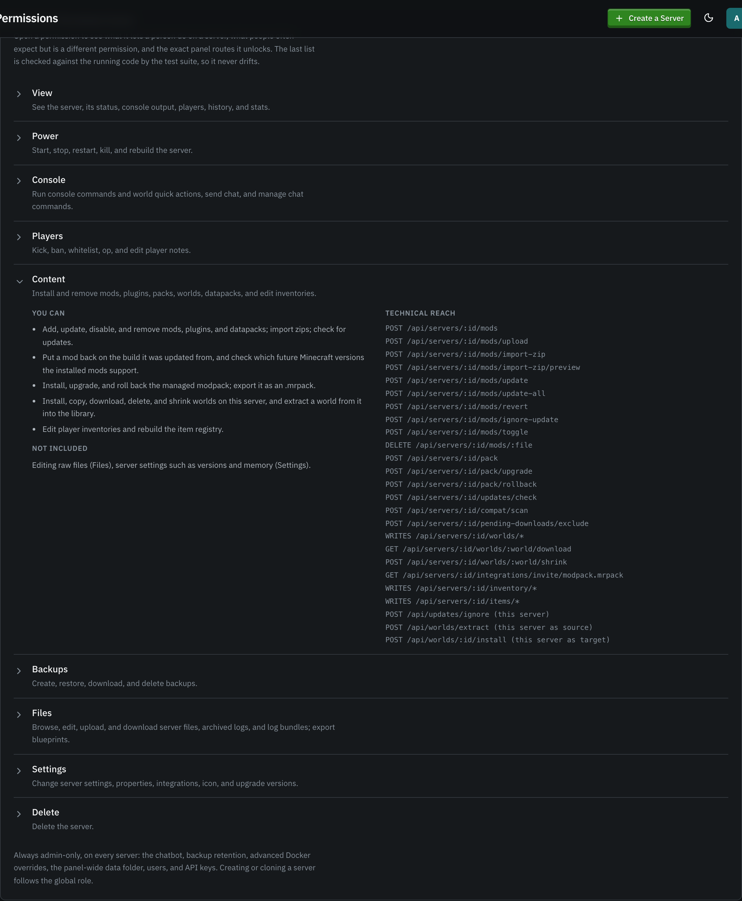

[← Voltar ao índice da documentação](/docs/)

O painel é multiusuário. Gerencie contas em **Configurações → Usuários**.

## As três funções

| Função       | Padrão em cada servidor                                                                                                                           |
| ------------ | ------------------------------------------------------------------------------------------------------------------------------------------------- |
| **admin**    | Tudo: gerenciar usuários, chaves de API, arquivos globais, substituições avançadas do Docker e todas as ações do servidor.                        |
| **operator** | Executar e configurar servidores (iniciar/parar, console, backups, mundos, mods, a maioria das configurações), mas não áreas exclusivas de admin. |
| **viewer**   | Somente leitura. Ver servidores e seus status, mas sem fazer alterações.                                                                          |

Todo usuário, incluindo um viewer, pode gerenciar sua própria [autenticação de dois fatores](/docs/two-factor-authentication/), pois proteger seu próprio login não é uma ação de gerenciamento de servidor.

Uma função é o **padrão** para cada servidor. Para dar a alguém direitos diferentes em um servidor, use as permissões por servidor abaixo.

## Permissões por servidor

A página **Permissões** (na barra lateral, ou **Permissões do Servidor** em **Configurações → Usuários**) mostra uma grade: cada operador e viewer de um lado, cada servidor no topo. Clique em uma célula para decidir o que esse usuário pode fazer naquele servidor específico. Admins não são listados porque sempre têm tudo.

Cada célula é um conjunto de permissões:

| Permissão    | O que permite naquele servidor                                                                                            |
| ------------ | ------------------------------------------------------------------------------------------------------------------------- |
| **View**     | Ver o servidor, seu status, saída do console, jogadores, histórico e estatísticas.                                        |
| **Power**    | Iniciar, parar, reiniciar, matar e reconstruir o servidor.                                                                |
| **Console**  | Executar comandos do console e ações rápidas do mundo, enviar chat e gerenciar comandos de chat.                          |
| **Players**  | Expulsar, banir, adicionar à whitelist, dar op e editar notas de jogadores.                                               |
| **Content**  | Instalar e remover mods, plugins, pacotes, mundos, datapacks e editar inventários.                                        |
| **Backups**  | Criar, restaurar, baixar e excluir backups.                                                                               |
| **Files**    | Navegar, editar, fazer upload e download de arquivos do servidor, logs arquivados e pacotes de logs; exportar blueprints. |
| **Settings** | Alterar configurações do servidor, propriedades, integrações, ícone e versões de atualização.                             |
| **Delete**   | Excluir o servidor.                                                                                                       |

Abaixo da grade, **O que Cada Permissão Abrange** detalha o que uma pessoa pode fazer com cada permissão, o que não está incluído e as rotas exatas do painel que ela desbloqueia. Essa última lista é verificada contra o código em execução pela suíte de testes.

Em um celular, a grade se empilha em um cartão por usuário, com uma linha por servidor.

  

Como as peças se encaixam:

- **A função é o padrão.** Um operador começa com todas as permissões em todos os servidores; um viewer começa apenas com View. Uma célula em texto tênue (com a dica "Padrão da função") nunca foi alterada.
- **Uma célula substitui a função apenas para aquele servidor.** Dê a um viewer Power e Console em um servidor e ele poderá executá-lo, enquanto todos os outros servidores permanecem somente leitura para ele. Retire Delete de um operador em seu servidor principal e ele manterá todo o resto lá.
- **Toda permissão inclui View.** Você não pode agir em um servidor que não pode ver.
- **Desligue tudo para ocultar um servidor.** Ele desaparece da barra lateral, painel, backups, agendamentos, atividades, atualizações, modpacks, status ao vivo, tarefas em execução e blueprints desse usuário, e a biblioteca de mundos para de nomeá-lo. Um link direto, chamada de API ou soquete de console responde "não encontrado", o mesmo que um servidor que não existe.
- **Ações em todo o painel ainda seguem a função.** Criar servidores (incluindo clonar um), armazenamento, usuários, chaves de API, configurações globais e agendamentos em todo o painel não são por servidor, então um viewer com permissões em alguns servidores ainda não pode fazer nada disso. Operadores mantêm a criação de servidores e agendamentos em todo o painel; armazenamento, usuários, chaves de API e configurações globais são apenas para admins.
- **Agendamentos seguem o servidor.** Um reinício, backup ou comando agendado em um servidor requer a permissão correspondente lá (Power, Backups ou Console), qualquer que seja a função.
- **Blueprints também seguem o servidor.** Exportar um servidor como blueprint requer Files lá, pois o arquivo carrega seus arquivos. Um blueprint exportado de um servidor que alguém não pode ver também fica oculto para essa pessoa.
- **Áreas exclusivas de admin permanecem exclusivas de admin** em todos os servidores: o chatbot, retenção de backup e substituições avançadas do Docker.

Cada alteração é registrada no log de atividades com quem alterou o quê; essas entradas são mostradas apenas para admins. Excluir um usuário remove suas linhas. Remover um servidor os mantém, então um servidor oculto de alguém permanece oculto em seu histórico e backups mantidos.

Instalações existentes continuam funcionando sem alterações: até que um admin edite uma célula, cada usuário tem exatamente o que sua função lhes deu antes.

## Exclusivo para admins e por quê

Algumas coisas são restritas a admins propositalmente:

- **Gerenciamento de usuários, armazenamento, configurações globais, chaves de API e arquivos globais.**
- **A [API pública](/docs/public-api/):** habilitar `/api/v1` e criar, escopar ou revogar seus tokens Bearer somente leitura.
- **Substituições avançadas do Docker:** nome de contêiner personalizado, publicações de porta extras e bind mounts. Um bind mount pode mapear qualquer caminho do host para um contêiner e, combinado com o acesso Docker do painel, isso é efetivamente root no host. Esses campos só aparecem para admins.

Nomes de contêineres personalizados também não podem residir no namespace `msm-` do próprio painel, então um contêiner nomeado manualmente nunca pode ofuscar outro servidor e direcionar incorretamente um comando de parada ou comando para a instância errada.

## Gerenciando contas

Admins podem criar usuários, alterar funções, redefinir senhas e excluir contas na tabela de Usuários. A coluna **2FA** mostra se cada usuário tem a autenticação de dois fatores ativada; um admin pode redefinir a 2FA de outro usuário com **Redefinir 2FA** no menu de ações desse usuário (para o caso de perda do telefone e códigos de backup), mas nunca desativar a sua própria sem a senha, o que o fluxo de autoatendimento cuida em vez disso.

Falhas de login são limitadas por taxa por conta (tanto um contador por IP quanto um contador global da conta) para desacelerar tentativas de força bruta, e o mesmo limite cobre a etapa do código 2FA, para que uma senha correta não possa redefinir o contador antes de adivinhar o código. Na frente disso, há um limitador de solicitação mais grosseiro por IP do cliente nos endpoints de login / 2FA / configuração, ajustável via `RATE_LIMIT_AUTH_PER_15MIN` (padrão 100; atrás de um proxy reverso, defina `TRUST_PROXY` para que ele use o IP real do cliente).
