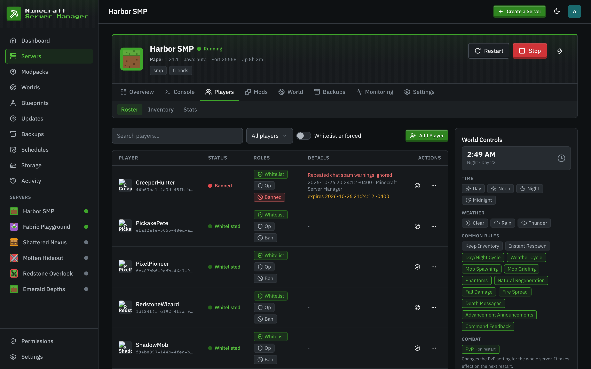

[← Înapoi la indexul documentației](/docs/)

## Crearea unui server

Apăsați **Create a Server** (bara de sus) sau cardul **Create a server** pentru a deschide expertul.

Expertul pre-completează câmpurile pentru memorie, CPU și cotă de disc din **Defaults for new servers** (Implicituri pentru servere noi) din pagina Settings (Setări), pe care un administrator le poate modifica oricând.

Alegeți:

- Un **nume** (și o pictogramă opțională, o culoare de accent și etichete pentru a vă organiza flota).
- Un **tip de server** - vanilla, Paper, Fabric, Forge, NeoForge și altele, fiecare mapat la imaginea itzg corectă în culise.
- O **versiune Minecraft** - `LATEST`, un snapshot sau o versiune specifică.
- **Resurse** - RAM (heap), limită de memorie a containerului, CPU și o cotă de disc.

Preferi un modpack? Tab-ul **From modpack** (Din modpack) instalează în schimb un pachet CurseForge, Modrinth, FTB sau GT New Horizons (vezi [Modpacks](/docs/modpacks/)), sau preia un **zip personalizat pe care îl încărcați**: o exportare de modpack CurseForge (`manifest.json`) sau orice zip de fișiere mod. Manifestul (sau un vot majoritar pe fișierele identificate) completează loader-ul și versiunea Minecraft, iar fiecare mod se instalează într-o singură sarcină. Puteți, de asemenea, să începeți dintr-un [Blueprint](/docs/blueprints/) salvat.

Panoul alege automat un runtime Java sensibil pentru versiunea dvs., preia imaginea, creează containerul și (opțional) îl pornește, totul dintr-un singur formular.

## Lista serverelor

Pagina **Servers** (Servere) listează întreaga dvs. flotă cu starea și statistici rapide.

## Un singur server

Deschiderea unui server vă oferă un spațiu de lucru cu file:

- **Overview** (Prezentare generală) - stare, statistici live, uptime și controalele primare de pornire / oprire / repornire.
- **Console** (Consolă) - fluxul live de log-uri și intrarea comenzilor, plus chat-ul din joc ([detalii](/docs/console-and-chat/)).
- **Players** (Jucători) - cine este online, plus inventar, statistici și [comenzi de chat](/docs/console-and-chat/).
- **Mods** (Moduri) - lista modurilor instalate, [browserul de moduri](/docs/modpacks/) și actualizări de conținut.
- **World** (Lume) - [lumi, harta live și managerul de fișiere](/docs/worlds-and-files/).
- **Backups** (Backup-uri) - [snapshot-uri și restaurare](/docs/backups/) pentru acest server.
- **Monitoring** (Monitorizare) - istoric per server și metrici live, inclusiv rapoarte de crash (vezi mai jos).
- **Settings** (Setări) - totul despre cum rulează serverul, plus [integrările](/docs/integrations/) (Discord, pagină de stare, invitații, chatbot).

Bara **World Controls** (Controale lume) se deplasează pe fiecare filă: ceasul din joc, vremea, regulile comune ale jocului ca cipuri comutabile și "Show all world rules" (Arată toate regulile lumii) pentru restul.

**Monitoring → Live** (Monitorizare → Live) afișează TPS și milisecunde per tick, un card de sănătate și stabilitate cu ultimele 24 de ore / 7 zile de crash-uri și reporniri, și dimensiuni per lume.

## Setări server

Fila **Settings** (Setări) este suprafața completă de configurare: redenumire, resurse, politică de actualizare, pornire automată / repornire automată, variabile de mediu și suprascrieri Docker avansate. Câmpurile care modifică modul în care rulează containerul sunt marcate clar ca necesitând o repornire.

**Despre contorul de memorie.** "RAM (Java heap)" este transmisă către Java atât ca dimensiune inițială, cât și ca dimensiune maximă a heap-ului, iar Java umple un heap primit în avans în primul minut, cu sau fără presetările de flag Aikar / MeowIce. Deci, contorul de memorie se stabilizează la aproximativ dimensiunea heap-ului și rămâne acolo chiar și atunci când nimeni nu joacă; marcajul de pe contor indică unde se află heap-ul sub limita containerului, iar nota de sub el spune acest lucru. Dacă ați prefera să vedeți memoria urmărind utilizarea reală, setați un **Initial heap** (Heap inițial) mai mic (avansat): pe un heap de 2 GB, acest lucru a redus utilizarea inactivă de la 2,6 GB la aproximativ 1,3 GB în măsurătorile noastre. Java necesită, de asemenea, memorie în afara heap-ului (aproximativ 0,5 GB pe vanilla, 1,5 până la 2 GB pe un modpack mare), ceea ce este scopul spațiului liber al limitei containerului. Consultați "Two memory limits" (Două limite de memorie) din README pentru cifre.

> Câmpurile avansate de suprascriere Docker (nume personalizat al containerului, port suplimentar și mount-uri de legătură, și suprascrieri brute) sunt **doar pentru administratori**, deoarece un mount de legătură plus accesul Docker al panoului este echivalent cu root pe gazdă. Vezi [Users & roles](/docs/users-and-roles/).

## Rapoarte de crash & analiză mclo.gs

Rapoartele de crash (`crash-reports/*.txt` și fișierele JVM `hs_err_pid*.log`) sunt preluate automat, analizate într-un rezumat pe o singură linie cu excepția și modurile suspectate, și listate sub **Monitoring → History** (Monitorizare → Istoric):

Fiecare card de raport oferă un vizualizator încorporat (cu secțiuni pliabile și excepții evidențiate), copierea stack trace-ului și descărcare, plus două acțiuni [mclo.gs](https://mclo.gs):

- **Share to mclo.gs** (Partajează pe mclo.gs) publică raportul ca un paste public și copiază link-ul - exact ceea ce cer autorii de moduri și serverele Discord de suport. Link-ul este reținut pe raport, astfel încât nimic nu este vreodată încărcat de două ori.
- **Analyze** (Analizează) rulează perspectivele automate ale mclo.gs peste paste: probleme cunoscute cu soluții sugerate (dependențe lipsă, nepotriviri de versiuni, conflicte comune de moduri), afișate direct în panou.

Ambele acțiuni sunt protejate de o confirmare explicită, deoarece un paste este public: rapoartele de crash pot include nume de jucători și lista dvs. completă de moduri. Panoul nu încarcă niciodată nimic de la sine.
