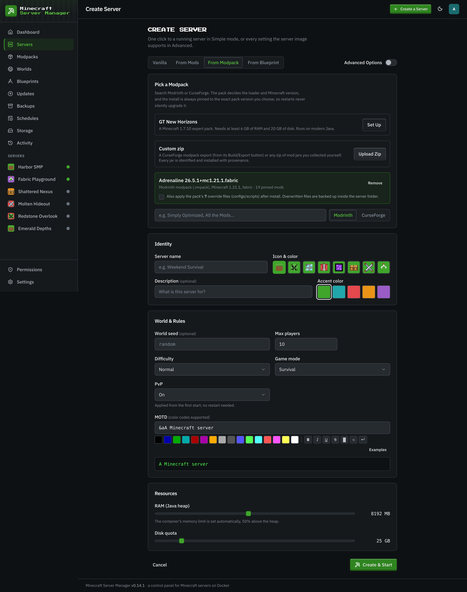

[← Înapoi la indexul documentației](/docs/)

## Lumi

Pagina **Lumi** este biblioteca de lumi: fiecare lume salvată într-un singur loc. **Încărcați Lume** preia o arhivă `.zip` sau `.tar` și găsește automat lumea din interior, **Salvați în Bibliotecă** creează instantanee ale lumii live a unui server (funcționează în timp ce serverul rulează), iar fiecare lume din bibliotecă poate fi descărcată sau instalată pe orice server cu **Instalați pe…**. Instalarea fie înlocuiește lumea serverului (serverul trebuie oprit, iar lumea curentă este salvată mai întâi) fie o adaugă alături, pentru activare ulterioară. Un control de compatibilitate rulează înainte de fiecare instalare.

Propria filă **Lume → Lumi** a unui server listează lumile de pe acel server. De acolo puteți activa o altă lume (cu serverul oprit), descărca, duplica, redenumi sau [micșora](/docs/world-shrink/) o lume, copia pe alt server, șterge una inactivă și reseta lumea activă cu un seed nou, păstrat sau personalizat (se oferă mai întâi o salvare de siguranță). Aceeași bibliotecă se află mai jos, cu **Instalați aici**.

## Managerul de fișiere

Sub secțiunea **Lume** a unui server, fila **Fișiere** este un manager de fișiere complet în browser pentru directorul de date al acelui server. Listați, citiți, editați, redenumiți, mutați, copiați, ștergeți și încărcați fișiere, creați foldere și căutați textul fișierelor dintr-un folder cu **Găsiți în Fișiere**: tot ce ați face în mod normal prin SSH, din browser.

Fișierele text se deschid într-un editor cu o limită de 8 MB; fișierele mai mari pot fi descărcate. Încărcările acceptă până la 20 de fișiere simultan.

### Rămânerea în interiorul sandbox-ului

Fiecare operațiune pe fișiere este limitată la propriul director de date al serverului. Panoul rezolvă fiecare cale și refuză orice ar ieși din limită: traversarea `..`, căi absolute și chiar linkuri simbolice care indică în afara directorului (inclusiv cele invalide care nu există încă). Un mod sau plugin nu poate planta un link pentru a păcăli managerul de fișiere să citească sau să scrie în altă parte pe gazdă.

## Moduri

Pentru serverele modificate și cu pluginuri, fila **Moduri** (grupul său propriu în bara laterală a serverului) gestionează setul de moduri: răsfoiți și adăugați moduri și vedeți ce este instalat. Din rândul fiecărui mod instalat puteți să-l actualizați (sau să ignorați acea actualizare), să-l [anulați](/docs/updates/#undoing-a-mod-update), să-l dezactivați sau să-l eliminați, iar **Actualizați Tot** aplică toate actualizările disponibile cu o singură repornire. Actualizările de moduri și pachete apar și pe pagina [Actualizări](/docs/updates/).

### Adăugarea de moduri

Patru moduri de intrare, toate din bara de instrumente a filei Moduri:

- **Căutați Moduri**: căutați în **Modrinth sau CurseForge** (butonul CurseForge apare odată ce o cheie API este stocată sub **Setări → Chei API**), iar pe serverele cu pluginuri și **Hangar** (registrul propriu de pluginuri al PaperMC) și **SpigotMC** (prin proxy-ul CDN al Spiget), ambele fără cheie. O filă **Pachete de date** caută pachetele de date ale Modrinth. Totul este filtrat după loader-ul serverului și versiunea Minecraft (o casetă de selectare arată și build-uri care nu sunt listate ca fiind compatibile, pe propriul risc); serverele Quilt văd automat și build-urile etichetate fabric, deoarece Quilt rulează moduri Fabric. Rezultatele deja pe server afișează o insignă **Instalat**. Dacă un autor CurseForge interzice descărcările automate (sau o resursă SpigotMC este găzduită extern), panoul o indică clar și oferă o cale **Deschideți CurseForge** (sau **Deschideți SpigotMC**) + **Încărcați Jar** în loc să eșueze în mijlocul instalării.

  

- **Importați Zip**: un buton, trei forme, detectate automat:
  - Un **modpack Modrinth (`.mrpack`)**: fiecare fișier fixat este canonizat înapoi în proiectul său Modrinth prin căutare de hash (astfel încât modurile importate să păstreze nume reale, pictograme și să rămână verificabile pentru actualizări; fișierele pe care Modrinth nu le cunoaște se instalează de la propriul URL al pachetului), verificat împotriva sumelor de control sha512 ale pachetului în timpul descărcării și previzualizat cu verdicturi de potrivire. Fișierele doar pentru client sunt omise vizibil, iar ambele arbori de suprascriere (`overrides/`, apoi `server-overrides/`; copia specifică serverului are prioritate) pot fi aplicate.

    

  - O **exportare modpack CurseForge** (zip-ul pe care aplicația CurseForge îl produce, cu `manifest.json`): fiecare mod fixat este rezolvat în bloc, previzualizat cu avertismente (loader/MC greșit pentru acest server, fișiere care nu mai sunt pe CurseForge, moduri care necesită descărcare manuală) și instalat cu progres real. `overrides/` pachetului (configurații, scripturi) poate fi aplicat opțional; orice fișier care ar fi suprascris este salvat mai întâi în `.import-backups/<timestamp>/` în interiorul folderului serverului.
  - Un **zip simplu de jar-uri** pe care le-ați colectat singur: fiecare jar este identificat (potrivire hash Modrinth → amprentă CurseForge → metadatele proprii ale jar-ului) și judecat în raport cu serverul (_se potrivește / loader greșit / versiune MC greșită / deja instalat / neidentificat_), astfel încât să alegeți ce aparține de fapt înainte ca ceva să se instaleze.
- **Adăugați după URL**: lipiți aproape orice: pagini de proiect Modrinth, CurseForge, Hangar sau SpigotMC, un URL de depozit sau lansare GitHub (funcționează și un simplu `owner/repo`; instalările GitHub preferă cea mai recentă versiune stabilă și omit fișierele secundare `-sources`/`-javadoc`), un simplu slug Modrinth sau orice URL direct `.jar`. Panoul rezolvă build-ul corect pentru loader-ul serverului și versiunea MC.

  

- **Încărcați Jar** (din fallback-ul de căutare sau rezolvitorul de descărcări în așteptare): jar-urile încărcate sunt identificate în același mod, astfel încât să păstreze numele real, versiunea, pictograma și să devină verificabile pentru actualizări.

Fiecare instalare din registru este **verificată prin sumă de control în timpul descărcării**: fluxul este verificat împotriva celui mai puternic digest publicat de registru (sha512 → sha256 → sha1 → md5), iar o nepotrivire anulează procesul înainte ca ceva să ajungă pe server.

Un zip întreg (`.mrpack` inclus) poate, de asemenea, **crea un server**: în fila **Din Modpack** a vrăjitorului, încărcați-l, iar manifestul pachetului (sau un vot majoritar printre jar-urile identificate) completează loader-ul, versiunea Minecraft și build-ul loader-ului.
